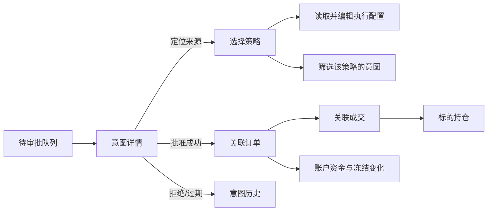
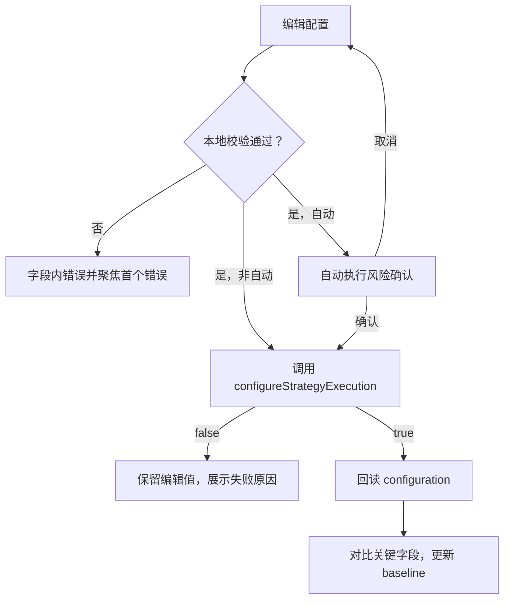

# 新版 QML 策略执行/审批工作区设计

> 文档状态：初版，可交付开发会话实施  
> 设计基线：2026-08-01 当前仓库  
> 范围：策略列表、执行配置、策略意图审批、订单/成交/持仓与账户反馈  
> 非目标：本设计不修改旧版 `qml/Main.qml`，不启用真实券商，不改变策略和风控算法

## 1. 设计目标与原则

新版工作区要让用户在同一上下文内回答四个问题：

1. 哪个策略正在产生信号，它是否启用？
2. 该策略是否允许执行，以何种模式和预算执行？
3. 当前有哪些待审批意图，批准后将提交什么订单？
4. 意图提交后，订单、成交、仓位和账户发生了什么变化？

设计遵循以下原则：

- **研究开关与交易开关分离**：`strategyModel.enabled` 只代表策略运行/信号生成；执行模式由 `StrategyExecutionConfig` 单独控制。界面不得用一个开关同时表达两者。
- **默认安全**：执行模式默认 `Disabled`；`Automatic` 必须经过强化确认；任何信息不完整、过期、未登录或状态不确定的意图都不得显示为可批准。
- **状态来自业务层**：QML 只通过 `TradingController` 和列表模型访问业务，不自行推断订单已经提交、已成交或配置已持久化。
- **意图、订单、成交可追溯**：以 `intentId → orderId → execution.orderId` 串起完整链路。
- **模拟交易身份始终可见**：当前所有下单走模拟券商。界面必须显示“模拟账户/模拟执行”，不得使用容易被理解为真实交易的无标识文案。
- **高风险动作可审阅、可撤回前确认**：审批和开启自动执行前展示完整摘要；拒绝是终态操作，应确认原因；配置表单在保存前可放弃更改。

## 2. 当前能力核对

### 2.1 已可直接接入

| 能力 | 当前入口 | 设计用途 |
| --- | --- | --- |
| 策略列表 | `tradingController.strategyModel` | 左侧策略导航与运行状态 |
| 策略执行配置读取 | `strategyExecutionConfiguration(strategyId)` | 配置表单初始化、保存后回读 |
| 策略执行配置保存 | `configureStrategyExecution(...) -> bool` | 保存模式、TIF、金额、仓位比例、超时和每日预算 |
| 意图列表 | `tradingController.strategyIntentModel` | 待审批和历史意图 |
| 待审批总数 | `pendingStrategyIntentCount` | 导航徽标、页头摘要 |
| 批准意图 | `approveStrategyIntent(intentId) -> bool` | ManualApproval 批准动作 |
| 拒绝意图 | `rejectStrategyIntent(intentId, reason) -> bool` | ManualApproval 拒绝动作 |
| 订单反馈 | `orderModel` | 意图提交后的委托状态 |
| 成交反馈 | `executionModel` | 订单的逐笔成交 |
| 持仓反馈 | `positionModel` | 标的持仓与盈亏 |
| 账户反馈 | `account*` 属性、`accountStateChanged` | 资金、权益、盈亏和手续费摘要 |
| 券商状态 | `brokerName`、`brokerLoggedIn`、`tradingError` | 模拟身份、连接和错误提示 |

配置枚举必须按现有整数契约调用：

- 执行模式：`0 = Disabled`、`1 = ManualApproval`、`2 = Automatic`。
- 有效期：`0 = Day`、`1 = GTC`、`2 = IOC`、`3 = FOK`。

### 2.2 实施前必须明确的现状和缺口

| 优先级 | 现状/缺口 | 设计处理 |
| --- | --- | --- |
| P0 | 审批超时没有主动扫描。意图到达 `expiresAt` 后仍可能保持 `PendingApproval`，直到用户尝试批准或应用重启。`pendingStrategyIntentCount` 同样可能暂时包含已超时项。 | 后端增加定时过期更新后再把倒计时视为权威状态；在此之前，QML 到时立即禁用批准并显示“已超时，等待状态同步”，不得为触发过期而调用批准接口。 |
| P0 | `approveStrategyIntent`/`rejectStrategyIntent` 只有 `bool`，失败原因依赖全局 `statusText` 或意图后续更新，无法区分过期、状态冲突、风险重检失败、提交端口失败。 | 首版可在返回 `false` 后等待模型刷新并展示该意图 `message`；开发宜补充结构化操作结果或专用错误信号。 |
| P0 | 当前没有审批权限/操作者身份模型。 | 当前按单机模拟工作台设计，显示“本地模拟操作”；不得声称已经有 RBAC。接入真实交易前必须增加权限、身份和审计字段。 |
| P1 | `configureStrategyExecution` 不返回持久化结果，当前也没有策略配置存储可用状态。 | 保存成功仅写“配置已应用”；不能写“已安全保存到本地”。建议补充持久化状态/错误属性。 |
| P1 | 领域配置还有 `orderType`、`sellAll`、`limitOffsetBps`、`lotSize`，但当前 Controller 的配置读写契约未覆盖这些字段；读取结果也不含 `orderType`。 | 首版不提供这些字段的可编辑控件。订单类型只在生成后的意图中展示；若产品要求配置，先扩展 Controller 契约和测试。 |
| P1 | `cooldownSeconds` 可从配置查询，但执行配置保存接口不接收它；实际通过 `setStrategyParameters` 更新，并同步到执行配置。 | 把冷却期放在“策略参数”区，不混入执行配置保存按钮；分别调用对应 API。 |
| P1 | `strategyIntentModel` 是全量、最新意图置顶模型，没有待审批/策略筛选代理。 | 数据量较小时可展示全量历史；正式工作区建议由 C++ `QSortFilterProxyModel` 暴露待审批和筛选视图，避免在 QML 委托中做高度为零的伪筛选。 |
| P1 | 意图状态只暴露中文 `status` 和布尔 `pending`，没有稳定的状态码。 | 待审批动作只依赖 `pending`；其他状态暂用中文展示。建议增加 `statusCode`，避免 QML 用中文文案做逻辑判断。 |
| P2 | `docs/project-wiki.md` 的角色清单未写 `referencePrice`，但当前模型代码已经暴露该角色。 | 以模型代码为准，设计和实现使用 `referencePrice`；后续同步 Wiki。 |
| P2 | 配置读取返回空 Map 时，无法区分“策略不存在”“仍在加载”“读取失败”。 | 当前同步初始化下按“无可用执行配置”处理；建议增加明确的查询结果或加载状态。 |

## 3. 信息架构

### 3.1 页面层级

```text
主框架
└─ 策略执行（导航徽标：pendingStrategyIntentCount）
   ├─ 工作区页头
   │  ├─ 模拟券商/登录状态
   │  ├─ 账户可用资金、总权益、冻结资金
   │  └─ 全局错误/安全提示
   ├─ 策略列表（左栏）
   │  ├─ 搜索与状态筛选
   │  ├─ 策略运行状态
   │  └─ 执行模式与待审批数量摘要
   ├─ 策略详情与执行配置（中栏）
   │  ├─ 策略参数
   │  ├─ 执行模式
   │  ├─ 订单有效期与超时
   │  └─ 仓位和每日预算
   ├─ 待审批意图（右栏）
   │  ├─ 待审批队列
   │  └─ 意图详情/批准/拒绝
   └─ 交易反馈（底部可调整高度）
      ├─ 订单
      ├─ 成交
      ├─ 持仓
      └─ 全部意图
```

### 3.2 桌面布局

目标基准为 1440×900 及以上桌面窗口；最小宽度建议 1180。采用“三栏 + 底部反馈抽屉”：

- 左栏 260–300 px：策略选择，是整个页面的主上下文。
- 中栏最小 460 px：所选策略详情和表单，纵向滚动。
- 右栏 380–440 px：审批队列和当前意图详情。
- 底部 240–320 px：订单、成交、持仓和意图历史，可折叠但默认展开。

窄于 1180 px 时不压缩关键字段：右栏改为由页头“待审批 N”按钮打开的抽屉；中栏保留，底部反馈使用全宽标签页。首版不面向移动端。

### 3.3 页面关系和联动



联动规则：

- 点击策略：更新中栏配置，并将右栏/底部默认筛选为该策略；用户可切换“仅当前策略/全部策略”。
- 点击待审批意图：打开详情，同时选中来源策略；不丢弃该策略尚未保存的表单修改，若需切换则先提示保存/放弃。
- 批准成功：自动切换底部到“订单”，高亮匹配 `orderId` 的行；若尚未进入订单模型，显示“已提交，等待订单回报”。
- 点击订单：通过 `orderId` 筛选成交；若订单来源于策略意图，可反向定位意图。
- 点击持仓：只改变反馈筛选，不改变策略配置表单。

## 4. 关键交互流程

### 4.1 策略选择与配置加载

1. 默认选中策略列表第一项；无策略时显示空状态。
2. 调用 `strategyExecutionConfiguration(strategyId)`。
3. 返回非空 Map：以返回值填充表单并保存为 `baseline`；此时 `dirty = false`。
4. 返回空 Map：显示“此策略暂无可用执行配置”，所有保存控件禁用，不自行构造一个看似已保存的默认配置。
5. 收到 `strategyExecutionConfigChanged(strategyId)`：若当前表单不脏，自动回读；若表单已脏，显示“配置已在其他位置更新”，让用户选择重新载入或保留当前编辑。

需要始终并排显示两种状态：

- **策略运行**：来自 `strategyModel.enabled`，文案“运行中/已停用”。
- **订单执行**：来自 `executionMode`，文案“禁用/人工审批/自动执行”。

组合提示示例：

- 策略停用 + 自动执行：显示警告“当前不会产生新信号；重新启用策略后会自动下单”。
- 策略运行 + 执行禁用：显示中性提示“信号仍会产生，但不会提交订单”。

### 4.2 配置编辑与保存

表单分成四组，避免一个长表单失去风险层级：

1. **执行模式**：禁用、人工审批、自动执行。
2. **订单时效**：TIF、审批超时、订单超时。
3. **仓位**：单次固定金额、最大仓位占比。
4. **每日预算**：最多订单数、最大累计订单金额。

数值规则与当前 Controller 一致：所有数值必须是有限值且不小于 0。补充界面语义：

- `0` 必须明确标注具体含义，不统一解释：`fixedOrderValue = 0` 会使买入仓位计算为 0 并拒绝该意图；`maxPositionPercent = 0` 表示不启用这一项仓位上限；`approvalTimeoutSeconds = 0` 为“不设审批超时”；`orderTimeoutSeconds = 0` 为“不设额外订单超时”；`maxOrdersPerDay = 0` 和 `maxDailyOrderValue = 0` 为“不启用对应的每日限制”。
- 金额使用账户币种格式和千分位；输入值传 Controller 时仍为原始数值。
- `maxPositionPercent` 显示 `%`，其现有含义是百分数，例如 `10.0` 表示 10%，不是 `0.1`。
- 保存按钮只有在表单有效且 `dirty` 时可用；提供“放弃更改”。

保存流程：



保存成功后必须回读配置，而不是仅依据 `true` 乐观更新。成功提示为“配置已应用”；在没有持久化确认接口前不能承诺“已持久化”。

### 4.3 ManualApproval 审批

待审批卡片最小展示：标的、买卖方向、数量、订单类型、参考价/限价、预计金额、来源策略、剩余审批时间。点击后详情展示：

- 信号：`signalSide`、`signalPrice`、`signalReason`、创建时间。
- 拟定订单：`orderSide`、`orderType`、`timeInForce`、`quantity`、`referencePrice`、`limitPrice`、`orderExpiresAt`。
- 风险上下文：账户可用资金/总权益、该标的当前持仓、策略固定金额、最大仓位比例、每日预算。
- 审计：`intentId`、状态、更新时间和 `message`。

批准规则：

1. 只有 `pending === true`、未达到界面计算的 `expiresAt`、券商已登录、无正在执行动作时显示可用“批准并提交”。
2. 点击后打开确认对话框，标题明确为“批准后将立即提交模拟订单”。
3. 确认摘要再次展示方向、标的、数量、订单类型、价格规则和预计金额。
4. 调用 `approveStrategyIntent(intentId)`。调用期间按钮进入忙碌状态并防重复点击。
5. 返回 `true` 代表意图最终已提交，不只代表“审批记录成功”；等待模型将状态更新为“已提交”，并根据 `orderId` 定位订单。
6. 返回 `false` 时不自行改状态；重新读取当前模型行。若已变为“已过期/已拒绝/提交失败”，显示对应 `message`；若仍待审批，显示通用错误并允许重试。

重要说明：协调器会在批准时重新执行策略规则、仓位计算和预算检查。因此审批卡片中的数量和限价是审批前快照，最终订单参数可能因账户/持仓状态改变而重新计算。界面需写明“提交时将再次校验风控和仓位”，订单模型才是提交后的权威记录。

### 4.4 拒绝

1. 点击“拒绝”打开原因对话框。
2. 提供常用原因快捷项：“信号不符合预期”“仓位过高”“市场状态不适合”“重复意图”，并允许自由输入。
3. 原因可空；空值由后端记录“人工审批拒绝”。界面建议要求用户至少选择或输入一项，以提高审计质量，但不改变后端契约。
4. 二次确认文案：“拒绝后此意图不能再次批准”。
5. 调用 `rejectStrategyIntent(intentId, reason)`；返回 `true` 后移入历史并保留详情，返回 `false` 时刷新该行，避免覆盖已被其他动作处理的状态。

当前没有“撤销拒绝”能力，界面不得提供撤销入口。

### 4.5 过期

倒计时以 `expiresAt` 为准；无有效值时显示“不过期”。时间显示同时包含相对时间和本地绝对时间，例如“02:14 后过期 · 14:32:10”。

状态规则：

- 距离过期 ≤ 60 秒：琥珀色警示，同时保留文字/图标，不只靠颜色。
- 当前时间 ≥ `expiresAt`：立即禁用批准，卡片标记“已超时，等待状态同步”。
- 后端模型更新为“已过期”后：移入历史，展示 `message`。
- 应用重启恢复时，未完成的 `Created`、`PendingApproval`、`Approved` 会统一转为“已过期”，原因是“应用启动恢复时终止未完成执行意图”。

P0 实施要求：在后端增加主动过期机制并使 `strategyIntentModel` 与 `pendingStrategyIntentCount` 同步更新。在此之前不得用 `approveStrategyIntent` 作为“探测是否过期”的手段，因为批准接口在临界时间内可能真实提交订单。

### 4.6 Automatic 模式风险提示

从 Disabled 或 ManualApproval 切换到 Automatic 时使用阻断式确认对话框，不能只用 Toast：

- 固定标题：“开启自动执行（模拟账户）”。
- 展示策略名、标的、固定下单金额、最大仓位占比、订单 TIF/超时、每日次数/金额上限。
- 明确说明：“策略产生满足条件的信号后将跳过人工审批并立即进入风控和下单链路。”
- 若次数或金额预算为 `0`，用醒目标记显示“未设置此项上限”。
- 若策略当前停用，说明“启用策略后自动执行会立即生效”。
- 若券商未登录、账户不可用、`fixedOrderValue <= 0` 或存在表单错误，确认按钮禁用。`maxPositionPercent` 或两项每日预算为 `0` 时不直接判为非法，但必须以“此项未限制”醒目标记并纳入强确认。
- 用户必须勾选“我理解自动执行会跳过逐笔审批”。建议再输入策略名称确认；模拟版至少需要勾选，真实交易版必须强确认和重新认证。

自动模式生效后：

- 页面顶栏和策略行持续显示“自动执行”危险级徽标，不能只在保存时提示一次。
- 提供明显的“立即禁用执行”按钮，调用同一配置接口将模式保存为 `Disabled`。
- 已提交订单不会因禁用策略执行而自动撤单；提示用户前往订单页逐笔处理。
- 自动产生的意图仍进入“全部意图”，状态通常直接从“已创建”到“已提交”，失败则显示“已拒绝/提交失败”。

## 5. QML 数据角色与 Controller 映射

### 5.1 `strategyModel`

| 角色 | 类型/含义 | 界面使用 |
| --- | --- | --- |
| `strategyId` | 字符串，策略稳定 ID | 选择键、所有 API 参数 |
| `symbol` | 标的代码 | 策略行副标题、筛选持仓 |
| `name` | 策略名称 | 主标题、自动模式确认 |
| `description` | 参数摘要 | 列表摘要 |
| `thresholdPercent` | 当前阈值 | 策略参数表单 |
| `cooldownSeconds` | 冷却秒数 | 策略参数表单 |
| `enabled` | 是否运行/产出信号 | 运行开关；不是订单执行开关 |

相关调用：

- `setStrategyEnabled(strategyId, enabled)`：当前返回 `void`，失败无结构化结果。
- `setStrategyParameters(strategyId, thresholdPercent, cooldownSeconds)`：更新策略参数；冷却期同时同步到执行配置。

### 5.2 `strategyIntentModel`

模型按最新意图置顶；相同 `intentId` 状态更新为原位刷新。

| 角色 | 界面使用 |
| --- | --- |
| `intentId` | 列表键、批准/拒绝参数、审计展示 |
| `strategyId` | 关联策略、筛选 |
| `symbol` | 标的和持仓筛选 |
| `signalSide` | 原始信号方向（中文） |
| `signalPrice` | 信号价 |
| `signalReason` | 信号原因 |
| `orderSide` | 拟定订单方向（中文） |
| `orderType` | 市价/限价 |
| `timeInForce` | 当日有效/GTC/IOC/FOK 的中文名称 |
| `quantity` | 拟定数量 |
| `limitPrice` | 限价；市价单不作为成交承诺 |
| `referencePrice` | 估值/仓位计算参考价；当前 Wiki 清单遗漏但代码已存在 |
| `status` | 中文状态展示；不要作为逻辑分支的唯一依据 |
| `orderId` | 关联订单；为空表示尚无订单 |
| `message` | 等待、拒绝、失败、过期等业务说明 |
| `createdAt`、`updatedAt` | 创建/更新时刻 |
| `expiresAt` | 审批过期时刻 |
| `orderExpiresAt` | 订单到期时刻，与审批过期分开显示 |
| `pending` | 是否为 `PendingApproval`；批准/拒绝按钮的主要状态依据 |

现有中文状态为：已创建、待审批、已批准、已提交、已拒绝、提交失败、已过期。

### 5.3 配置 Map

`strategyExecutionConfiguration(strategyId)` 当前返回：

| Key | 表单映射 | 可由当前配置保存 API 修改 |
| --- | --- | --- |
| `strategyId` | 当前策略标识 | 否 |
| `enabled` | 派生状态，模式非 Disabled 时为 true | 间接，由模式决定 |
| `executionMode` | 执行模式 | 是 |
| `timeInForce` | 订单有效期 | 是 |
| `fixedOrderValue` | 固定下单金额 | 是 |
| `maxPositionPercent` | 最大仓位百分比 | 是 |
| `cooldownSeconds` | 冷却期 | 否，改用 `setStrategyParameters` |
| `approvalTimeoutSeconds` | 审批超时 | 是 |
| `orderTimeoutSeconds` | 订单超时 | 是 |
| `maxOrdersPerDay` | 每日订单数上限 | 是 |
| `maxDailyOrderValue` | 每日订单金额上限 | 是 |

保存调用必须严格按现有参数顺序：

```qml
tradingController.configureStrategyExecution(
    strategyId,
    executionMode,
    timeInForce,
    fixedOrderValue,
    maxPositionPercent,
    approvalTimeoutSeconds,
    orderTimeoutSeconds,
    maxOrdersPerDay,
    maxDailyOrderValue
)
```

### 5.4 订单、成交、持仓和账户

| 数据源 | 关键角色/属性 | 关系 |
| --- | --- | --- |
| `orderModel` | `orderId`、`symbol`、`side`、`orderType`、`timeInForce`、`status`、`quantity`、`filledQuantity`、`remainingQuantity`、`limitPrice`、`averageFillPrice`、`createdAt`、`expiresAt`、`updatedAt`、`message`、`cancellable` | 用意图 `orderId` 精确关联 |
| `executionModel` | `executionId`、`orderId`、`symbol`、`side`、`quantity`、`price`、`commission`、`timestamp`、`amount` | 用订单 `orderId` 关联 |
| `positionModel` | `symbol`、`name`、`quantity`、`availableQuantity`、`averageCost`、`marketPrice`、`marketValue`、`unrealizedPnl`、`realizedPnl`、`returnPercent` | 用意图/订单 `symbol` 关联 |
| 账户属性 | `accountAvailableCash`、`accountFrozenCash`、`accountMarketValue`、`accountTotalEquity`、`accountRealizedPnl`、`accountUnrealizedPnl`、`accountTotalCommission` | 工作区顶栏与审批确认摘要 |
| 风控属性 | `maxOrderValue`、`maxPositionValue`、`maxDailyLoss`、`maxActiveOrders` | 展示账户级硬限制；策略预算不能替代这些限制 |

### 5.5 信号和刷新

QML 应监听：

- `strategyExecutionStateChanged`：刷新徽标、审批动作状态和相关摘要。
- `strategyExecutionConfigChanged(strategyId)`：按脏状态规则回读配置。
- `accountStateChanged`：刷新审批对话框中的资金和持仓风险上下文。
- `brokerStateChanged`、`tradingStateChanged`：刷新动作可用性和错误。
- 模型自身 `rowsInserted`、`dataChanged`、`modelReset`：列表和关联详情更新。

不要用 `statusText` 的中文内容做业务判断，它仅适合作为全局提示文案。

## 6. 组件拆分建议

开发会话可新建以下 QML 组件；本设计不要求改动旧版 `Main.qml`：

```text
qml/strategyexecution/
├─ StrategyExecutionWorkspace.qml
├─ StrategyWorkspaceHeader.qml
├─ StrategyNavigator.qml
├─ StrategyExecutionForm.qml
├─ StrategyIntentQueue.qml
├─ StrategyIntentDetails.qml
├─ StrategyApprovalDialog.qml
├─ StrategyRejectDialog.qml
├─ AutomaticExecutionWarningDialog.qml
├─ TradingFeedbackTabs.qml
├─ AccountRiskSummary.qml
└─ StrategyExecutionFormat.js
```

状态管理建议集中在 `StrategyExecutionWorkspace.qml`：

- `selectedStrategyId`
- `selectedIntentId`
- `selectedOrderId`
- `intentScope`（当前策略/全部）
- `formBaseline`、`formDraft`、`formDirty`、`formValid`
- `configSaveBusy`
- `busyIntentIds`（或单个 `busyIntentId`）
- `bannerMessage`、`bannerSeverity`

格式化函数只负责日期、金额、百分比和显示标签，不承担业务状态推导。

## 7. 空状态、加载、错误与并发状态

### 7.1 空状态

| 场景 | 文案与动作 |
| --- | --- |
| 无策略 | “暂无可配置策略。请先创建或加载策略。”不显示空表单。 |
| 无待审批 | “当前没有待审批意图。”提供“查看全部意图”。 |
| 无历史意图 | “策略尚未产生执行意图。”说明执行禁用时信号可能被拒绝记录。 |
| 无订单 | “尚无订单回报。”不得写成“所有订单已完成”。 |
| 无成交 | “当前筛选条件下暂无成交。” |
| 无持仓 | “模拟账户当前无持仓。” |
| 配置 Map 为空 | “未找到该策略的执行配置。”禁用保存，并提供重新加载。 |

### 7.2 加载

当前配置 getter 和模型初始化是同步的，Controller 没有专用加载属性。因此首版只在组件初始化的单个事件循环内使用短暂骨架，不展示无法结束的假进度条。若后续改为异步，应新增明确的 `loading/loaded/error` 状态再启用持续加载 UI。

列表更新时保留滚动位置和选择；模型 `dataChanged` 不应让整个右栏闪烁。审批/保存采用局部忙碌状态，不锁死订单和账户反馈区域。

### 7.3 错误

- 字段错误：紧邻字段，包含原因和允许范围，保存时聚焦首个错误。
- 配置保存失败：表单顶部错误条，保留草稿，不关闭页面。
- 审批/拒绝失败：保留当前意图详情，刷新模型并展示意图 `message`；全局 `statusText` 只作补充。
- 券商/交易错误：页面顶栏持久错误条，来源为 `tradingError`；错误未消失前禁用高风险操作。
- 订单拒绝/失败：在订单与意图两个位置显示，并提供关联跳转。
- 状态竞争：如果动作返回 false 且意图已不再 pending，提示“此意图已被处理或状态已变化”，而不是笼统写“网络错误”。

## 8. 权限、安全与审计提示

- 当前是单机模拟系统，顶部固定显示“模拟交易”。`brokerLoggedIn === false` 时批准和自动执行确认不可用，并提供登录入口或说明。
- 当前没有用户身份、角色权限或审批人字段；界面不得显示虚构的“管理员已授权”。
- `intentId`、策略、信号原因、拒绝原因、时间、状态、`orderId` 必须在详情中可复制，便于问题追踪。
- 不在 QML 日志、错误条或截图中显示 Token、券商凭证、数据库连接信息。
- 打开 Automatic 只影响未来信号；关闭执行也不自动取消已提交订单。两个边界都必须明确提示。
- 账户级风控和策略级预算同时展示，文案说明“策略预算是额外限制，不能替代账户风控”。
- 若未来接入真实券商，必须在本设计之外增加：重新认证、审批身份、权限检查、不可抵赖审计、服务端幂等和真实/模拟环境硬隔离。

## 9. 可访问性

- 所有状态同时使用文字、图标和颜色；买卖、成功/失败、即将过期不得只靠红绿区分。
- 正文/背景对比度至少 4.5:1，大号文本至少 3:1；键盘焦点边框清晰可见。
- 最小点击目标 36×36 px，主要批准/拒绝按钮建议高度 40–44 px。
- 合理焦点顺序：策略列表 → 配置表单 → 保存 → 审批队列 → 意图详情 → 反馈标签页。
- 支持方向键浏览列表、Enter 打开详情、Esc 关闭对话框、Ctrl+S 保存配置。批准/拒绝不绑定单键快捷键；任何快捷审批仍必须经过确认。
- 为按钮设置可读名称，例如“批准 600519 的买入意图”，而不是只有“批准”。
- 倒计时不每秒向屏幕阅读器播报；仅在 60 秒、10 秒和过期时发布一次可访问状态变化。
- 表格列允许水平滚动或选择性隐藏，不能用截断隐藏订单 ID、数量或状态等关键数据；完整值可通过详情或 ToolTip 获取。
- 时间同时提供本地绝对时间；相对时间不能作为唯一表达。

## 10. 推荐实施顺序

### 阶段 A：数据契约补强（P0）

1. 增加主动审批过期机制，并测试模型更新和 `pendingStrategyIntentCount`。
2. 为意图增加稳定 `statusCode`；为审批/拒绝增加结构化结果或专用错误。
3. 明确配置持久化失败的 Controller 状态。
4. 根据界面筛选需要增加待审批/策略筛选代理模型。

### 阶段 B：只读工作区

1. 完成策略导航、配置回读、待审批列表和详情。
2. 接入订单、成交、持仓、账户与关联跳转。
3. 覆盖空状态、加载、错误和键盘浏览。

### 阶段 C：可写配置与审批

1. 接入配置校验、保存回读、脏状态保护。
2. 接入 ManualApproval 批准、拒绝、过期和重复点击保护。
3. 接入 Automatic 风险确认和持续风险标识。

### 阶段 D：验证与旧界面替换决策

完成组件测试、QML lint、键盘/读屏检查和模拟账户端到端验收后，再决定如何从主框架导航到新工作区；不得直接在旧 `Main.qml` 中边设计边替换。

## 11. 验收清单

### 信息架构

- [ ] 策略列表、配置、待审批、交易反馈在一个工作区内，且视觉主次清楚。
- [ ] 选择策略能联动配置和意图；意图能定位订单；订单能定位成交。
- [ ] 策略运行状态与执行模式分开显示，不共享同一个开关。
- [ ] 模拟交易身份在页头和自动执行确认中始终可见。

### 配置

- [ ] 配置表单由 `strategyExecutionConfiguration` 回读初始化。
- [ ] 参数顺序和枚举值与当前 Controller 契约一致。
- [ ] 非有限值、负数、空值和越界值在调用前被拦截。
- [ ] 所有 `0` 的业务含义被逐项说明。
- [ ] 保存成功后回读并核对，不把 `bool true` 等同于持久化成功。
- [ ] 切换策略/离开页面时保护未保存修改。

### ManualApproval

- [ ] 只有 pending、未超时、已登录且非忙碌意图可批准。
- [ ] 批准前展示标的、方向、数量、价格规则、TIF、预计金额和账户风险摘要。
- [ ] 界面说明提交前会重新校验仓位、预算和账户风控。
- [ ] 批准成功后可定位 `orderId`；等待回报时有明确中间态。
- [ ] 拒绝要求确认并记录原因，拒绝后不能再次批准。
- [ ] 重复点击和状态竞争不会造成重复动作或虚假成功提示。

### 过期和 Automatic

- [ ] 后端主动过期会同步更新模型与待审批数量。
- [ ] 到期瞬间批准按钮失效，不用批准 API 探测过期。
- [ ] 应用重启恢复导致的过期有明确原因。
- [ ] Automatic 必须经过阻断式风险确认，未登录或表单无效时不可开启。
- [ ] Automatic 生效后有持续标识和“立即禁用执行”入口。
- [ ] 禁用执行不会被描述为会自动撤销已提交订单。

### 状态、错误与可访问性

- [ ] 无策略、无审批、无订单、无成交、无持仓、无配置各有独立空状态。
- [ ] 保存、审批、拒绝失败保留上下文和用户输入。
- [ ] 不使用 `statusText` 中文文案驱动业务逻辑。
- [ ] 所有关键状态不只靠颜色表达，对比度和焦点可见性达标。
- [ ] 全流程可以仅用键盘完成，但高风险动作仍需确认。
- [ ] 倒计时不会造成读屏器每秒播报。

## 12. 未决问题

1. 首版是否只服务模拟账户，还是需要现在就预留真实交易环境切换？建议首版只做模拟，并把环境标识做成不可忽略的基础组件。
2. 是否要求审批人身份和审批权限？当前后端没有身份体系；若答案为是，应先设计权限与审计数据结构，再实现写操作。
3. Automatic 的强确认等级：仅勾选、输入策略名，还是需要重新认证？模拟版建议“勾选 + 输入策略名”，真实版必须重新认证。
4. 是否开放 `orderType`、`sellAll`、`limitOffsetBps`、`lotSize` 配置？当前 Controller 契约无法完整读写，不能只做前端控件。
5. 每日预算是否需要展示“今日已用次数/金额”？协调器内部已统计，但 Controller 尚未暴露。建议增加只读使用量，才能让审批和自动执行风险摘要完整。
6. 配置保存是否必须给出“已持久化”保证？若是，需要把存储结果从 `StrategyExecutionStore` 一路反馈到 Controller。
7. 待审批是否需要批量批准？基于风险和当前接口能力，初版明确不做；如未来增加，应逐笔展示结果且不能用全有或全无的假象。
8. 审批前的拟定订单参数在最终提交重算时可能变化，是否要在变化超过阈值时再次确认？建议后端提供预览版本/校验令牌后再支持严格确认。
