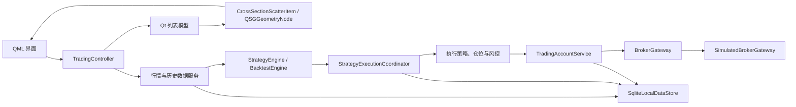

# PPTrader 项目 Wiki

## 项目定位

PPTrader 是基于 Qt 6、C++20 和 QML 的桌面量化交易工作台。系统当前面向研究、行情观察、策略验证和模拟交易；真实券商接口属于后续扩展范围。设计原则是业务层不依赖 QML、外部数据和券商均通过接口替换、关键状态可恢复且行为可测试。

图表、数据库、NAS 与行情 Provider 的阶段边界见 `docs/roadmap/图表存储与行情10A-10F.md`，历史 Tick 回测的全局路线见 `docs/roadmap/历史Tick回测与NAS数据路线图.md`。架构决策是：本地 SQLite 保存历史 Tick 事实、派生缓存和应用状态；NAS 保存原始数据并通过服务 API 提供，不直接共享 SQLite/WAL 文件。免费实时行情最低粒度固定为 1 分钟且只驻留工作台内存，远端日 K 只作为研究缓存；历史回测只能使用 NAS 同步/显式导入后的 Tick 事实，三者不能自动回退或覆盖。

盘中真实成交统一进入 `RawTradeIncrementalIngestService`。批次必须带稳定来源与成交序号，并限制为单代码、单交易日；SQLite 唯一键负责重放幂等，事实提交后只刷新该日已经物化过的 K 线周期。事实已提交但缓存刷新失败时两种状态分开报告：原始成交不会回滚或丢失，下次查询依据指纹自动补建缓存。

SQLite 全库版本从阶段 10B 起由 `PRAGMA user_version` 管理，当前为 v3（H2 增加回测数据集身份列）。`app_database_metadata` 的 database UUID 标识数据库身份，复制或搬迁后保持不变；`schema_migration_history` 记录全库迁移，原 `schema_versions` 只保留为回测归档等子模块的兼容版本。旧库升级先执行 `VACUUM INTO` 一致性备份，再在单事务内迁移并完成 SQLite、外键和必需业务表校验；程序不会自动删除这些备份。

本地数据库位置由 `StorageProfile` 管理并写入 `QSettings`。搬迁是复制并切换，不删除源库：Controller 先拒绝所有活动任务并排空/关闭后台 SQLite 连接，工作线程复制到目标临时文件，校验 database UUID 与完整性后才原子确认、保存配置并重启连接。UNC/SMB/NFS 地址不能作为 SQLite 路径；NAS 数据在 10D 中作为独立数据节点，通过 catalog/分块接口同步到本地数据库。

NAS 数据节点 v1 的详细契约见 `docs/nas-data-node-protocol.md`。`NasDataNodeClient` 只接受用户显式配置的安全端点，以 requestId 管理异步 health/catalog/download；校验后的单日 CSV 进入本地暂存区，再复用现有 TickData 流式解析和 SQLite 事务导入。NAS 原始文件、暂存副本、本地事实表和派生 K 线各有独立身份，下载成功不能冒充导入成功。

v1 已在真实虚拟机数据仓库上经 SSH 本地端口转发完成单日闭环：目录清单、文件字节数与 SHA-256 一致，客户端事务导入 4064 条合法成交并刷新 239 根 60 秒 K 线。节点现已安装为 systemd 用户服务，使用目标机环境文件提供仓库根目录和回环端口，仓库不保存连接参数；客户端验收结束后关闭本地 SSH 隧道，远端只读服务保留运行。生产部署仍需 NAS 原生 HTTPS、令牌轮换与监控。

## 目录与分层

- `src/domain/`：跨层值对象和枚举，如行情、订单、成交、持仓、账户、回测和策略执行意图。
- `src/services/`：行情、历史数据、SQLite、撮合、账户、交易所规则、风控和回测服务。
- `src/strategy/`：策略接口、SMA/动量/价差策略、仓位计算、执行策略和执行协调器。
- `src/models/`：面向 QML 的只读/可观察列表模型。
- `src/visualization/`：全市场点云的数据变换、命中测试和 Qt Quick Scene Graph 批量渲染。
- `src/app/TradingController.*`：应用组合根和唯一 QML 业务入口。
- `qml/`：界面；`scripts/`：mootdx/Python 数据桥；`tests/`：Qt Test；`data/`：本地运行数据。



横截面计算独立于逐 Tick 策略链路：`MarketSnapshotAssembler` 将同一批次的 A 股行情按股票池过滤、去重并形成 `MarketSnapshot`，随后由 `CrossSectionalIndicatorEngine` 一次计算整个截面。单标的实时策略通过 symbol 索引路由，不再接收无关股票的 Tick。

面向“全市场时刻股价”页面，`MarketSnapshotListModel` 保存一个不可混批的完整截面版本。模型按证券代码稳定排序，所有价格、成交量和涨跌幅角色保持数值类型；板块按代码前缀及 venue 归类为主板、深市主板、创业板、科创板、北交所，无法识别时回退为“未知”。

## 新版 QML 页面架构

`qml/Main.qml` 只创建窗口、主题、顶栏、顶层 `TabBar`、常驻 `StackLayout` 和公共底栏，所有业务数据由 `TradingController` 注入。三个常驻实例分别是 `DashboardPage`、`StrategyResearchPage` 和 `MarketSnapshotPage`；切换 Tab 不会销毁搜索、历史数据、运行中回测、快照筛选或散点选中状态。

`DashboardPage` 是默认入口，采用双选择器、双 K 线桌面工作台：左侧分别选择实时 A 股和 SQLite 本地回测品种；右侧上图使用选中实时品种的内存 1 分钟行情，下图按选中 Tick 派生数据集周期读取本地历史序列。两图都只显示真实 Candle，没有可靠数据时显示明确空/错误状态。回测权益曲线与成交明细保留在 `StrategyResearchPage`；`MarketSnapshotPage` 继续管理全市场快照，不直接访问 SQLite 或行情服务。

`CandleSeriesChart` 的交互状态由 `LocalCandleSeriesItem` 和 `LocalCandlePlotData` 承担。C++ 负责视口归一化、指针锚定缩放、Bar 平移、可见价格范围与命中；QML 只转发鼠标/键盘事件并绘制十字线标签。蜡烛仍是三个批量 `QSGGeometryNode`，缩放后不会为不可见数据构建几何，也不会为每根 K 线创建 QML Item。

`StrategyResearchPage` 已能从独立回测策略目录选择 SMA、RSI、MACD 或布林带策略，并使用选中的历史 Tick 派生 SQLite 数据集运行。内置和自定义入口都直接调用 `loadRecentCandles()`，不进入 `HistoricalDataService`；远端 K 线只在独立研究缓存工作区显示。实时执行用的 `strategyModel` 与回测策略目录继续分离，避免把绑定观察列表和审批配置的实时策略误当成历史回测模板。

自定义模式由 `CustomStrategyWorkbench` 承载，只调用 `TradingController` 的策略模型、Schema、定义导出、校验、分析、保存和严格本地回测入口。编辑器不执行 JSON 中的脚本、JavaScript、命令或网络操作；DSL 仍由 C++ 白名单校验器和编译器解释。策略必须先校验、保存为不可变新版本，并与当前编辑内容一致后才能启动。

`runSelectedLocalCustomStrategyBacktest()` 是页面专用的数据边界：只使用 `selectedBacktestSymbol/selectedBacktestFrequency` 对应的 SQLite 数据集和当前真实可用根数，直接调用 `loadRecentCandles()`；不会进入 `HistoricalDataService`，因此缓存不足时也不会回退 Provider。运行前 `CustomStrategyWorkspacePolicy` 统一检查已保存定义、executable、预热根数、请求根数、本地清单和任务状态。

自定义结果继续由统一 `BacktestEngine` 产生。结果配置保存 strategyId、strategyVersion、规范化参数、规则快照和实际 OHLCV 的 SHA-256 `dataVersion`。结果区使用 `backtestResultMatchesCustomStrategy()` 判断当前选择与已完成结果身份；不匹配时仍可查看旧结果，但必须显示“结果属于其他策略版本”。`backtest_only` 只代表历史回测可执行，不代表已获准进入模拟或实盘交易。

`BacktestArchivePanel` 消费 `backtestArchiveModel`，只通过 `TradingController.loadBacktestArchive(resultId)` 恢复归档。启动时仅查询摘要目录，不自动选择、不联网、不重跑；用户显式加载后，`equityCurveModel`、`backtestTradeModel`、摘要和 `backtestResultConfiguration` 同时切换到归档副本。页面以 `backtestResultHistoricalSnapshot` 标识历史快照，当前策略版本、编辑参数或本地 K 线变化不会覆盖该副本。

H3A/H3B 已增加独立 `BatchBacktestService` 和 `BatchBacktestResultListModel`。控制器从严格本地 Tick catalog 选择同周期数据集，后台线程以独立 SQLite 连接逐项读取，并把活动 `BacktestEngine` 限制为 20；每项运行前加载数据集身份（缺失/缓存过期按失败隔离），完成后保留摘要并在内存有界保留完整结果（32 项 LRU）。`archiveBatchBacktestItem(symbol)` 复用回测归档事务按需保存单项曲线/成交/身份；`batch_backtest_runs`/`batch_backtest_run_items` 持久化运行计划（全库 v4），应用重启把遗留 running 转为可重试 cancelled，`resumeBatchBacktest(runId)` 只重跑失败/取消项。批量任务与单标的任务互斥，支持原子取消、requestId 门控和单项失败隔离。它不是组合资金回测，也不自动批量保存曲线/成交。独立 Release 探针实测 5207×239 根在活动上限 20 时用时 2.710 秒；真实 5207 份数据的 NAS 同步、SQLite 装载和端到端上限仍属于 H1/H3B 后续大档验证。

`TickDataImportPanel` 是阶段 8A 的显式本地文件入口。目录、单个 A 股代码、交易日、文件格式、聚合周期和 5min volume 单位全部由用户确认；目录选择只更新控制器状态，不枚举或打开文件。只有导入按钮调用 `startTickDataImport()`，后台结果通过 requestId 回传，QML 不直接访问 `QFile` 或 SQLite。

`TickDataBatchImportPanel` 是阶段 8B 的受控多日入口。`prepareTickDataBatchImport()` 只为指定代码和日期区间计算确定性预期路径并检查文件元数据，不解析内容、不递归扫描；`startTickDataBatchImport()` 才逐日串行复用阶段 8A 解析器。每个日期独立提交事务，失败继续；取消后可用 `resumeTickDataBatchImport()` 保留成功项并重试其余项。

NAS H1A 在网络侧增加同样的按日事务边界，H1B 将输入扩展为用户明确提交的多代码 manifest。`NasTickSyncQueue` 按日期、代码稳定排序并串行执行 download→SHA-256→import；失败项不会回滚成功日期，取消与恢复也不会重新处理成功项。H1C 使用版本化原子 JSON 保存计划，重启仅从本地恢复并把中断项转为可重试状态，不自动访问节点。缓存管理只扫描和显式清理 Qt 暂存目录内符合 `YYYYMMDD/代码.csv` 的文件，跳过符号链接和无关文件，绝不删除 SQLite 事实。详细契约见 `docs/nas-sync-recovery-cache.md`。

阶段 8C 在同一面板增加日历、覆盖预检和历史恢复。计划读取 SQLite 按交易日的现有 K 线数量，但仍不打开 CSV；完整日期默认跳过，部分覆盖明确显示后才允许用户启动 UPSERT。历史摘要可按代码/状态筛选，`restoreTickDataBatchRetryPlan()` 从不含路径的逐日明细恢复成功状态，并以用户当前重新确认的根目录重建待重试路径。

阶段 8D 将导入结果接入只读图表查询。阶段 9A 将接口扩展为 `requestLocalCandleSeriesPeriod(symbol, periodSeconds, page, pageSize, maximumPoints)`，接受 1–86400 秒，并在独立 SQLite 连接的工作线程按需生成原始 Tick 缓存。页 0 是最新数据，页内保持时间升序；`LocalCandleSeriesRequestGate` 只有在 requestId 等于当前代次时才结束 loading 和更新模型。`requestLiveDayCandleSeries()` 使用另一组服务、模型和请求代次，只返回最近一个存在原始 Tick 的上海交易日。

当一页原始 Bar 多于显示预算时，`LocalCandleSeriesQueryService` 按连续桶聚合 OHLCV：首开、末收、区间高低和成交量求和，B/S/M 分向量同样求和，`sourceCount` 说明每个显示点包含多少根原始 Bar。桶以 Asia/Shanghai 的交易日和上午/下午会话为硬边界，绝不跨午休或隔夜合并；因此跨越多个交易日时显示点数可能略高于目标预算。`LocalCandleSeriesItem` 在 GUI 线程复制 `LocalCandleSeriesListModel` 快照，渲染线程只使用该缓存；影线和涨跌实体以三个 `QSGGeometryNode` 批量提交。网格仍由单个 Canvas 绘制，没有逐 Candle QML Item。

股票搜索文本由 `TradingController.stockSearchText` 统一持有。搜索结果或散点调用 `openInstrumentResearch(symbol)` 后，控制器验证并更新 `selectedInstrument`，再发出 `instrumentResearchRequested`；只有 `Main.qml` 响应该信号并切换到“指标与策略”，页面彼此不持有引用。顶层页签支持 Tab/Shift+Tab、左右方向键和 Enter/Space。

### 主页双品种选择契约

主页未来使用三套明确隔离的选择语义。`selectedInstrument` 继续专属于指标与策略页的 legacy 研究选择；`selectedLiveSymbol` 表示主页实时品种，只能从 `AShareUniverseLoader` 已加载的 A 股股票池选择；`selectedBacktestSymbol` 表示主页本地回测品种，只能从 SQLite 历史清单选择。三者由 `WorkspaceInstrumentSelectionState` 保存，任何一类切换都不会隐式修改另外两类。

`SqliteLocalDataStore::localHistoryCatalog()` 对 `candles` 按 `symbol + period_seconds + source + adjustment` 聚合，返回代码、名称、市场、venue、周期、来源、真实行数以及首末 K 线时间；同品种同周期的远端 K 与 Tick 派生 K 不会被合并为 `mixed`。控制器以 `localHistoryDataCatalog` 暴露全部研究数据，但 `localBacktestDataCatalog` 只保留 `source=raw_tick_cache_v1`、A 股、范围有效的数据集。`selectLocalBacktestInstrument(symbol, frequency, minimumBars)` 只查询这份严格清单，回测读取再以 SQL source 条件二次约束；远端 K、缺失周期或根数不足均返回 `false` 且不调用 Provider。

阶段 9A 已替换阶段 5B 的快照价位图与主页权益图。上图使用 `liveDayCandleSeriesModel` 展示最近一个原始成交交易日，下图使用 `localCandleSeriesModel` 展示本地历史序列；二者共用 `CandleSeriesChart + LocalCandleSeriesItem` 的 Scene Graph 批量绘制，但请求状态和模型互相隔离。切换主页实时品种不会改变研究或回测品种；下图选择仍不会触发 Provider。`equityCurveModel` 继续用于策略页和回测归档，不再占用主页第二张核心图。

`CrossSectionScatterItem` 在 GUI 线程从 `marketSnapshotModel` 一次读取必要角色，形成与模型生命周期解耦的紧凑点缓存；Scene Graph 渲染同步阶段只读取该缓存，不跨线程访问 `QAbstractItemModel`。点云按板块分成最多五个 `QSGGeometryNode`，每个 2 px 点用八边形三角批次和 Qt 内置平面颜色材质绘制，不为每只股票创建 QML Item。模型、尺寸、板块或 Y 轴模式变化时才重建几何，hover/选中只更新 QML 十字线和提示框。

`CrossSectionPlotData` 统一负责板块位、可见性、对数/线性坐标、过滤统计、Top 3 和最近点命中；`CrossSectionChartCard` 与 `SnapshotSummaryPanel` 消费 `CrossSectionScatterItem.summary`，因此点、板块数量、最高/中位/平均/最低、Top 3 和选中股票属于同一批次与过滤版本。过滤只改变可见性，不改变 `displayIndex`，避免横向位置跳动。静态坐标网格仍用单个 Canvas，股票点已经完全离开 Canvas。

页面状态优先级为 `Error > Loading(无旧数据) > Empty > Incomplete/Stale > Healthy`。Stale 和 Incomplete 保留已有点并使用黄色警告；只有 Healthy 使用绿色。QML 的 busy 直接绑定 `snapshotLoading`，查询由 `AsyncMarketSnapshotQueryService` 在独立 SQLite 连接上执行。`SnapshotRequestGate` 为每次请求分配递增代次；只有当前 `snapshotRequestId` 的结果可以更新模型，旧响应不会清除 loading 或覆盖较新状态。

1600×1000 是视觉基准：顶栏 64、页面标题 74、时刻卡 92、主内容 690、底栏 48 px，主图与 318 px 摘要间隔 16 px。窗口小于 1600 px 时，时刻卡切换为 148 px 双行布局；小于 1360 px 时，摘要变为覆盖式、可滚动的单实例抽屉，关闭后主图恢复全宽。不要在主区和抽屉各维护一份摘要，否则筛选版本和焦点状态会分叉。

主题集中在 `PPTheme.qml`，默认字体为 `Noto Sans SC` 并由系统字体机制回退。`PpButton.available` 表示业务动作是否可用：不可用控件仍保留悬停说明和可访问禁用原因，但不会获得普通 Tab 焦点或触发动作；可用按钮以独立外环显示键盘焦点。板块筛选行具有复选框语义，支持 Tab、Space/Return 和 checked 状态。散点图本身可聚焦并公布图表/选中点摘要，但逐点键盘导航尚未实现，界面会明确说明这一边界。

自动刷新只负责每 5 秒查询最近一个已完成快照，不能作为 Provider 在线或健康的证据；自动刷新成功色、Provider 健康、快照完整率和 Stale 状态分别消费控制器真值。Incomplete 时摘要标题、价格分布和 Top 3 均说明“基于部分数据”。导出、全屏、播放和双击多窗口尚未实现，控件保持禁用并说明原因；CPU/MEM 没有真实遥测时显示 `--`。

`CrossSectionScatterItem::geometryChange()` 在 Plot 尺寸变化时使批量几何失效，防止缩放窗口后仍沿用旧坐标。该路径仍复用原有紧凑缓存和按板块批量节点；响应式调整不会退回逐点 QML Item 或 Canvas 点云。

### 性能可观测性

点云性能指标是事件驱动的 CPU 采样，不是逐帧遥测。`modelPreparationMilliseconds` 统计模型到紧凑点缓存及摘要的准备；对 `MarketSnapshotListModel` 使用只读快照快速路径，对其他 `QAbstractItemModel` 保留角色回退。`sceneGraphUpdateMilliseconds` 统计 Scene Graph 同步阶段的分组、顶点分配和节点构建，`renderMilliseconds` 仅作为兼容别名；它们都不能代表 GPU 呈现或完整帧时间。

Debug 默认采样，Release 默认零采样，可通过 `PPTRADER_PERF_METRICS` 显式开启或关闭。每次采样同时记录可见点数和顶点数，关闭或重新开启会推进指标代次，旧渲染线程回调不能污染新状态。性能预算、DPI 证据、当前 p50/p95 和复现命令见 `docs/performance-baseline.md`。

## 核心业务流程

### 行情与历史数据

实时行情由 `MarketDataProvider` 产生 Tick，经控制器分发给模型、策略、账户盯市和模拟券商。历史请求先查 SQLite K 线缓存，不足时由 `HistoricalDataProviderRouter` 按能力在 Tushare Pro、BaoStock 和 mootdx 间路由，校验后 UPSERT，并返回统一的 `Candle` 序列。当前只声明沪深 A 股，北交所暂不进入路由。

阶段 7A 将用户数据获取与回测准备明确拆开。`LocalHistoryDownloadPanel` 只通过 `TradingController` 维护独立下载目标和请求状态；`selectHistoryDownloadInstrument()` 只验证本地 A 股股票池，不访问网络。只有 `downloadAndStoreHistoryAdjusted(frequency, targetBars, adjustment)` 会调用专用 `HistoricalDataService`：同复权口径完整缓存直接复用，缓存不足才调用路由。该专用 Service 与历史预览/回测 Service 分离，二者不会互相覆盖 requestId 或取消任务。

Provider 返回的每根 K 线必须满足目标 symbol/周期/复权、有效时间、有限且为正的 OHLC、high/low 包含开收盘价、非负成交量，才会进入 SQLite 事务。成交量统一为股；Tushare 与 mootdx 原始手数乘 100。成功时 `candles` 与 `historical_dataset_versions` 在同一事务写入 source、adjustment、downloadedAt、根数、范围及规范化 OHLCV 的 SHA-256 dataVersion；失败时不写库，也不改变既有 catalog。当前每个 symbol/period/time 只保留一个活动价格口径，切换复权会替换重叠 K 线。详细路由见 `docs/historical-provider-routing.md`。

主页 `LocalBacktestSelector`、自定义策略 `runSelectedLocalCustomStrategyBacktest()`、目录刷新和本地品种切换仍然是离线路径。它们不会因为 catalog 中数据不足而自动调用 `HistoricalDataProvider`；用户必须回到显式下载工作区主动补充。

### TickData CSV 本地导入

阶段 8A 的原子操作只处理单代码、单交易日。逐笔文件位于 `YYYYMMDD/代码.csv`。解析器兼容两种明确格式：无表头五列 `HH:mm:ss,price,volume_lots,amount,side`，以及带中文表头的六列“成交时间、成交价格、价格变动、成交量、成交金额、性质”。两者时间都按 `Asia/Shanghai` 转 UTC，成交量按手乘 100 得到股数；B/S/M 与买盘/卖盘/中性盘映射到独立 `RawTradeDirection`，不复用策略 `TradeSignal`。

5min 文件位于 `YYYYMMDD+5min/代码.csv`，表头必须为 `time,open,close,high,low,volume`。因为源文件 volume 单位尚未形成可信元数据，导入请求默认 Unknown 并直接拒绝；用户必须选择 Shares（原值）或 Lots（乘 100）。source 分别记录为 `tickdata_csv_5min_shares` 或 `tickdata_csv_5min_lots_to_shares`，禁止静默猜测。

解析器使用 `QFile::readLine()` 逐行处理，最多保留 100 条结构化诊断，每条含文件路径、行号、原因和 fatal 标识。逐笔事实以 2048 条小批交给 SQLite sink，内存不会随文件行数线性增长。导入时仍同时生成所选 60/300 秒 Candle；`[09:25,09:30)` 归入集合竞价桶，上午和下午按各自会话锚点分桶，15:00 之后、午休及其他盘外记录跳过。5min 标签使用同一边界映射并拒绝重复 Bar。

阶段 9B 验证了虚拟机数据接入，但没有把 SSH 凭据引入应用。操作者在当次授权会话中把一个明确远端文件传到临时 staging，PPTrader 仍只读取显式本地文件；成功写入 SQLite 后立即删除临时副本。源码、数据库、测试、日志与文档均不保存 SSH 地址、账户、密码或远端根目录。后续若建设应用内 SSH，必须优先使用 key/agent、主机指纹校验和逐文件白名单，不能保存明文密码。

逐笔格式通过 `beginRawTradeTickImport()/appendRawTradeTicks()/commitRawTradeTickImport()` 替换同代码、交易日与 source 的事实数据；删除旧日和写入新日属于同一事务，错误或取消调用 rollback，因此不会留下半日数据。成功后再 UPSERT 导入请求周期的 Candle 并刷新 catalog。5min 文件只有 OHLCV，无法反推逐笔，因此仅写 `candles`，不会伪造 `raw_trade_ticks`。

`RawTickCandleAggregator` 是任意周期派生的唯一实现。周期范围为 1–86400 秒：小于 4 小时按 09:25 集合竞价、09:30 上午、13:00 下午三个锚点分桶，午休不跨 Bar；4 小时及以上归为以 09:25 为标识的单交易日桶。任何周期都不跨上海交易日。OHLC 取首/末/极值，volume 与 B/S/M 方向量求和，source 固定为 `raw_tick_cache_v1`。

`raw_tick_candle_cache_state` 保存 symbol、交易日、周期、原始行数、最大原始 ID、生成 Bar 数和缓存版本。查询前以这些字段比较事实表；不一致时在事务中只替换该日该周期的派生 Candle。缓存是可删除、可重建的性能层，`raw_trade_ticks` 才是本地逐笔事实。当前仍没有目录扫描、92GB 全量导入、逐笔回放或远端同步。

阶段 8B 在原子操作外增加计划和编排。计划最多覆盖 366 个自然日，仅生成所选区间内工作日的预期文件；项目尚无完整交易日历，因此法定节假日会显示为 Missing，而不是被错误判定为解析失败。计划状态为 Missing/Ready/Running/Succeeded/Failed/Cancelled；继续导入会重新检查待处理路径，但已成功日期保持不变。

阶段 8C 用 `AShareTradingCalendar` 替换单纯的工作日判断。当前权威覆盖年份为 2026，来源标识 `SSE-2025-45`；周末和公告休市日不进入计划。超出覆盖年份时不会猜测节假日，普通工作日以 `weekday-fallback` 进入计划并在状态中警告。该日历也接入 `MarketSession`，因此 2026 公告休市日不会生成模拟 Tick 或通过交易时段规则。

覆盖预检由 `SqliteLocalDataStore::candleCountsByTradingDate()` 按 Asia/Shanghai 将同代码、同周期 K 线分组。1min 240 根、5min 48 根仍只是完整日参考：达到参考值可按默认选项标为 SkippedExisting；不足则标记 partial，启动前显示 `willOverwrite`，写入仍使用唯一键 UPSERT。预检不判断复权、公司行动或每根 Bar 的内容等价性。

批次仍只有一个解析线程，并在文件边界顺序执行，避免多个大 CSV 同时争用内存和 SQLite 写锁。取消在 `QFile::readLine()` 行边界检查；当前文件取消不写库，后续文件保持待处理。每个成功文件拥有独立事务，因此失败或取消不会回滚此前成功日期，重复执行继续依赖 `candles` 唯一键保持幂等。

质量审计记录跳过行、输入时间逆序、连续竞价参考 Bar 缺失和结构化说明。标准完整日参考值为 1min 240 根或 5min 48 根，不包含 09:25 独立 Bar；它是 warning 基线，不是交易日历或停牌判定。批次运行摘要持久化后可在启动时恢复，但只保存代码、日期、参数、数量、质量和状态，不保存用户目录或单文件路径。

mootdx 实时桥使用全市场股票池临时文件接收大规模代码列表，并将请求按 40 只拆分。股票池由 `AShareUniverseLoader` 从 `data/astock_cache.json` 加载；它与观察列表分离，并记录 source/accepted/rejected 数量。代码、缓存市场标签和规范 venue 必须一致，名称中的 NUL 会被清除。构建和安装会把缓存复制到程序 `data/` 目录。

每轮桥接输出 `snapshot_begin`、若干 `quote` 和 `snapshot_end`；C++ Provider 在工作线程内组装快照，并核对协议 expected/received 与实际股票池/去重数量。结构化 Provider 状态为 Stopped、Starting、Healthy、Degraded、Error；任何缺失都不会显示为 Provider Healthy。控制器仍以 90% 完整率和 10 秒批次耗时作为横截面计算水位线。

`RealtimeProviderRouter` 与 Provider 同处后台线程，同一时刻只启动一个候选。活动 Provider 的状态、行情观测和快照都会刷新 watchdog；Error、连续三个低于 90% 的批次或候选声明周期内完全静默才触发熔断。高完整率 Degraded 继续服务并降低评分。候选冷却 60 秒后可自动恢复，非活动旧源事件被丢弃。Controller 向 QML 暴露活动源、能力列表、分钟能力、评分、fallback 和 failover 次数。

腾讯全市场 Provider 使用 Qt Network 通过 HTTPS 顺序请求，每批 80 只、每 60 秒一轮，只映射沪深。独立 `TencentMinuteBarService` 只为 `selectedLiveSymbol` 请求最多 320 根 1 分钟 OHLCV，Controller 以独立 requestId 门控后转换为 `realtimeMinuteCandleModel`。该模型不调用 SQLite；停止实时任务、切换品种或退出时取消请求。响应成交量按手乘 100 转股，报价时间按 `Asia/Shanghai` 转 UTC；休市保留最近交易日并显示 stale。

桥接器会先验证指定服务器能返回实时行情，再进入轮询；可通过 `PPTRADER_PYTHON` 指定 Python，`PPTRADER_TDX_PRIMARY_SERVER`/`PPTRADER_TDX_BACKUP_SERVER` 覆盖主备端点。旧 `PPTRADER_TDX_SERVER` 保持兼容。受控集成测试还可设置 `PPTRADER_TDX_MAX_BATCHES` 和 `PPTRADER_AUTOSTART_LIVE`。

当前 VS Code 配置将 `PPTRADER_PYTHON` 指向 `${workspaceFolder}\.venv\Scripts\python.exe`。首次使用需在仓库根目录创建隔离环境并安装依赖：

```powershell
python -m venv .venv
.\.venv\Scripts\python.exe -m pip install -r requirements.txt
```

### 策略与下单

历史回测策略继承 `BacktestStrategy`，由 `BacktestStrategyRegistry` 提供稳定的 ID、中文名称、说明、适用市场、最小预热根数和参数 Schema。注册表负责默认值补齐、类型/范围和交叉参数校验，再创建具体策略；`BacktestEngine` 只依赖抽象策略，并把 `taskId`、`strategyId` 和规范化参数保存进 `BacktestResult.config`。当前策略 ID 为 `sma_crossover`、`rsi_mean_reversion`、`macd_trend` 和 `bollinger_mean_reversion`。

历史 K 线请求在 Provider、`KlineDataFetcher`、`HistoricalDataService` 与控制器之间携带递增 requestId。服务只接受当前代次，控制器分别记录预览请求和待回测请求；旧响应不能更新模型或触发新任务。回测任务另有递增 taskId，完成结果同时公布任务、品种和策略身份。

策略研究页只通过 `TradingController` 编辑回测状态。通用配置由 `backtestFrequency`、`backtestBarCount`、`backtestConfiguredInitialCapital`、`backtestCommissionRate` 和 `backtestSlippageRate` 表示；策略专属值保存在 `selectedBacktestParameters`。控制器拒绝未知周期、2–5000 以外的根数、非有限或越界资金/费率，以及注册表判定无效的策略参数。切换策略会加载该策略默认参数，运行时把规范化配置复制进结果，后续编辑不会改变已完成任务的 `backtestResultConfiguration`。

`EquityCurveListModel` 和 `BacktestTradeListModel` 除角色模型外还提供 `count` 与只读 `get(row)`，供单个 Canvas 权益图和详情读取使用；非法行返回空 Map。`BacktestArchiveListModel` 只承载按完成时间倒序的轻量摘要，完整曲线和成交仅在用户选定 result ID 后读取。界面不得复制或推导交易结果，权益、回撤、成交和费率说明必须来自同一 `BacktestResult`。

成功回测的归档流程为：`BacktestEngine` 完成并生成实际 Bar 数与 dataVersion → 控制器复制不可变结果并生成 result ID/完成时间 → `SqliteLocalDataStore` 在一个事务中写父结果、权益点和成交 → 成功后刷新摘要模型。身份不完整、SHA-256 格式错误、自定义策略缺少版本/规则快照或任一 SQL 写入失败都不会形成可加载归档。写库失败不影响本次内存结果查看，但控制器必须显示“本次结果未保存”。

### 自定义策略 DSL

自定义策略定义由 `CustomStrategyValidator` 在写库前校验，SQLite 和 QML 不负责解释表达式。v1 仅允许 `custom_` ID、A 股、`backtest_only`、有限数字和固定指标/字段/操作符白名单；复杂度限制为 8 层、64 节点、32 个参数。详细格式见 `docs/custom-strategy-dsl.md`。

`CustomStrategyCompiler` 将已校验定义转为索引化条件、操作数、去重指标计划和不可变规则快照，运行参数在编译时规范化。`CustomIndicatorRuntime` 按 Bar 增量更新七类指标，`CustomBacktestStrategy` 使用三值逻辑求值；缺失值不会被当作 false 后再由 `not` 翻转，上穿/下穿也不会跨缺口。控制器可调用 `analyzeCustomStrategyJson()` 获取预热根数、计划规模和 `ruleSnapshot`。

规则快照包含固定仓位比例、止损、止盈、最大持仓 Bar 和强制 A 股 T+1。买入日触发退出时运行时锁存首次原因，并在下一交易日首个有效 Bar 执行；`BacktestEngine` 通过抽象 `positionFraction()` 分配下单预算。

自定义策略不加入只管理内置策略的 `BacktestStrategyRegistry`。`runCustomStrategyBacktest()` 按 ID/版本查找 SQLite 恢复的不可变定义，在历史请求前编译并复制计划，历史数据返回后把受控实例交给同一 `BacktestEngine`。引擎要求实例与配置中的 ID、版本、规范化参数和规则快照完全一致；任务结果额外保存实际排序后 OHLCV 输入的 SHA-256 `dataVersion`。模型状态为 `backtest_ready`，但 `executionScope=backtest_only`，订单入口不会加载该策略。

策略将行情转换为 `TradeSignal`，`StrategyEngine` 同时发出策略 ID 和信号，避免多策略共享行情时发生配置串用。`StrategyExecutionCoordinator` 根据 `StrategyExecutionConfig` 校验启用状态、冷却期和仓位，创建可审计的 `StrategyOrderIntent`。人工模式等待批准，自动模式直接经 `OrderSubmissionPort` 提交。每日订单次数和金额预算在成功提交时累计，跨日自动重置。

应用启动顺序为：打开 SQLite → 恢复账户和订单 → 恢复策略配置及意图 → 创建实时策略 → 等待行情。数据库不可用时仍可运行行情和策略观察，但策略配置不会假装已持久化。默认策略执行配置为 Disabled，只有显式配置后才允许提交订单。

### A 股横截面指标

横截面指标以一个批次的全市场快照为输入，而不是逐股票触发。指标通过 `supportsMarket()` 声明适用市场；当前 `AShareRelativeStrengthIndicator` 仅接受 A 股，根据 `price / previousClose - 1` 计算当日相对强弱，并产生 Z-Score、强弱排名和 `[0, 1]` 分位数。停牌、过期行情及缺少现价/昨收的数据保留在结果中，但标记为无效并说明原因。

“同一时刻”在工程上表示同一行情批次或同一水位线窗口，不要求每只股票拥有完全相同的物理到达时间。快照包含 `batchId`、统一时间、预期股票数和完整率；真实数据源接入还需提供批次结束事件和超时封口策略。

### 账户与撮合

`TradingAccountService` 在提交前执行交易所规则和账户风控，冻结现金或可卖数量。模拟券商根据最新 Tick、买卖方向、滑点、限价和可用流动性生成 `Execution`。部分成交会逐笔更新现金、持仓和订单；撤单、拒单或到期后释放剩余冻结资产。

## 主要数据结构

| 类型 | 关键字段 | 用途 |
| --- | --- | --- |
| `Instrument` | symbol、market、venue | 证券身份和市场归属 |
| `Tick` / `Candle` | timestamp、OHLC、volume、可选 B/S/M 分向量 | Provider 行情观测与可缓存历史 K 线 |
| `RawTradeTick` | instrument、tradingDate、timestamp、sourceLine、price、volumeShares、amount、direction | 本地逐笔成交事实；B/S/M 不复用策略信号 |
| `RawTradeFingerprint` | count、maximumId | 判断指定代码/交易日的派生 K 线缓存是否过期 |
| `RawTickDayFingerprint` | tradingDate、rawCount、rawMaximumId、barCount、cacheVersion | 单个交易日的事实指纹与派生缓存状态；参与数据集身份哈希的只有事实字段 |
| `BacktestDatasetIdentity` | instrument、periodSeconds、source、aggregatorVersion、days、datasetVersion、日期范围、缺口/日历覆盖 | 可回测数据集的不可变身份；由原始日期集合+Tick 指纹+聚合版本组合，`toJson()` 随归档保存 |
| `NasCatalogEntry` | symbol、tradingDate、format、size、sha256、version、downloadPath | NAS 单代码单交易日的不可变下载清单项 |
| `NasDownloadResult` | requestId、entry、localPath、receivedBytes、cacheReused、error | 经大小与 SHA-256 校验的本地暂存结果 |
| `TickDataImportRequest` | rootDirectory、instrument、tradingDate、format、period、volumeUnit | 一次显式的单文件本地导入请求 |
| `TickDataImportDiagnostic` | path、lineNumber、reason、fatal | 面向 QML 和测试的逐行结构化错误 |
| `AShareTradingDayStatus` | tradingDay、coverageKnown、holiday、reason、source | A 股交易日与权威覆盖状态 |
| `TickDataBatchPlanItem` | request、runtime filePath、status、existing/expected、记录/Bar/质量统计 | 路径仅运行期存在；其他字段可恢复 |
| `TickDataImportRunSummary` | runId、代码/日期/参数、成功/失败/覆盖/日历汇总、status | 可恢复的批次摘要；不含目录与文件路径 |
| `LocalHistoryDataset` | instrument、periodSeconds、source、adjustment、candleCount、firstTime、lastTime | SQLite 按来源隔离的本地历史数据清单项 |
| `LocalCandleSeriesQuery` | instrument、periodSeconds、page、pageSize、maximumPoints、latestTradingDayOnly | 任意周期分页、主页最近交易日语义与显示预算 |
| `LocalCandleSeriesPoint` | Candle、endTime、sourceCount | 一个原始或 OHLCV 聚合显示点 |
| `LocalCandleSeriesResult` | query、points、total/page/raw/bucket、downsampled、error | 异步分钟序列查询的完整状态 |
| `MarketSnapshot` | batchId、timestamp、expectedCount、quotes | 一次全市场横截面计算的输入 |
| `MarketSnapshotQueryResult` | requestedTime、resolvedTime、staleness、health、error | 历史时刻查询的结构化结果 |
| `FactorFrame` | indicatorId、values、rank、zScore、percentile | 横截面因子输出 |
| `TradeSignal` | side、price、reason | 策略输出，不等同于订单 |
| `OrderRequest` | side、type、timeInForce、quantity、expiresAt | 提交前订单参数 |
| `Order` | status、filledQuantity、averageFillPrice | 委托生命周期快照 |
| `Execution` | orderId、quantity、price、commission | 不可变的逐笔成交 |
| `Position` | quantity、availableQuantity、averageCost | 当前持仓与盈亏 |
| `AccountSnapshot` | cash、frozenCash、totalEquity、dailyPnl | 账户核算和日级风控基准 |
| `StrategyOrderIntent` | signal、orderRequest、status、orderId | 从信号到订单的审计记录 |
| `BacktestConfig` | taskId、strategyId、strategyVersion、strategyParameters、ruleSnapshot、dataVersion、datasetIdentity、instrument、frequency、fees | 一次回测的不可混用配置快照；datasetIdentity 为运行前准备的数据集身份 |
| `BacktestResult` | config、summary、trades、equityCurve | 已完成任务的摘要、成交和权益结果 |
| `BacktestArchiveSummary` | resultId、taskId、completedAt、策略/数据身份、摘要 | 启动与列表使用的轻量归档项 |
| `BacktestArchiveRecord` | resultId、completedAt、完整 BacktestResult | SQLite 完整回测归档与恢复载体 |
| `CustomStrategyDefinition` | schemaVersion、strategyId、version、JSON、作用域、时间 | 不可变的自定义策略版本定义 |

订单状态主路径为 `Pending → Accepted → PartiallyFilled → Filled`；任意活动订单可进入 `Cancelled`，参数、规则或风控失败进入 `Rejected`。IOC 允许部分成交后撤销余量；FOK 要求一次全部成交；DAY 默认在所属市场收盘到期；GTC 仅在显式撤单或设置了 `expiresAt` 时结束。

策略意图状态为 `Created → PendingApproval/Approved → Submitted`，也可能进入 `Rejected`、`Failed` 或 `Expired`。应用重启时未完成的审批意图会被标记过期，避免重复下单。

## SQLite 数据结构

默认运行库为 `data/pptrader.db`。主要表如下：

| 表 | 内容与约束 |
| --- | --- |
| `ticks`、`signals` | Provider/快照行情观测与策略信号流水；`ticks` 不是原始逐笔成交事实 |
| `raw_trade_ticks` | TickData 逐笔成交事实；代码/交易日/source/sourceLine 唯一，统一存 UTC |
| `market_snapshots` | 已完成批次元数据；批次号、快照/完成时刻、预期和收到数量 |
| `candles` | Provider、外部 5min 或原始 Tick 派生 K 线缓存；`symbol + period_seconds + start_time_utc` 唯一 |
| `historical_dataset_versions` | 远端历史数据集的 source、adjustment、请求/实际根数、范围、下载时刻与 SHA-256 身份 |
| `raw_tick_candle_cache_state` | 原始行数/最大 ID/算法版本指纹；控制单日单周期缓存重建 |
| `orders` | 委托当前状态、有效期和累计成交 |
| `executions` | 成交流水；`execution_id` 唯一，重复写入忽略 |
| `positions` | 按 `symbol` 保存最新持仓快照 |
| `account_snapshots` | 最近最多 1000 份账户快照 |
| `strategy_execution_configs` | 每个策略一份执行、超时和预算配置 |
| `strategy_order_intents` | 信号、订单参数、审批及提交结果 |
| `custom_strategies` | 自定义策略 JSON；`strategy_id + version` 主键，禁止同版本覆盖 |
| `schema_versions` | 子系统 schema 版本；回测归档当前为 v1 |
| `backtest_results` | 不可变结果身份、配置、数据版本、数据集身份（`dataset_*` 列）和摘要；`result_id` 主键 |
| `backtest_equity_points` | 权益、现金、持仓市值与回撤；按 result/sequence 排序 |
| `backtest_trades` | 完整成交身份、价格、数量、费用、盈亏和原因 |
| `tickdata_import_runs` | 多日导入运行参数、数量、质量和状态摘要；不保存任何路径或凭据 |
| `tickdata_import_run_items` | 每个计划日期的状态、覆盖、数量、质量和错误；不保存目录或文件路径 |

`SqliteLocalDataStore::ensureSchema()` 负责建表及只增不删的列迁移。数据库时间统一保存为 UTC ISO 8601；业务判断交易日时转换为市场或本地日期。

旧 `candles` 表会增量增加 `buy_volume`、`sell_volume`、`neutral_volume` 和 `directional_volume_known`，默认值为零/未知。普通 Provider K 线不会被误认为具备成交方向；逐笔 CSV 聚合 Bar 才设置已知标记。

回测归档三张业务表使用外键和单事务保证原子性；父结果、权益曲线和成交明细要么全部提交，要么全部回滚。归档父记录自 H2 起保存完整数据集身份 JSON（日期范围、原始行数、派生根数、缺口、日历来源），历史结果不以当前缓存解释；`BacktestDatasetService` 会在运行回测前按需重建过期派生缓存并校验身份。应用当前不提供删除和自动保留期，归档会持续保存在本地数据库；批量导出、多结果对比和云同步也尚未实现。H2 详细契约见 `docs/backtest-dataset-identity.md`。

全市场 Tick 由 `AsyncTickWriter` 在独立线程和独立 SQLite 连接中写入。数据库启用 WAL、5 秒 `busy_timeout` 和 `NORMAL` 同步级别；队列最多保留 3 个待写批次，过载时丢弃新批次并报告。每批使用一个事务，`ticks(batch_id, symbol)` 的部分唯一索引保证同一批次重放不会产生重复记录。无批次的旧式 Tick 仍可同步写入。

历史时刻查询同时要求 `snapshot_time_utc <= requested` 和 `completed_at_utc <= requested`，再按快照时刻倒序选择一批。这样不会把目标时刻尚未完成的采集批次当作当时可用数据。模型始终显示 `resolvedSnapshotTime`，不会用 `requestedSnapshotTime` 冒充真实数据时刻。完成元数据只在 Tick 明细写入成功后登记；旧数据库自动创建新表，不删除或改写既有 Tick。

## 风控与市场规则

账户级限制包括单笔金额、单标的持仓市值、当日最大亏损和最大活动委托数。交易所规则服务负责会话时间、整手数量、最小价格步长、停牌和 A 股涨跌停范围。策略级预算是额外一层限制，不能代替账户风控。真实交易接入前还需补充券商侧可撤数量、费率、T+1、交易日历和对账规则。

## 构建与验证

```powershell
cmake --preset vs2022-x64
cmake --build --preset vs2022-debug --parallel
ctest --preset vs2022-debug --output-on-failure
cmake --build --preset vs2022-debug --target all_qmllint
```

新增服务优先依赖抽象接口并通过构造函数注入。新增业务行为需要覆盖正常路径、边界、错误输入、异步信号和持久化恢复；QML 只能通过 `TradingController` 访问业务能力。

策略审批入口位于 `TradingController::approveStrategyIntent` 和 `rejectStrategyIntent`，空 ID、未知 ID 或非待审批状态返回 `false`；待审批数量通过 `pendingStrategyIntentCount` 暴露。这些接口只负责编排，实际资金冻结和订单状态仍由 `TradingAccountService` 处理。

策略配置入口为 `TradingController::configureStrategyExecution` 和 `configureStrategyOrderPolicy`，使用整数枚举参数以便 QML/脚本调用：执行模式 `0=Disabled, 1=ManualApproval, 2=Automatic`；订单类型 `0=Market, 1=Limit`；有效期 `0=Day, 1=GTC, 2=IOC, 3=FOK`。单项查询 `strategyExecutionConfiguration` 返回完整 `QVariantMap`，批量查询 `strategyExecutionConfigurations` 按 `strategyId` 稳定排序。控制器拒绝非法枚举、负数和 NaN/无穷浮点值；配置仅在 SQLite 写入成功后进入内存，失败时调用方收到 `false`。

全市场时刻接口为 `requestMarketSnapshot(QDateTime)`、`requestMarketSnapshotAt(QString)` 和 `requestLatestMarketSnapshot()`。返回值只表示异步任务是否受理，不表示是否找到数据。字符串时刻无偏移时按 `Asia/Shanghai` 解析；默认选择请求时刻之前最近的已完成批次。`snapshotLoading`、`snapshotRequestId` 和 `resolvedSnapshotRequestId` 描述查询生命周期；`requestedSnapshotTime`、`resolvedSnapshotTime`、`snapshotBatchId`、预期/收到数量、`snapshotCompleteness`、批次延迟、`snapshotStalenessMilliseconds`、`snapshotHealth` 和 `snapshotError` 属于最终接受的同一请求版本。陈旧度大于 10 秒为 `stale`，完整率低于 90% 为 `incomplete`。

Provider 状态与历史快照健康严格分离：`providerHealth/providerHealthText/providerMessage/providerError` 描述真实数据源，`providerExpectedCount/providerReceivedCount/providerCompleteness/providerBatchId/providerUpdatedAt` 描述最近采集；`snapshotHealth` 只描述数据库查询结果。Provider 缺失一只也为 Degraded，而历史快照仍按 90% 产品阈值判断是否足以展示和计算。

## 配置与安全

不要提交 `data/pptrader.db`、行情下载缓存、API Token、券商凭证或个人 `CMakeUserPresets.json`。Python 数据桥是独立进程边界，输入输出必须校验；生产券商适配器必须具备幂等客户端订单号、重连对账、速率限制、审计日志和默认关闭的安全开关。

TickData 导入根目录只来自运行时用户选择，不在源码、日志、测试、文档或批次摘要表中预置/持久化同步路径、主机、用户名或凭据。UNC/远端协议不是 8A/8B 输入；如数据已通过操作系统挂载为本地盘符，PPTrader 只把它视为用户显式选择的普通绝对路径。8B 只检查明确日期区间的确定性路径，不递归枚举目录。

NAS 端点地址可保存在 QSettings，但 Bearer Token 只从运行环境注入。非回环端点必须使用 HTTPS，URL 不得携带用户名或密码；使用 SSH 本地端口转发时，服务仅监听 NAS 回环地址，PPTrader 连接本机回环端点。节点和客户端都不记录鉴权头、仓库绝对路径或用户连接信息。

## 真实 TDX 容量基线

2026-08-01 使用 `202.108.253.139:80` 和刷新后的 5317 条股票缓存进行只读测试。5000 只股票的分块结果如下：

| 每组数量 | 完整率 | 服务端采集耗时 | 结论 |
| ---: | ---: | ---: | --- |
| 40 | 95.44% | 1799 ms | 当前默认值 |
| 50 | 94.92% | 1426 ms | 可用 |
| 60 | 94.24% | 1265 ms | 可用但完整率略低 |
| 80 | 93.14% | 1027 ms | 超过当前推荐值 |
| 100 | 75.22% | 774 ms | 存在明显响应截断 |

40 只/组、3 秒间隔连续 5 批时，每批均收到 4772/5000 条，采集耗时 1787–1795 毫秒，无超时、解析错误或完整率衰减。探测命令为：

```powershell
.\.venv\Scripts\python.exe scripts\probe_mootdx_snapshot.py `
  --counts 5000 --batch-size 40 --repeats 5 --interval 3 --timeout 60
```

## 当前边界

横截面计算、批次协议、后台批量写库、异步历史回读和单服务器 TDX 网络基线均已完成 5000+ 标的测试。当前缓存经校验可提供 5207 只沪深股票，但所选 TDX 服务器的市场代码 2 列表为空，北交所仍需第二个可靠列表来源。真实可用性仍取决于交易时段、网络、服务器负载和断线行为；当前尚无失败分块重试、多服务器运行期切换和长期稳定性监控。本地点云与 K 线均使用 Scene Graph 批量几何；TickData 已支持原始成交事务存储、受控日期区间、任意周期派生、盘中幂等增量追加及 NAS 按日显式同步，虚拟机已有回环 systemd 用户服务，但仍无全目录扫描、跨年度完整交易日历、原始逐笔回放、Parquet/WebSocket、生产级 HTTPS/认证轮换和监控。系统也没有生产券商、盘口级撮合、公司行动处理或组合级风险。
`StrategyIntentListModel` 将 `StrategyOrderIntent` 映射为 QML 角色：`intentId`、`strategyId`、`symbol`、信号与订单字段、状态、消息和各类时间。显示角色保留本地化文本，同时提供 `signalSideValue`、`orderSideValue`、`orderTypeValue`、`timeInForceValue` 和 `statusValue` 整数角色供界面判断，避免依赖翻译文本。模型按 `createdAt` 倒序、相同时间按 `intentId` 排序，恢复时过滤空 ID 并按最新 `updatedAt` 去重；`count`、`pendingCount`、`get(row)` 和 `indexOfIntent(id)` 可用于审批详情和定位。启动恢复结束后，控制器用协调器完整快照重建模型，未完成意图仍按安全规则转为 `Expired`。
## 推荐硬件环境

PPTrader 当前是 Windows x64 桌面应用，运行负载主要来自 Qt/QML 图形界面、Python 行情桥、SQLite 本地存储，以及约 5000 只 A 股的批次快照和横截面指标计算。Qt 官方 Windows 配置覆盖 x86_64；项目当前固定使用 Qt 6.4.3 + MSVC 工具链，因此建议使用 Windows 10 22H2 或 Windows 11 64 位。Qt 官方支持列表也将 Windows x64 与 MSVC 作为标准桌面配置。[Qt for Windows 支持配置](https://doc.qt.io/qt-6/windows.html)

| 场景 | 推荐配置 | 说明 |
| --- | --- | --- |
| 最低运行 | 4 核 CPU、16 GB RAM、512 GB SSD、集成显卡 | 适合单标的研究、回测和少量模拟行情；不建议长期跑全市场批次 |
| 推荐开发/模拟 | 8 核 16 线程 CPU、32 GB RAM、1 TB NVMe SSD、双屏 1080p/1440p | 适合 VS2022 编译、Qt Creator/VS Code、Python 行情桥、SQLite 和模拟交易同时运行 |
| 全市场批次 | 12 核 24 线程以上 CPU、64 GB RAM、1–2 TB NVMe SSD、稳定有线网络 | 面向 5000 标的批次行情、横截面因子计算、后台批量写库和日志留存 |
| 长时间运行 | 推荐配置或更高、带宽稳定、UPS、良好散热 | 适合盘中连续运行；优先保证网络、磁盘健康和断电恢复 |

### 关键选型原则

- CPU 优先选择较新的 x86-64 处理器；横截面计算和编译更受核心数影响，单标的策略则更看重单核响应。
- 32 GB 是日常开发的合理基线；如果同时保留 IDE、调试器、Python、SQLite WAL 和 5000 标的内存快照，建议 64 GB。
- 使用 NVMe SSD，不建议把运行库、日志或缓存放在机械硬盘、USB 移动盘或网络共享目录。SQLite 通常是单写入者模型，WAL 可改善读写并行，但不能替代高速本地磁盘和合理的批量写入策略。[SQLite 并发说明](https://sqlite.org/search?q=concurrent+write+support)
- 不需要独立 GPU；Qt/QML 界面使用集成显卡即可。只有在后续加入大量图表、视频或 GPU 计算时才需要独立显卡。
- 网络建议有线千兆或稳定 Wi-Fi 6；行情质量和延迟通常比额外 GPU 更重要。真实券商接入前应增加双链路、断线重连和本地缓存。

### 推荐部署组合

开发与模拟交易建议使用一台 Windows 11 x64、8 核 CPU、32 GB RAM、1 TB NVMe 的桌面机或迷你主机；运行 5000 标的批次时升级到 64 GB RAM。不要把 SQLite 数据库放在 NAS 或共享盘上；如果需要远程监控，可让 PPTrader 在本机运行，再通过日志/监控服务读取状态。

硬件达到推荐配置不代表行情一定可用：mootdx/数据源限流、市场开闭市、数据完整率和服务器响应仍是主要外部约束。真实交易还需要独立的风控、断电保护、网络冗余和人工熔断设计。
