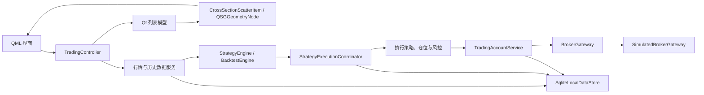

# PPTrader 项目 Wiki

## 2026-09-21 二板／三板历史 Tick 因子研究

NAS 历史 Tick 显示三板及以上相对二板具有可重复描述差异：次日触板率 49.25% 对 24.35%，收盘封板率 35.66% 对 17.30%，且前一日封板更早、前日上午成交更集中、次日早盘动量更强。但严格样本外、真实可成交、T+1、费用和双侧容量口径下，唯一完整月 2026-08 仅 +5.63% 和 1 次可成交封板；没有达到月收益 50% 与每月 5 次两项资格门槛。

研究层因此只保留因子证据和可复现工具，不生成默认策略、不接模拟或真实账户。下一步先补 6–12 个完整月份、官方交易日历和历史股票状态，再冻结新的训练／验证／锁定测试边界；锁定月不得反复调参。详见 [正式报告](limit-up-tick-factor-backtest-2026-09-21.md)。

## 2026-09-21 Qt 6.11 真实行情恢复段

09:30 因残留活动 TDX bridge 门禁停止后，系统没有绕过保护；确认原进程退出并获批准，09:43:25–15:31 完成恢复段。两个实时子窗口保持用户三屏布局，6/6 次切换成功，最终各 241/49/25 根 1m/5m/10m K；一次末柱回退响应被拒绝且下一轮恢复。全市场 282 帧均为 5207/5207，冻结候选累计触板 16/54、最后帧封板 15/54。该结果是单日前瞻，不等于可成交或盈利。

TDX 主备未取到有效结果，Router 稳定回退腾讯，failover=2。退出后无 PPTrader、监控或桥后代残留，实时事实四表保持零写入。收盘后进一步修复 bridge 输出编码、Router 受控停止和结束排空，最终 Qt 6.11 CTest 55/55；下一交易窗口仍要用修复版做真实复验。完整边界见 [09-21 报告](limit-up-strategy-market-acceptance-2026-09-21.md)。

## 2026-09-20 实时链路修复状态

已关闭 9/14 暴露的三项代码缺陷：腾讯轮询对象现随 Provider 一起迁移工作线程；Router 候选重新激活不会继承旧失败连续数，也不会由 `Starting` 状态误触发降级熔断；同品种分钟末柱回退不再覆盖当前图表模型。快照行情时刻、完成时刻和单调采集耗时已拆分，TDX 桥退出会保留 JSON/stderr 诊断。Qt 6.11.2 Release 构建、QML lint、定向数据/路由/退出回归均通过。当前仍是“代码修复完成、交易日验收待完成”：周末公共 TDX 空数据不能判断盘中可用性，真实 Router 恢复和 60 秒腾讯节拍必须在下一交易窗口确认。

## 2026-09-14 涨停候选前瞻样本

目标日前冻结的二板/三板候选已用真实行情完成单日观察：三板 6 只中 4 只精确触板、3 只最后帧封板；二板 21 只中 7 只精确触板、6 只最后帧封板。合计精确触板 11/27、最后帧封板 9/27。三板组在这一天更强，但单日命中不等于排队可成交、风险可控或长期盈利，继续只用于模拟研究。

应用显示与资源链路完成全天运行、6 次切换、最终 241 根 1 分钟 K、零实时事实写库并正常退出。公共 TDX 当日退出码 1，腾讯回退虽给出 101 个完整全市场帧，但 p95 帧间隔约 215 秒且 Router failover 达 488；分钟流另有 2 次同品种末标签回退。因此生产行情 SLA 尚未通过，必须先修复 TDX 可诊断性、Router 反复切换、分钟单调接受和真实延迟遥测。详见 [2026-09-14 报告](limit-up-strategy-study-2026-09-14.md)。

## 当前方向：一仓与全市场股票池

2026-09-09 08:20 更新：执行中心已修复账户数字语义和成交滚动。跨股票股数不再汇成误导性的“持仓”，页面改为现金、净值、持仓市值/仓位、总盈亏、持仓/可售标的数及逐股持仓；订单前门禁称“未提交信号”，只有实际提交失败才称“订单拒绝”。最近100条成交拥有独立滚轮和常显滚动条，总数不截断。15分钟可见慢速全量回放得到318=买162+卖156，182个样本逐项复算0失败、实际订单拒绝0、自然退出。最低成交数不再作为策略资格硬门槛，旧候选取消该门槛复算仍因盈亏比不足而全部不合格。见[验收报告](paper-single-account-longrun-acceptance-2026-09-09.md)。

2026-09-09 04:41 更新：月级20股修复版可见应用四小时长稳已通过。全量1,455,326 Tick / 126,686 Bar，成交318=买162+卖156，拒绝40,214全部属于持股/仓位上限；报告、日志、最终QML页面一致，隔离库保持零行情事实/回测归档写入。其后独立样本外策略研究80/80完成、40/40重复稳定，但冻结的最差折回撤<5%、盈亏比>=3、至少20笔交易和平均正收益门槛下**无合格策略**。收益最高样本也因回撤8.6656%、盈亏比2.3717被拒绝，不接真实账户。见[长稳报告](paper-single-account-longrun-acceptance-2026-09-09.md)和[研究报告](raw-tick-profitability-walk-forward-2026-09-09.md)。

23:54 更新：执行中心已补齐成交买/卖拆分和五类拒绝原因，月级 20 股门禁在 1,455,326 Tick 上验证成交 318=162+156、拒绝 40,214=分类合计，应用日志、报告和可见界面一致；高拒绝来自持续买入条件碰到持股/仓位上限。修复版四小时可见回放已启动，尚不作长稳结论。策略搜索安排在长稳之后串行运行，以严格时间切分后的回撤<5%、平均盈亏比≥3为门槛；无候选达标时必须报告“无合格策略”。见[当前证据](paper-single-account-longrun-acceptance-2026-09-09.md)。

21:12 更新：20 股两日 Release 实际一仓回放及 30 秒节奏预检通过；四小时可见应用正式段已运行，预计 09-09 01:11 结束。只证明当前小规模流程，不代表 5,000+。见[当前长稳状态](paper-single-account-longrun-acceptance-2026-09-09.md)。

20:55 更新：用户确认空分钟不阻断后，已修复并用原六股 NAS 文件重验通过（36,197 条成交输入、2,824 根指标计算、18 笔模拟成交、一仓）。两处空分钟保留质量告警，不补数；旧失败为修复前记录。详见[非阻断政策及结果](single-account-market-universe-2026-09-08.md)。

20:37 补验状态：一仓双股跨日买卖与源时钟保护已通过离线真实应用测试。NAS 新复制六股两日输入的实际预检被 000006 / 09-07 两个无记录分钟阻断，完整长稳未启动；这不是网络权限错误，也不等于已确认采集丢失。见[最新证据](single-account-market-universe-2026-09-08.md)。

2026-09-08 晚用户确认：一个 PPTrader 只有一个模拟资金持仓账户，一个生效策略可计算和筛选 5,000+ 股票；指标按股计算但不拥有资金。历史与实时只替换输入适配层，安全时钟接管尚待验收。实施状态和证据范围见[一仓验收记录](single-account-market-universe-2026-09-08.md)；下文多候选账户仅为旧阶段历史。

## 2026-09-08 15:31后：真实行情双模拟账户未完成验收

当天因09:30单品种预检误判TDX“启动中”而未启动正式段，至收尾未重跑：上午/下午/延长段正式覆盖均0，未创建账户、未产生模拟成交。不能把盘前回放通过、已有工程测试或短暂预检资源样本当作全天实盘通过。正式数据库未生成，完整性/schema/事实表检查不适用；原始证据保留，见[最终报告](paper-flow-acceptance-2026-09-08.md)。当天跟进收尾删除，修复及重新验收仍待授权。

## 2026-09-08 09:30：真实行情模拟门禁未通过

单品种腾讯分钟已返回当日数据，TDX“启动中”却被预检当成失败，应用退出码1且非强杀，编排器停止，正式双模拟账户没有启动。本次是状态/错误信号契约误判，不是已证实的Permission denied；TDX是否可用仍未验收。原始证据保留，只读诊断后不改冻结代码、不自动重跑。修复要求与覆盖限制见[当天流程报告](paper-flow-acceptance-2026-09-08.md)；下方08:17等待信息为历史状态。

## 2026-09-08：历史回放 / 真实行情到模拟账户

新增[流程验收记录](paper-flow-acceptance-2026-09-08.md)。盘前使用 NAS 已验证历史 Tick，原始时间不改写，1m 特征经相同策略执行链进入独立模拟账户；盘中只替换输入来源并先做网络预检。历史和实时实验不能混用，不连接真实券商，不以收益判定本轮成功。

盘前1/2/5/10/20独立实例分档全部通过，07:53:41前自然退出，每实例708根计算、5次模拟成交；Release定向8/8、Debug全量54/54及QML检查通过。用户已授权本次后台联网和子进程继承，并将截止延长为完整交易日15:31；08:17精确回收尚无应用子进程的旧等待程序，保留原记录，获批启动编排器PID44224等待09:30单品种门禁。正式双模拟账户午休不重启、持续至15:31，原跟进每5分钟只监控、不另开网络探针；真实段结果仍待验收。

## 2026-09-08：真实行情与候选模拟仓

执行中心新增“真实行情 · 独立模拟筛选”：先保存策略，再显式发布模拟新版本、启动顶部行情、按固定股票新建独立模拟仓。各候选资金和持仓隔离，不跟随图表换股；停止保留持仓，退出前手工导出状态摘要。原始行情不写库，未接真实账户；真实账户后续仍只允许一个生效策略。首版为单股 1m 研究链路，公开源分钟闭合、成本/盘口、重启恢复及实际盈利尚不能通过此入口认定。见[实现边界与本轮证据](realtime-paper-strategy-implementation-2026-09-08.md)。

离线工程验收：Debug 全量 **54/54**、Release 定向 **8/8**、两配置构建及 QML lint 通过；原生执行中心可操作并自然退出。此计数为新增模拟入口后的本轮结果，下面52项为上一阶段历史记录。盘中前瞻模拟仍须独立开展，不连接真实下单。

## 2026-09-08：向导退出根因修复

当前Qt6.4.3的ScrollBar在重复无障碍激活时累积动作连接，最小动作和真实向导退出均已取得红→绿证据。修复以[受控依赖构建](../cmake/qt-scrollbar-fix/README.md)交付，不修改全局Qt、不屏蔽无障碍；构建校验部署库，新增动作/真实退出/部署拒绝门禁。Debug普通、重复10,000次激活、真实离线运行后取消均正常退出，原生1120小窗口操作后约1.055秒回收且退出码0。Debug全量CTest **52/52（139.32秒）**、构建与QML lint通过，Release定向 **4/4（21.23秒）**通过，详见[最新修复报告](app001-scrollbar-exit-fix-2026-09-08.md)。下面“未修复”为此前诊断阶段，不覆盖最新结论；Qt6.8实际运行和APP-003持续UIA内存长稳仍未验收。

## 2026-09-08：退出与 Qt 6.8 规则

测试进程已全部回收，但复杂向导仍可出现长时间QML销毁，APP-001未修复。当前工具链是Qt6.4.3，不是6.8；本轮只核对官方v6.8.0相关源码并生成[编码与退出验收规则](qt68-coding-rules.md)，已接入AGENTS/CLAUDE。正常无障碍不得关闭来冒充修复，功能JSON通过不能替代进程退出；最新[诊断报告](app001-exit-diagnosis-2026-09-08.md)明确实测、假设和后续回归门禁。

## 2026-09-08：小窗口操作补验

用户说明上轮曾手动调整界面；本轮电脑空闲后，同一构建在1120×760隔离窗口完成预览/返回编辑、底部下一步4→5与上一步4→3，底栏可见且JSON无透出。指定界面操作与归档日期两个入口已分别有证据；不代表八步完整流程、实际数据预览或退出均通过。APP-001仍在定时关闭/Alt+F4后复现，本轮没有改生产代码。见[原生补验报告](wizard-small-window-reacceptance-2026-09-08.md)。下节“尚未通过”的界面状态保留为上轮历史，最新状态以本节为准。

## 2026-09-07：归档请求样本日期修复

schema v25 为单标的回测归档独立保留用户请求日期，区别于实际输入首末；Candle/Tick × 空白/单边/双边在关闭存储后重开、显示/完整输入两种模式均可恢复 UTC 毫秒时刻。旧 v24 未记录范围保持“未知”，不以当前界面或实际行情范围补写。真正缺列的旧库迁移、备份、旧未知复制、损坏/倒置日期拒绝读取均已覆盖，完整 SQLite 目标 **50/50（3178ms）**、真实 Controller **100 项检查**通过，旧未知范围不能保存为可重跑验证。最终 Debug 构建、全量 CTest **49/49（113.86 秒）**与 QML lint 通过。小窗口原生操作仍未通过：截图实际尺寸与测试目标不符，关闭本轮隔离实例后也复现 QML 引擎销毁残留，APP-001 不关闭；几何回归不能替代实际操作验收。详见 [归档修复及验收](backtest-archive-sample-window-2026-09-07.md) 和 [宿主布局收尾](flow03-host-layout-2026-09-07.md)。历史证据库保持原版本，不原位升级。

## 2026-09-07：双指标成交生命周期补充

新增 BIAS＋WMA 固定合成样本的导入派生、引擎成交、版本隔离及归档往返验收，足宽条件菜单四个 QML 鼠标样例通过。用户授权临时最大化后，原生向导保存／重启重载同版／000001 1m 500 根离线回测／归档已产出非零成交；500 Candle、500 权益点、1 闭合交易和末仓均可核对，不能把含浮盈的 0.06% 视为盈利证明。半屏 FLOW-03、验证保存 FLOW-08、Bar 回放 FLOW-09 和一次退出残留仍未通过。用户明确授权后，原草稿／布局三项恢复核验成功，问题已交“bug修复”任务开始处理；首次权限拒绝记录保留。详见 [补充报告](custom-strategy-signal-lifecycle-2026-09-07.md)，此前零交易样例保持原结论。

四轮版本／单变量门控／账户重置对照已通过，最终全量 CTest 48/48（95.97 秒）、Debug 构建及 QML lint 通过；本轮主线没有修改业务代码，临时放宽的窗口布局已按授权恢复。

## 2026-09-07：自定义策略指标目录

固定指标目录已从 10 类扩为 18 类，新增 WMA、BIAS、CCI、WR、OBV、MFI、KDJ、DONCHIAN。每策略最多 16 个命名序列；同类指标可用不同参数与输出组合成一套策略，指标本身不拥有资金或持仓。核心测试 54 项／0 失败、Debug 全量构建、菜单修正后的定向 CTest 6/6（9.81 秒）及 QML lint 通过；全量 CTest 47/48，唯一失败为既有 `batch_backtest` 归档往返。

隔离可见应用已保存含 SMA／MACD／BIAS／DONCHIAN／KDJ 的 `custom_wizard_draft` v1，退出重启后重载同一 SHA-256 定义，17:43:46 日志确认完成 `000001`、1m、500 根离线回测。该样例入场含 `sma > sma`，0 交易、0 收益只验证零交易流程，不证明策略有效性。条件菜单捕获／操作不稳定待复现，完整策略编制体验尚未通过。详见 [参数及计算口径](custom-strategy-indicators.md) 和 [保存／重载／离线回测验收](custom-strategy-indicator-expansion-2026-09-07.md)。本轮仅为 AS3 部分交付，不代表原始 Tick 自定义策略、多股选股、任意公式或收益验收完成。

## 2026-09-07：策略研究主线

同日后续：周期 K 末日 T+1 持仓归档兼容已修复，Debug 构建、全量 CTest 48/48（101.15 秒）与 QML lint 通过，见 [修复记录](candle-tplusone-archive-fix-2026-09-07.md)。上节 47/48 保留为指标扩展当时证据；条件菜单与完整策略编制体验仍待验收。

后续优先 A 股的「多股策略基线 → 策略内日频选股／分时进场 → 多指标组成一个策略 → 独立账户的有界指标组合与参数搜索」，外汇、加密货币暂不展开。按用户更正，每个策略运行实例独占一份资金和持仓；指标不持有账户，不同策略即使观察相同股票也不合并持仓。一个多股策略可在自己的账户内管理多个标的，与多个独立策略共用资金是不同概念。现有 DSL 多指标条件、Top-N 横截面回测和原始 Tick 嵌套 walk-forward 可复用，新增双频／研究编排仍待实施。当前工程审查发现七项成交／扫描问题，应先修复再排名选优；详见 `docs/strategy-research-review-2026-09-07.md`，实施与收益证据边界见 `docs/roadmap/A股选股与策略组合研究.md`，术语见根目录 `CONTEXT.md`。

收益研究保持原始 Tick 默认输入、周期显式选择、实时只显示不写库。长稳通过不等于盈利；年 10%、月 10%、月 100% 是待验证研究目标，不能通过筛选最优回测或短样本年化宣称实现。

## 项目定位

PPTrader 是基于 Qt 6、C++20 和 QML 的桌面量化交易工作台。系统当前面向研究、行情观察、策略验证和模拟交易；真实券商接口属于后续扩展范围。设计原则是业务层不依赖 QML、外部数据和券商均通过接口替换、关键状态可恢复且行为可测试。

图表、数据库、NAS 与行情 Provider 的阶段边界见 `docs/roadmap/图表存储与行情10A-10F.md`，历史 Tick 回测的全局路线见 `docs/roadmap/历史Tick回测与NAS数据路线图.md`。架构决策是：本地 SQLite 保存历史 Tick 事实、派生缓存和应用状态；NAS 保存原始数据并通过服务 API 提供，不直接共享 SQLite/WAL 文件。免费实时行情最低粒度固定为 1 分钟且只驻留工作台内存，远端日 K 只作为研究缓存；历史回测只能使用 NAS 同步/显式导入后的 Tick 事实，三者不能自动回退或覆盖。

截至 2026-08-23 的“已实现 / 代码已实现但待真实验收 / 未实现”矩阵统一记录在 `docs/documentation-status-2026-08-23.md`；更早文件保留为历史快照，阶段文档中的旧测试数字不代表当前测试总数或生产 SLA。

应用退出生命周期（2026-08-24）：最后一个 QML 窗口关闭时显式触发 `QApplication::quit`，`aboutToQuit` 先调用 `TradingController::shutdown()`，按取消任务、停止行情、排空 SQLite worker 的顺序关闭后台线程；`app.exec()` 返回后显式销毁 QML engine/controller，窗口几何保存仍挂在同一退出信号。行情组合服务提供只用于退出的同步 drain，避免析构时跨线程阻塞。`scripts/pptrader-exit-probe.ps1` 使用 `--exit-probe-native` 发送真实 `WM_SYSCOMMAND/SC_CLOSE` 验证进程回收；它不启动行情、因子研究、NAS 或任何网络操作。

真实行情复验（2026-08-27，状态于 2026-08-28 收尾）：上午 Provider 探针 36/36 轮零错误，副屏 QML 显示 5207/5207 全市场快照和 600519 当日 1 分钟 K 线，隔离库确认实时事实不落库；但首轮应用出现内存增长和关闭超时，登记为 `APP-003`。后续隔离定位为外部 Windows UI Automation 持续枚举 Qt 6.4 大型 QML 可访问树造成，非行情批次、模型 reset 或 Scene Graph 持续绘制。正常应用保留无障碍能力，仅无人值守验收通过 `PPTRADER_ACCEPTANCE_DISABLE_ACCESSIBILITY` 隔离 `WM_GETOBJECT`。修复后副屏 Release 可见运行 74.5 分钟，TDX 73/73、腾讯分钟 75/75 成功，私有内存 p95/max 221.6/223.1 MiB 且斜率为负，实时事实继续零写入，计划结束后 20 秒内退出。该结果通过应用级稳定基线，但不等于完整四小时、辅助技术兼容或生产 SLA。详见 `docs/market-data-real-acceptance-2026-08-27.md`。

完整应用复验（2026-08-31）：获准联网的同一 Release 从 08:26 连续运行至 15:31，无重启覆盖四小时连续竞价与 15:00–15:30 延长观察。848 个样本无超过 45 秒缺口，PPTrader 私有内存 p50/p95/max 为 226.773/228.500/249.902 MiB、斜率 +0.0139 MiB/分钟，日志为空且 20 秒内退出；四类实时行情事实表保持 0，订单/成交/持仓为 0。完整业务结论仍未通过：600519 分钟序列全天停在上一交易日，且 Router 期间出现 3 组 Python 行情桥进程对、合计私有内存峰值约 2.01 GiB。全市场快照曾从“无可用源”恢复到腾讯备用 5207/5207，但不能替代选中品种分钟图门禁。详见 `docs/market-data-real-acceptance-2026-08-31.md`。

8 月 31 日收尾把实时运行语义拆为两层：`RealtimeLiveSessionState::requested` 表示用户启动意图，Provider health 只更新 `providerActive`；分钟刷新以 requested 为准。TDX 桥进程则由 `ManagedProcessTree` 在 Windows 上按精确父 PID 捕获并由深到浅回收后代，`MootdxMarketDataProvider` 不再直接只结束 QProcess 父进程。两个状态均有无需网络的回归测试；当时待完成的真实分钟推进和单桥资源口径已由下段交易日回归替代。

交易日阻断回归（2026-09-01）：同一获准联网的 Release 从 09:26:49 运行到 15:31:05。腾讯分钟完成响应 364/364 成功，requestId 2–365 连续唯一，600519 从 1 根增长至 241 根、末标签由 09:30 推进至 15:00；午休保持 11:30，收盘后保持 15:00。TDX 完成 354 个唯一全市场批次，完整率 min/p50/p95 为 99.3278%/99.8656%/99.9040%，耗时 p50/p95 为 1791/2005 ms。监控以 PPTrader 精确后代树归组：4264/4264 个样本均只有一个逻辑桥组，两个 Python 进程只是 venv 启动器与实际解释器；应用、监控器和桥最终全部回收。隔离库四类实时事实表保持 0，schema v24 和完整性正常。正式段无自然故障、fallback 或 failover，因此 Router 恢复仍只由启动前受控门禁证明；另发现 12:59:21 已返回 13:01 Bar 标签，时间语义需调查。详见 `docs/market-data-real-acceptance-2026-09-01.md`。

验收后复盘确认：上述 `1→241` 是 Provider/Controller 的真实内存序列推进，不代表当时所有 K 都已正确可见。午后状态为 131 根时图表只绘制最新 1 根，原因是初始单根视窗宽度被持续保留，而非不同分钟数据覆盖。2026-09-01 收尾已修复自动扩展视窗，并把单品种分钟轮询改为自然分钟边界后 1.5 秒；定向 CTest 3/3、Debug 全量 CTest 45/45 和 QML lint 已通过。该验证未联网，真实盘中视觉与调度复验仍待完成。

盘中真实成交统一进入 `RawTradeIncrementalIngestService`。批次必须带稳定来源与成交序号，并限制为单代码、单交易日；SQLite 唯一键负责重放幂等，事实提交后只刷新该日已经物化过的 K 线周期。事实已提交但缓存刷新失败时两种状态分开报告：原始成交不会回滚或丢失，下次查询依据指纹自动补建缓存。

NAS 数据管理与回测任务页共享 `TradingController.backtestSampleFromDate/backtestSampleToDate` 日期状态。NAS 起始日期输入完成后默认把结束日期同步到同一天；结束日期随后可独立修改。只有有效且不逆序的日期范围才会更新回测配置，非法输入保留上一次有效范围，清空操作会移除样本窗限制。该状态不触发网络请求，catalog 查询仍只在用户点击按钮后执行。

SQLite 全库版本从阶段 10B 起由 `PRAGMA user_version` 管理，当前为 v25：v3 增加回测数据集身份列，v4 增加批量运行恢复，v5 增加组合回测归档，v6 增加逐日 Tick 内容摘要缓存和派生缓存内容指纹，v7 增加 `backtest_validation_runs`，v8 为组合归档增加结果类型、不可变策略身份和完整腿级数据身份，v9–v11 增加带来源版本的 A 股标的日事实及导入/修订审计，v12–v13 增加不可变行业数据集及导入审计，v14 增加不可变因子定义版本注册表，v15 增加不可变候选因子版本与验证关联审计，v16 增加授权外部因子数据集、观测和冻结候选绑定，v17 增加授权外部因子独立研究归档，v18 增加单标的回测 Candle/信号快照，v19–v20 增加原始 Tick 输入/信号与样本末未平仓快照，v21–v22 增加固定留出日数和 walk-forward 折数，v23 增加原始 Tick 参数敏感性不可变结果，v24 增加与逐日原始内容 SHA-256 绑定的质量凭证，v25 独立保留单标的归档请求样本日期并区分旧未知范围与明确无界。`app_database_metadata` 的 database UUID 标识数据库身份，复制或搬迁后保持不变；`schema_migration_history` 记录全库迁移，原 `schema_versions` 只保留为子模块兼容版本。旧库升级先执行 `VACUUM INTO` 一致性备份，再在单事务内迁移并完成 SQLite、外键和必需业务表校验；程序不会自动删除这些备份。

本地数据库位置由 `StorageProfile` 管理并写入 `QSettings`。搬迁是复制并切换，不删除源库：Controller 先拒绝所有活动任务并排空/关闭后台 SQLite 连接，工作线程复制到目标临时文件，校验 database UUID 与完整性后才原子确认、保存配置并重启连接。UNC/SMB/NFS 地址不能作为 SQLite 路径；NAS 数据在 10D 中作为独立数据节点，通过 catalog/分块接口同步到本地数据库。

NAS 数据节点 v1 的详细契约见 `docs/nas-data-node-protocol.md`。`NasDataNodeClient` 只接受用户显式配置的安全端点，以 requestId 管理异步 health/catalog/download；校验后的单日 CSV 进入本地暂存区，再复用现有 TickData 流式解析和 SQLite 事务导入。NAS 原始文件、暂存副本、本地事实表和派生 K 线各有独立身份，下载成功不能冒充导入成功。

v1 已在真实虚拟机数据仓库上经受控本地转发完成单日闭环：目录清单、文件字节数与 SHA-256 一致，客户端事务导入 4064 条合法成交并刷新 239 根 60 秒 K 线；100 档装载与热缓存并发基线也已有记录。2026-08-26 完成 10/100 档各 5 轮重复同步和 90 秒任意周期冷/热准备，累计 550 文件 0 失败。H5C 于 2026-08-27 将逐日强内容摘要放入完整导入事务提交前预热，并使数据集身份走干净指纹快路径；100 档 90 秒冷准备 p50/p95 从 65.580/83.689 秒降为 34.907/46.680 秒。H5D.1 随后移除全目录刷新中的 Tick 全表聚合，同库首次冷读由 3558 ms 降为 466 ms、热读为 3–4 ms。H5D.2 又补齐取消代次门控、`ready` 项重启恢复和流式准备取消；100 标的受控进程中断后复用 79 个已提交缓存，只重建 21 个并完成 100/100 回测。详见 `docs/nas-performance-2026-08-26.md`、`docs/nas-performance-h5c-2026-08-27.md`、`docs/nas-performance-h5d-2026-08-27.md` 和 `docs/nas-performance-h5d2-2026-08-27.md`。节点已安装为回环 systemd 用户服务，仓库不保存连接参数。Token 文件轮换、Range 续传、变更摘要和 zlib 已有代码/自动测试，但真实节点故障与长稳验收尚未完成；生产部署仍需 NAS 原生 HTTPS、监控、审计、备份和容量告警。

Tick 强身份的一致性规则：完整 CSV 导入在同一事务内写事实并预热 `raw_tick_content_fingerprints`，摘要失败必须回滚；增删改触发器把对应日期置 dirty。全目录刷新只信任干净强指纹，dirty/缺失日期按事实计数并判 stale，不在 Controller 主线程重算 SHA-256；`BacktestDatasetService` 在后台为用户实际请求的目标数据集补算强身份、判定派生缓存新鲜度，不以当前缓存或编辑中参数重新解释已归档结果。

## 目录与分层

- `src/domain/`：跨层值对象和枚举，如行情、订单、成交、持仓、账户、回测和策略执行意图。
- `src/services/`：行情、历史数据、SQLite、撮合、账户、交易所规则、风控和回测服务。
- `src/strategy/`：策略接口、SMA/动量/价差策略、仓位计算、执行策略和执行协调器。
- `src/models/`：面向 QML 的只读/可观察列表模型。
- `src/visualization/`：全市场点云的数据变换、命中测试和 Qt Quick Scene Graph 批量渲染。
- `src/app/TradingController.*`：应用组合根和唯一 QML 业务入口。
- `qml/`：界面；`scripts/`：mootdx/Python 数据桥；`tests/`：Qt Test；`data/`：本地运行数据。



横截面计算独立于逐 Tick 策略链路：`MarketSnapshotAssembler` 将同一批次的 A 股行情按股票池过滤、去重并形成 `MarketSnapshot`，随后由 `CrossSectionalIndicatorEngine` 一次计算整个截面。单标的实时策略通过 symbol 索引路由，不再接收无关股票的 Tick。

面向“全市场时刻股价”页面，`MarketSnapshotListModel` 保存一个不可混批的完整截面版本。模型按证券代码稳定排序，所有价格、成交量和涨跌幅角色保持数值类型；板块按代码前缀及 venue 归类为主板、深市主板、创业板、科创板、北交所，无法识别时回退为“未知”。

## 新版 QML 页面架构

`qml/Main.qml` 只创建窗口、主题、顶栏、五项顶层 `TabBar`、常驻 `StackLayout` 和公共底栏，所有业务数据由 `TradingController` 注入。五项为“主页/市场快照/指标与策略/回测任务/执行中心”，底层仍只有 `DashboardPage`、`MarketSnapshotPage`、`StrategyResearchPage` 三个常驻实例。回测任务路由到策略页 `subPage=0`，执行中心路由到 `subPage=5`；切换不会销毁搜索、历史数据、运行中回测、审批、快照筛选或散点选中状态。只有后续出现独立状态模型需求时才拆新页面文件。

`DashboardPage` 是默认入口，采用双选择器、双 K 线桌面工作台：左侧分别选择实时 A 股和 SQLite 本地回测品种；右侧上图使用选中实时品种的腾讯 1 分钟事实，可只在内存派生 5/15/30/60 分钟，下图按选中 Tick 派生数据集周期读取本地历史序列。两图都只显示真实 Candle，没有可靠数据时显示明确空/错误状态。回测权益曲线与成交明细保留在 `StrategyResearchPage`；`MarketSnapshotPage` 继续管理全市场快照，不直接访问 SQLite 或行情服务。

`CandleSeriesChart` 的交互状态由 `LocalCandleSeriesItem` 和 `LocalCandlePlotData` 承担。C++ 负责视口归一化、指针锚定缩放、Bar 平移、可见价格范围与命中；QML 只转发鼠标/键盘事件并绘制十字线标签。蜡烛、成交量、参数化 MA/BOLL、RSI/MACD 和回测买卖点均按类型使用有界批量 `QSGGeometryNode`，缩放后不会为不可见数据构建几何，也不会为每根 K 线、量柱或指标点创建 QML Item。默认参数是 MA(5,20)、BOLL(20,2)、RSI(14) 和 MACD(12,26,9)，QML 参数面板只写 C++ 属性，快慢周期关系和数值范围由 C++ 再校验。指标预热期以空值表达；价格叠加指标进入自动价格范围，RSI 使用 0–100 独立副图，MACD 使用视口自适应的独立零轴副图，均不污染价格量纲。价格轴采用 1/2/5 友好刻度，时间轴按可见跨度格式化，两者随视口和手动价格缩放同步更新。动态刷新约定为：此前完整序列全部可见且用户尚未缩放时，尾部新增会扩大可见范围；用户缩放到子范围且仍位于右边界时保持该跨度跟随最新；用户拖到历史区域后保持历史视口。`LocalCandleSeriesListModel` 对同分钟更新发出 `dataChanged`，下一分钟尾部追加发出 `rowsInserted`，序列身份变化才 reset。QML 以“实时跟随/历史浏览”和“返回最新”明确呈现该状态；End 恢复右边界，Home/双击恢复完整范围。

`ChartIndicatorPreferences` 是应用级 QML 单例，统一保存三个图表入口的图层开关与 MA/BOLL/RSI/MACD 参数。数据写入本机 `QSettings` 的 `chart/indicators` 分组，读取时再次执行范围和快慢周期关系归一化；修改任一图表后其他常驻图表即时收到属性信号。该对象只保存显示偏好，不参与策略 DSL、回测参数、结果身份、SQLite 或网络请求。`LocalCandleSeriesItem` 另公开全量重建和增量更新计数用于测试/诊断，不逐帧打印日志。

`StrategyResearchPage` 已能从独立回测策略目录选择 SMA、RSI、MACD 或布林带策略，并使用选中的历史 Tick 派生 SQLite 数据集运行。正式内置/自定义回测由 `BacktestDatasetService` 按 `raw_tick_cache_v1` 身份准备和校验，不进入 `HistoricalDataService`；远端 K 线只用于独立研究缓存。向导只读预览同样通过按 source 限定的 SQL 只读取 `raw_tick_cache_v1`，多来源并存时不会误用 Provider 研究 K 线，也不会访问网络。实时执行用的 `strategyModel` 与回测策略目录继续分离。

自定义模式由 `CustomStrategyWorkbench` 承载，只调用 `TradingController` 的策略模型、Schema、定义导出、校验、分析、保存和严格本地回测入口。编辑器不执行 JSON 中的脚本、JavaScript、命令或网络操作；DSL 仍由 C++ 白名单校验器和编译器解释。策略必须先校验、保存为不可变新版本，并与当前编辑内容一致后才能启动。

`runSelectedLocalCustomStrategyBacktest()` 是页面专用的数据边界：只使用 `selectedBacktestSymbol/selectedBacktestFrequency` 对应的 SQLite 数据集和当前真实可用根数，直接调用 `loadRecentCandles()`；不会进入 `HistoricalDataService`，因此缓存不足时也不会回退 Provider。运行前 `CustomStrategyWorkspacePolicy` 统一检查已保存定义、executable、预热根数、请求根数、本地清单和任务状态。

自定义结果继续由统一 `BacktestEngine` 产生。结果配置保存 strategyId、strategyVersion、规范化参数、规则快照和实际 OHLCV 的 SHA-256 `dataVersion`。结果区使用 `backtestResultMatchesCustomStrategy()` 判断当前选择与已完成结果身份；不匹配时仍可查看旧结果，但必须显示“结果属于其他策略版本”。`backtest_only` 只代表历史回测可执行，不代表已获准进入模拟或实盘交易。

`BacktestArchivePanel` 消费 `backtestArchiveModel`，只通过 `TradingController.loadBacktestArchive(resultId)` 恢复归档。启动时仅查询摘要目录，不自动选择、不联网、不重跑；用户显式加载 schema v18 新归档后，`candleModel`、`signalModel`、`equityCurveModel`、`backtestTradeModel`、摘要和 `backtestResultConfiguration` 同时切换到归档副本。页面以 `backtestResultHistoricalSnapshot` 标识历史快照，当前策略版本、编辑参数或本地 K 线变化不会覆盖该副本；旧 v17 记录缺少 Candle/信号时显示明确空态。

H3A/H3B 已增加独立 `BatchBacktestService` 和 `BatchBacktestResultListModel`。控制器从严格本地 Tick catalog 选择数据集，后台线程以独立 SQLite 连接逐项读取；周期 K 线允许 1～20 个活动引擎，普通原始 Tick 固定逐标的、再按交易日分段驻留，并通过 `rawTickResidencyChanged` 报告当前分段资源边界。`BacktestEngine` 仍逐 Tick 计算，但每个事件循环最多处理 256 条。每项运行前加载数据集身份，完成后保留全部摘要；完整结果缓存同时限制为 32 项和约 256 MiB，超限只影响旧项的按需归档能力。批量请求使用起止日期而不是“所有标的共同根数”：`raw_ticks` 是默认模式，直接读取每标的范围内全部 `raw_trade_ticks`；`candles` 只有用户显式选择后才读取对应周期的 `raw_tick_cache_v1`。策略目录以 `supportsRawTicks/supportsCandles` 过滤；`tick_momentum`、`tick_mean_reversion`、`tick_volume_breakout`、`tick_directional_imbalance` 支持裸 Tick，SMA/RSI/MACD/布林带及声明式自定义策略仍要求 K 线。原始模式可显式启用固定参数时序验证：单折以最后 N 个实际观测上海交易日为验证段，继续发布并可归档该验证结果；2～20 折则采用扩展训练窗和互不重叠的连续验证窗。每个阶段都使用全新引擎状态，并保留日期、事实数、摘要及训练/验证 SHA-256 身份。多折结果只发布均值、中位数、最差/最好等描述性汇总，标记为 `researchOnly`，不把多条重置曲线合并或归档为一条连续结果。普通全样本 raw 结果只保留数据集身份和增量计算的执行哈希；`archiveBatchBacktestItem(symbol)` 在用户明确操作时把共享只读结果提交到独立 SQLite 工作线程，后台按原身份重新物化 Tick，身份变化即拒绝，再复用回测归档事务保存曲线/成交/不可变输入，Controller 仅接受当前 requestId。schema v19 的原始模式归档仍保存实际 Tick 与逐笔信号快照，v20 再保存样本末未平仓快照，v21 保存留出交易日数，v22 保存 walk-forward 折数。应用重启把遗留 running 转为可重试 cancelled，`resumeBatchBacktest(runId)` 保持验证配置且只重跑失败/取消项。批量任务与单标的任务互斥，支持原子取消、requestId 门控和单项失败隔离。它不是组合资金回测，也不自动批量保存全部曲线/成交；多折仍是固定参数描述性研究，不是统计显著性检验。独立 Release 探针实测 5207×239 根 Candle 在活动上限 20 时用时 2.710 秒；真实 5207 份数据的 NAS 同步、SQLite 装载和端到端上限仍属于后续大档验证。

H3B.9B 的原始 Tick 参数敏感性是独立研究链路，不复用批量结果伪装选参。`RawTickParameterSensitivityService` 从本地 SQLite 按选定日期读取单标的裸 Tick，在后台线程枚举最多 64 组规范化参数；所有候选只运行训练段，确定性选出一组后才在最终留出段运行一次。Controller 以递增 requestId 拒绝迟到结果，公开运行、取消、错误、当前结果、SQLite 装载/扫描耗时与历史归档。`raw_tick_parameter_sensitivity_results` 以完整 JSON 记录候选摘要、训练/验证边界、数据 SHA-256、候选集合、资金/费率/整手及最终身份；相同身份只能复用已有记录，不能被当前编辑状态覆盖。QML 的参数研究区把它与既有“自定义 K 线网格”明确分成两个模式。2026-08-29 的短窗真实 NAS 来源验收完成 10 代码×5 日、60/60 请求和 30/30 重复稳定；同日跨月补验又显式同步 530/530 个 6–8 月文件、3,030,617 条 Tick，并在 Release 下完成 60/60 请求、30/30 重复稳定，单请求总耗时 p50/p95 为 15,263.5/41,203.9 ms。跨月胜出参数相对 5 日窗口变化 23/30，表明参数对样本窗敏感。该结果始终标记 `researchOnly`，不表示跨年度稳定、策略显著、收益保证或可进入模拟/实盘。验收探针的超时路径必须等待工作线程确认取消后才能继续下一请求，避免 busy 状态造成级联拒绝。

H3B.9C 在同一链路上新增真正的嵌套 walk-forward：多折模式不沿用一组固定参数，而是每折只用当时可见的扩展训练段重新扫描候选，再在紧随其后的不重叠验证段评价。结果类型保存逐折候选、选中参数、日期、事实数和两侧数据身份，并只输出跨折描述性汇总；顶层旧字段明确映射末折，以兼容已有历史列表和 SQLite 列。v23 记录本来就是完整 JSON，因此无需为多折提升 schema；存储边界会拒绝缺折、折号错乱、时间泄漏和末折不一致。Controller 保留原单折签名并提供带折数重载，QML 以 1 折区分旧留出、以 2～20 折进入嵌套研究。受控真实验收的 1 标的×1 策略×2 次请求均成功，3 折选参和完整身份在重复运行中一致；单次总耗时约 30.9 秒。这不是跨标的/跨年度统计显著性证据。

2026-08-28 的 500 任务长稳沿用同一 20 引擎上限，15 分钟完成 4,598,000 个 100 根任务且零失败；它复用一个真实数据形状和 500 个容量身份，只证明调度与引擎稳定性，不能冒充 500 个独立历史数据集。实时 500 标的则是另一条内存链路：上午 113 轮均为 500/500，56,500 个策略任务全部排空。下午 119 轮 `Permission denied` 经相同二进制的受限/放行单代码对照，确认来自 Codex 网络沙箱；下午样本不能评价腾讯可用性。由此只能判定策略引擎已收行情容量通过，下午真实 Provider 和应用 Router 切换仍需在获准联网环境补验，见 `docs/live-500-strategy-acceptance-2026-08-28.md`。

H3C 新增组合资金回测：`PortfolioBacktestEngine` 以共享资金池按目标权重（默认等权）在共同交易日收盘定期再平衡，强制 A 股整手、费用、滑点与先卖后买；`PortfolioBacktestService` 逐腿校验 H2 数据集身份后异步运行，三个 v5 表事务保存组合定义、身份、权益与调仓成交。H3C.4 后，权益曲线从首个共同交易日起覆盖各腿观测日期并集；缺报价持仓沿用最近收盘并以 `priceStale` 标记，该日不成交也不推进调仓时钟。阶段 12D 起，在 2024–2026 权威市场日历范围内，所有腿同时缺失的交易日也会生成 15:00 估值点，但不会伪造成交；停牌只有存在显式来源事实时才标 `suspended`，否则为 `missing_unknown`。阶段 12G–12I 完成版本化行业快照、两步导入与横截面目标约束；12J 为 DSL v3 策略内单个横截面指标增加总体 Z-Score 绝对暴露上限。真实来源验收、通用多因子风险矩阵、做空与杠杆仍未实现（见 `docs/portfolio-backtest-design.md`）。

`TickDataImportPanel` 是阶段 8A 的显式本地文件入口。目录、单个 A 股代码、交易日、文件格式、聚合周期和 5min volume 单位全部由用户确认；目录选择只更新控制器状态，不枚举或打开文件。只有导入按钮调用 `startTickDataImport()`，后台结果通过 requestId 回传，QML 不直接访问 `QFile` 或 SQLite。

`TickDataBatchImportPanel` 是阶段 8B 的受控多日入口。`prepareTickDataBatchImport()` 只为指定代码和日期区间计算确定性预期路径并检查文件元数据，不解析内容、不递归扫描；`startTickDataBatchImport()` 才逐日串行复用阶段 8A 解析器。每个日期独立提交事务，失败继续；取消后可用 `resumeTickDataBatchImport()` 保留成功项并重试其余项。

NAS H1A–H1C 建立按文件事务边界、多代码 manifest 与跨进程恢复。H4.1 后 `NasTickSyncQueue` 按日期、代码稳定排序，可并行下载（默认 4、上限 16），校验完成后仍由单个导入服务串行执行 SQLite 事务；失败项不回滚成功项，取消/恢复不重复成功项。缓存管理只扫描和显式清理 Qt 暂存目录内符合 `YYYYMMDD/代码.csv` 的文件，跳过符号链接和无关文件，绝不删除 SQLite 事实。H5D.2 已验证取消代次拒绝迟到响应、`ready` 恢复和 100 标的本地进程中断复用；真实 NAS 网络乱序、Range/Token/changes/zlib 故障与节点长稳仍需验收。详细契约见 `docs/nas-sync-recovery-cache.md` 和 `docs/nas-data-node-protocol.md`。

H5A 把 NAS 同步结果接入统一回测数据集准备层。同步计划只负责把原始 Tick 安全落到本地 SQLite；计划正常完成后，专用 `BacktestDatasetService` 在独立工作线程按 QML 明确给出的周期和最低根数逐标的校验事实身份、重建过期派生缓存并生成 `raw_tick_cache_v1`。进度、成功代码、逐代码错误、耗时和取消状态经 `nasBacktestPreparationSummary` 暴露；批次结束只刷新一次 `localBacktestDataCatalog`，避免每个 NAS 文件导入都做全目录重扫。单标的成功会自动成为本地回测选择，多标的则进入同一 catalog，供内置、自定义、批量、组合和横截面服务离线读取。同步取消时保留已成功事实但不自动继续派生，用户可点击“准备已同步”；选择目录、打开页面和运行策略均不会联网。

H5B 的 Release 重复基线把 NAS 同步、任意周期准备和策略计算分开计量。10/100 档同步 p50 为 4.605/59.097 秒；100 档 90 秒冷准备 p50/p95 为 65.580/83.689 秒，热命中约 57 ms，100 标的 SMA 回测 p50 约 449 ms。逐标的分段证明冷准备长尾集中在首次规范化 Tick 内容 SHA-256 扫描，聚合器本身约 0.42 秒。现阶段不得把摘要计算移出身份校验或以弱指纹替代；后续可在导入事务后异步预热或批量顺序扫描，但选择数据和运行回测仍不得触网。

阶段 8C 在同一面板增加日历、覆盖预检和历史恢复。计划读取 SQLite 按交易日的现有 K 线数量，但仍不打开 CSV；完整日期默认跳过，部分覆盖明确显示后才允许用户启动 UPSERT。历史摘要可按代码/状态筛选，`restoreTickDataBatchRetryPlan()` 从不含路径的逐日明细恢复成功状态，并以用户当前重新确认的根目录重建待重试路径。

阶段 8D 将导入结果接入只读图表查询。阶段 9A 将接口扩展为 `requestLocalCandleSeriesPeriod(symbol, periodSeconds, page, pageSize, maximumPoints)`，接受 1–86400 秒，并在独立 SQLite 连接的工作线程按需生成原始 Tick 缓存。页 0 是最新数据，页内保持时间升序；`LocalCandleSeriesRequestGate` 只有在 requestId 等于当前代次时才结束 loading 和更新模型。`requestLiveDayCandleSeries()` 使用另一组服务、模型和请求代次，只返回最近一个存在原始 Tick 的上海交易日。

当一页原始 Bar 多于显示预算时，`LocalCandleSeriesQueryService` 按连续桶聚合 OHLCV：首开、末收、区间高低和成交量求和，B/S/M 分向量同样求和，`sourceCount` 说明每个显示点包含多少根原始 Bar。桶以 Asia/Shanghai 的交易日和上午/下午会话为硬边界，绝不跨午休或隔夜合并；因此跨越多个交易日时显示点数可能略高于目标预算。`LocalCandleSeriesItem` 在 GUI 线程复制 `LocalCandleSeriesListModel` 快照并计算 MA/BOLL/RSI/MACD；末根变更与尾部追加只复制变化行，并复用 RSI 平均涨跌及 MACD EMA 状态重算后缀，其他结构变化安全回退全量。渲染线程只使用该缓存；影线、涨跌实体、成交量、价格叠加线、RSI 线以及 MACD 线/柱均批量提交。QML 网格只按少量视口刻度创建轴线/文本，没有逐 Candle QML Item。50,000 根受控序列和 300 轮连续视口/价格轴交互已进入自动性能回归；另以 240 分钟、480 次末根更新/尾部追加验证连续刷新，Release p95 为 2.329 ms，历史视口不会被新数据拉回。

`pptrader_chart_frame_probe` 补充真实 `QQuickWindow` 的端到端交换帧口径：选择副屏、创建同一 C++ 图表项、持续驱动交互和尾部刷新，记录 RHI、显示刷新率、`frameSwapped` 间隔、CPU 更新和几何数量到 JSON。它不加载 QML 页面、行情、SQLite 或 NAS。75 Hz/Direct3D 11 下，优化前 50,000 总根数且初始可见 12,000 的 p95 为 15.751 ms；50,000 全可见、约 180 万顶点的 p95 为 29.355 ms。该间隔包含事件循环与呈现同步，不能解释成纯 GPU 指令耗时。

高密度视窗现由 `LocalCandlePlotData::renderBuckets()` 做纯显示级 LOD，容量为每个逻辑像素最多两个桶。桶保留首开、末收、区间高低和成交量峰值；指标线保留桶内时序 min/max，MACD 柱保留正负峰值。`LocalCandleSeriesItem` 的悬停、复制、信号和时间轴仍使用原始索引，LOD 不修改模型或持久化数据。复测 50,000 全可见时固定为 3,200 桶、168,246 顶点，p95 降至 15.762 ms；初始可见 12,000 的 p95 为 9.551 ms。诊断属性 `renderBucketCount`、`levelOfDetailActive` 和 `averageBarsPerRenderBucket` 只用于观测，不参与业务身份。

帧探针还支持按时长运行，并通过 Windows 进程计数器按周期采样工作集和私有字节；报告同时给出完整区间与剔除前 60 秒初始化后的增长/线性斜率。2026-08-25 的 30 分钟高压档完成 138,757 帧且正常退出，稳定段私有内存斜率为 0.283 MiB/分钟；帧 p95 20.034 ms、双刷新周期超限 2.285%，所以只确认“稳定性通过、性能预算边缘未通过”。该探针仍不包含 QML 页面、Controller 或真实行情，完整应用结论必须由盘中验收单独给出。

股票搜索文本由 `TradingController.stockSearchText` 统一持有。搜索结果或散点调用 `openInstrumentResearch(symbol)` 后，控制器验证并更新 `selectedInstrument`，再发出 `instrumentResearchRequested`；只有 `Main.qml` 响应该信号并切换到“指标与策略”，页面彼此不持有引用。顶层页签支持 Tab/Shift+Tab、左右方向键和 Enter/Space。

### 主页双品种选择契约

主页未来使用三套明确隔离的选择语义。`selectedInstrument` 继续专属于指标与策略页的 legacy 研究选择；`selectedLiveSymbol` 表示主页实时品种，只能从 `AShareUniverseLoader` 已加载的 A 股股票池选择；`selectedBacktestSymbol` 表示主页本地回测品种，只能从 SQLite 历史清单选择。三者由 `WorkspaceInstrumentSelectionState` 保存，任何一类切换都不会隐式修改另外两类。

`SqliteLocalDataStore::localHistoryCatalog()` 对 `candles` 按 `symbol + period_seconds + source + adjustment` 聚合，返回代码、名称、市场、venue、周期、来源、真实行数以及首末 K 线时间；同品种同周期的远端 K 与 Tick 派生 K 不会被合并为 `mixed`。控制器以 `localHistoryDataCatalog` 暴露全部研究数据，但 `localBacktestDataCatalog` 只保留 `source=raw_tick_cache_v1`、A 股、范围有效的数据集。`selectLocalBacktestInstrument(symbol, frequency, minimumBars)` 只查询这份严格清单，回测读取再以 SQL source 条件二次约束；远端 K、缺失周期或根数不足均返回 `false` 且不调用 Provider。

阶段 9A 曾以 `liveDayCandleSeriesModel` 展示原始成交交易日派生 K 线；10F 后主页上图改为 `realtimeMinuteCandleModel`，由 `TencentMinuteBarService` 对当前实时品种异步读取固定 1 分钟 OHLCV。页面打开与实时品种切换会显式请求一次；行情任务运行时以单次精确定时器对齐下一自然分钟边界后 1.5 秒，只有上一请求完成或取消后才安排下一轮。常用周期选择仅对已缓存 1 分钟序列按沪深交易时段在内存聚合为 5/15/30/60 分钟，午休不跨桶，不为切换周期联网。该模型不写历史事实、catalog 或回测身份。下图的周期模式继续使用 `localCandleSeriesModel` 和历史 Tick 派生缓存，选择行为不会触发 Provider。`equityCurveModel` 继续用于策略页和回测归档，不占用主页核心图。

2026-08-24 新增独立的非周期逐笔事件图。`LocalTickSeriesQueryService` 直接使用 `rawTradeTradingDates()`、`rawTradeFingerprint()` 与 `forEachRawTradeTick()`，默认解析最新交易日，也允许用户明确输入 ISO 交易日；异步 worker 和 requestId gate 保证旧响应不能覆盖新请求。查询利用事实行数预先计算目标事件序号，只保留需要显示的成交，因此大文件不会先整日读入内存；抽样保留首尾且不产生时间桶、OHLC 或虚假周期。`LocalTickSeriesListModel` 向 QML 暴露 timestamp、eventIndex、price、volumeShares、amount、direction/directionText、sourceLine/source 和 representedCount。`LocalTickSeriesItem` 使用 Scene Graph 单条价格线与 B/S/M 三组批量点几何，横轴严格表示事件顺序，悬停仍展示真实成交时刻。该功能是可缩放的数据浏览图，不是带播放时钟、速度控制和逐笔驱动策略的“逐笔回放”。

`CrossSectionScatterItem` 在 GUI 线程从 `marketSnapshotModel` 一次读取必要角色，形成与模型生命周期解耦的紧凑点缓存；Scene Graph 渲染同步阶段只读取该缓存，不跨线程访问 `QAbstractItemModel`。点云按板块分成最多五个 `QSGGeometryNode`，每个 2 px 点用八边形三角批次和 Qt 内置平面颜色材质绘制，不为每只股票创建 QML Item。模型、尺寸、板块或 Y 轴模式变化时才重建几何，hover/选中只更新 QML 十字线和提示框。

`CrossSectionPlotData` 统一负责板块位、可见性、对数/线性坐标、过滤统计、Top 3 和最近点命中；`CrossSectionChartCard` 与 `SnapshotSummaryPanel` 消费 `CrossSectionScatterItem.summary`，因此点、板块数量、最高/中位/平均/最低、Top 3 和选中股票属于同一批次与过滤版本。过滤只改变可见性，不改变 `displayIndex`，避免横向位置跳动。静态坐标网格仍用单个 Canvas，股票点已经完全离开 Canvas。

页面状态优先级为 `Error > Loading(无旧数据) > Empty > Incomplete/Stale > Healthy`。Stale 和 Incomplete 保留已有点并使用黄色警告；只有 Healthy 使用绿色。QML 的 busy 直接绑定 `snapshotLoading`，查询由 `AsyncMarketSnapshotQueryService` 在独立 SQLite 连接上执行。`SnapshotRequestGate` 为每次请求分配递增代次；只有当前 `snapshotRequestId` 的结果可以更新模型，旧响应不会清除 loading 或覆盖较新状态。

1600×1000 是视觉基准：顶栏 64、页面标题 74、时刻卡 92、主内容 690、底栏 48 px，主图与 318 px 摘要间隔 16 px。窗口小于 1600 px 时，时刻卡切换为 148 px 双行布局；小于 1360 px 时，摘要变为覆盖式、可滚动的单实例抽屉，关闭后主图恢复全宽。不要在主区和抽屉各维护一份摘要，否则筛选版本和焦点状态会分叉。

主题集中在 `PPTheme.qml`，默认字体为 `Noto Sans SC` 并由系统字体机制回退。`PpButton.available` 表示业务动作是否可用：不可用控件仍保留悬停说明和可访问禁用原因，但不会获得普通 Tab 焦点或触发动作；禁用透明度只作用于按钮本体，Tooltip 使用不透明背景和高对比文字；可用按钮以独立外环显示键盘焦点。板块筛选行具有复选框语义，支持 Tab、Space/Return 和 checked 状态。散点图本身可聚焦并公布图表/选中点摘要，但逐点键盘导航尚未实现，界面会明确说明这一边界。

自动刷新只负责每 5 秒查询最近一个已完成快照，不能作为 Provider 在线或健康的证据；自动刷新成功色、Provider 健康、快照完整率和 Stale 状态分别消费控制器真值。Incomplete 时摘要标题、价格分布和 Top 3 均说明“基于部分数据”。导出、全屏、播放和双击多窗口尚未实现，控件保持禁用并说明原因；CPU/MEM 没有真实遥测时显示 `--`。

`CrossSectionScatterItem::geometryChange()` 在 Plot 尺寸变化时使批量几何失效，防止缩放窗口后仍沿用旧坐标。该路径仍复用原有紧凑缓存和按板块批量节点；响应式调整不会退回逐点 QML Item 或 Canvas 点云。

### 性能可观测性

点云性能指标是事件驱动的 CPU 采样，不是逐帧遥测。`modelPreparationMilliseconds` 统计模型到紧凑点缓存及摘要的准备；对 `MarketSnapshotListModel` 使用只读快照快速路径，对其他 `QAbstractItemModel` 保留角色回退。`sceneGraphUpdateMilliseconds` 统计 Scene Graph 同步阶段的分组、顶点分配和节点构建，`renderMilliseconds` 仅作为兼容别名；它们都不能代表 GPU 呈现或完整帧时间。

Debug 默认采样，Release 默认零采样，可通过 `PPTRADER_PERF_METRICS` 显式开启或关闭。每次采样同时记录可见点数和顶点数，关闭或重新开启会推进指标代次，旧渲染线程回调不能污染新状态。性能预算、DPI 证据、当前 p50/p95 和复现命令见 `docs/performance-baseline.md`。

## 核心业务流程

### 行情与历史数据

实时行情由 `MarketDataProvider` 产生 Tick/快照，经控制器分发给内存模型、横截面计算、策略、账户盯市和模拟券商；实时观测不写 SQLite。历史请求是另一条显式链路：先查 SQLite K 线缓存，不足时仅在用户点击下载后由 `HistoricalDataProviderRouter` 按能力在 Tushare Pro、BaoStock 和 mootdx 间路由，校验后 UPSERT，并返回统一的 `Candle` 序列。当前只声明沪深 A 股，北交所暂不进入路由。

阶段 7A 将用户数据获取与回测准备明确拆开。`LocalHistoryDownloadPanel` 只通过 `TradingController` 维护独立下载目标和请求状态；`selectHistoryDownloadInstrument()` 只验证本地 A 股股票池，不访问网络。只有 `downloadAndStoreHistoryAdjusted(frequency, targetBars, adjustment)` 会调用专用 `HistoricalDataService`：同复权口径完整缓存直接复用，缓存不足才调用路由。该专用 Service 与历史预览/回测 Service 分离，二者不会互相覆盖 requestId 或取消任务。

Provider 返回的每根 K 线必须满足目标 symbol/周期/复权、有效时间、有限且为正的 OHLC、high/low 包含开收盘价、非负成交量，才会进入 SQLite 事务。成交量统一为股；Tushare 与 mootdx 原始手数乘 100。成功时 `candles` 与 `historical_dataset_versions` 在同一事务写入 source、adjustment、downloadedAt、根数、范围及规范化 OHLCV 的 SHA-256 dataVersion；失败时不写库，也不改变既有 catalog。当前每个 symbol/period/time 只保留一个活动价格口径，切换复权会替换重叠 K 线。详细路由见 `docs/historical-provider-routing.md`。

主页 `LocalBacktestSelector`、自定义策略 `runSelectedLocalCustomStrategyBacktest()`、目录刷新和本地品种切换仍然是离线路径。它们不会因为 catalog 中数据不足而自动调用 `HistoricalDataProvider`；用户必须回到显式下载工作区主动补充。

### TickData CSV 本地导入

阶段 8A 的原子操作只处理单代码、单交易日。逐笔文件位于 `YYYYMMDD/代码.csv`。解析器兼容两种明确格式：无表头五列 `HH:mm:ss,price,volume_lots,amount,side`，以及带中文表头的六列“成交时间、成交价格、价格变动、成交量、成交金额、性质”。两者时间都按 `Asia/Shanghai` 转 UTC，成交量按手乘 100 得到股数；B/S/M 与买盘/卖盘/中性盘映射到独立 `RawTradeDirection`，不复用策略 `TradeSignal`。

5min 文件位于 `YYYYMMDD+5min/代码.csv`，表头必须为 `time,open,close,high,low,volume`。因为源文件 volume 单位尚未形成可信元数据，导入请求默认 Unknown 并直接拒绝；用户必须选择 Shares（原值）或 Lots（乘 100）。source 分别记录为 `tickdata_csv_5min_shares` 或 `tickdata_csv_5min_lots_to_shares`，禁止静默猜测。

解析器使用 `QFile::readLine()` 逐行处理，最多保留100条结构化诊断，每条含文件路径、行号、原因和fatal标识。逐笔事实以2048条小批交给SQLite sink，内存不会随文件行数线性增长。导入时仍同时生成所选60/300秒Candle；`[09:25,09:30)`归入集合竞价桶，上午和下午按各自会话锚点分桶。H3B.27后，`HistoricalTickSessionRules`统一规定历史数据窗口为09:25～11:30、13:00～15:30；午休和15:30之后记录跳过，5min标签使用同一边界映射并拒绝重复Bar。

阶段 9B 验证了虚拟机数据接入，但没有把 SSH 凭据引入应用。操作者在当次授权会话中把一个明确远端文件传到临时 staging，PPTrader 仍只读取显式本地文件；成功写入 SQLite 后立即删除临时副本。源码、数据库、测试、日志与文档均不保存 SSH 地址、账户、密码或远端根目录。后续若建设应用内 SSH，必须优先使用 key/agent、主机指纹校验和逐文件白名单，不能保存明文密码。

逐笔格式通过 `beginRawTradeTickImport()/appendRawTradeTicks()/commitRawTradeTickImport()` 替换同代码、交易日与 source 的事实数据；删除旧日和写入新日属于同一事务，错误或取消调用 rollback，因此不会留下半日数据。成功后再 UPSERT 导入请求周期的 Candle 并刷新 catalog。5min 文件只有 OHLCV，无法反推逐笔，因此仅写 `candles`，不会伪造 `raw_trade_ticks`。

`RawTickCandleAggregator` 是任意周期派生的唯一实现。周期范围为 1–86400 秒：小于 4 小时按 09:25 集合竞价、09:30 上午、13:00 下午三个锚点分桶，午休不跨 Bar；4 小时及以上归为以 09:25 为标识的单交易日桶。任何周期都不跨上海交易日。OHLC 取首/末/极值，volume 与 B/S/M 方向量求和，source 固定为 `raw_tick_cache_v1`。

`raw_tick_candle_cache_state` 保存 symbol、交易日、周期、原始行数、最大原始 ID、生成 Bar 数和缓存版本。查询前以这些字段比较事实表；不一致时在事务中只替换该日该周期的派生 Candle。缓存是可删除、可重建的性能层，`raw_trade_ticks` 才是本地逐笔事实。当前仍没有目录扫描、92GB 全量导入、逐笔回放或远端同步。

阶段 8B 在原子操作外增加计划和编排。计划最多覆盖 366 个自然日，仅生成所选区间内工作日的预期文件；项目尚无完整交易日历，因此法定节假日会显示为 Missing，而不是被错误判定为解析失败。计划状态为 Missing/Ready/Running/Succeeded/Failed/Cancelled；继续导入会重新检查待处理路径，但已成功日期保持不变。

阶段 8C 用 `AShareTradingCalendar` 替换单纯的工作日判断，阶段 12D 将权威覆盖扩展为 2024–2026，来源分别标识 `SSE-2023-47`、`SSE-2024-38`、`SSE-2025-45`；周末和公告休市日不进入计划。超出覆盖年份时不会猜测节假日，普通工作日以 `weekday-fallback` 进入计划并在状态中警告。该日历也接入 `MarketSession`，因此公告休市日不会生成模拟 Tick 或通过交易时段规则。

覆盖预检由 `SqliteLocalDataStore::candleCountsByTradingDate()` 按 Asia/Shanghai 将同代码、同周期 K 线分组。1min 240 根、5min 48 根仍只是完整日参考：达到参考值可按默认选项标为 SkippedExisting；不足则标记 partial，启动前显示 `willOverwrite`，写入仍使用唯一键 UPSERT。预检不判断复权、公司行动或每根 Bar 的内容等价性。

批次仍只有一个解析线程，并在文件边界顺序执行，避免多个大 CSV 同时争用内存和 SQLite 写锁。取消在 `QFile::readLine()` 行边界检查；当前文件取消不写库，后续文件保持待处理。每个成功文件拥有独立事务，因此失败或取消不会回滚此前成功日期，重复执行继续依赖 `candles` 唯一键保持幂等。

质量审计记录跳过行、输入时间逆序、连续竞价参考 Bar 缺失和结构化说明。标准完整日参考值为 1min 240 根或 5min 48 根，不包含 09:25 独立 Bar；它是 warning 基线，不是交易日历或停牌判定。批次运行摘要持久化后可在启动时恢复，但只保存代码、日期、参数、数量、质量和状态，不保存用户目录或单文件路径。

H3B.12 将上述导入审计与回测准入分层。`BacktestDataQualityGate` 是纯本地确定性服务：它以用户请求日期、`BacktestDatasetIdentity`、权威交易日历、`ashare_instrument_day_status` 和最新可信 Tick 导入日审计为输入，输出 `pass/warning/reject`。请求范围内无 Tick 且无明确停牌事实是缺口；明确停牌可解释无成交，但停牌与成交并存会拒绝。单日坏行率大于 1% 或审计为 `error` 会拒绝；旧数据缺审计只警告，不能由当前 Tick 行数反推零坏行。公司行动覆盖未知也只警告，已知事件落入未复权范围则拒绝且不生成修正价格。`BatchBacktestService` 在创建引擎前应用门控，结果模型以 `dataQualityStatus/dataQualityEligible/dataQualityAssessment` 向 QML 暴露事实；schema 保持 v23。当前 NAS 隔离样本尚未写入导入审计和真实公司行动事实，因此这部分是代码契约，不是生产数据验收。

H3B.13 把“最新可信审计”收紧为原始 Tick 日质量凭证。显式 Tick 文件通过异步导入服务时，原始事实、规范化内容 SHA-256 与解析质量在同一事务中提交；v24 的凭证按代码、交易日、内容摘要和审计版本不可变保存。读取与门控都要求凭证摘要等于当前数据集逐日摘要，内容替换或增量追加后旧凭证自动失效，不能用历史批次明细或当前行数补造。旧 `tickdata_import_runs/items` 仍服务导入历史和恢复，但不会迁移为质量凭证。NAS 同步后的本地文件走同一入口即可获得新凭证；旧隔离库没有重新解析，因此不会自动升级为数据质量通过。

H3B.14 完成了这批跨月文件的真实重解析和源端核验。标准英文表头从 audit v2 起作为元数据跳过，旧 v1 凭证保留，同一内容读取优先高版本。数字方向 `1/2/4` 没有数据合同授权，不会被猜测为 B/S/M。对 530 个实际存在的文件重解析后，内容凭证覆盖为 530/530，但准入仍为 0/10：源端缺 50 个标的交易日、16 个文件坏行超限、2026-06-19 休市日有 10 个标的成交，公司行动事实仍未覆盖。`BacktestDataQualityAssessment.unexpectedNonTradingDates` 使休市日成交冲突成为结构化拒绝信息。“重新同步”只能在源端补采或清洁重导后执行；对不存在的源文件重试不会改善质量。

H3B.15 将质量拒绝变成真正的前置短路。批量服务完成身份、日历、停复牌和逐日审计评估后，只要 `eligible=false` 就直接返回身份中的事实数量、结构化原因和拒绝状态；不会再载入整段 Tick/K 线，也不会创建策略引擎。相同 10 标的隔离库 5 次只读复测 p50/p95 为 328/482 ms，旧路径为 32,104 ms；工作集峰值由约 224.7 MiB 降到最多约 22.7 MiB。该优化不放宽门槛、不更改数据身份或数据库 schema。

H3B.16 把源端修复目标细化为逐日结构化字段：停牌/成交冲突、坏行超限、审计 error 和审计有效数/事实数不一致都有独立日期数组，批量结果无需解析中文消息即可生成精确动作；计数不一致现在直接拒绝。当前隔离库的机器清单为 50 项补采或授权停牌事实、16 项清洁重导和 10 项休市日期核验。源端是否已有新文件尚未重新确认：本次 SSH 公钥认证在读取目录前失败，不能把认证失败写成“源端无变化”。

H3B.17 区分“原始 Tick 回测执行流”和“归档原始 Tick 快照”。普通批量路径按身份逐日读取，策略和持仓跨段连续，执行哈希增量计算；完成结果不长期持有全量 Tick。显式归档才重新物化，并同时核对逐日内容 SHA-256、整段执行哈希、条数和首末时间；身份改变不会生成归档。该阶段所记“逐 Tick 权益曲线尚未有界化”已被 H3B.19 替代；固定单折、固定参数多折和参数敏感性已分别由 H3B.20/H3B.21/H3B.22 分日化。

H3B.18 将显式单项归档迁入 `AsyncBacktestArchiveService`。批量保留器向任务提供共享只读结果快照，避免 UI 线程复制完整权益曲线；工作线程独占 SQLite 连接并负责 Tick 物化、身份复验和事务写入。Controller 暴露 loading、请求/解析 requestId、活动标的、结果 ID 和错误，旧代次不能覆盖当前状态。任务不可取消，退出或迁移数据库时等待完成；当时的“工作线程完整 Tick 峰值”缺口已由 H3B.23 的流式写入替代。

H3B.19 定义“展示权益曲线”与“精确绩效观测”两个口径。原始 Tick 超过 8192 条时，`BacktestResult.equityCurve` 采用有界确定性采样并保留首点、末点和最大回撤点；`equityObservationCount` 记录全部观测，`equityCurveSampled` 防止调用方把展示序列误解为完整逐 Tick 事实。最终权益、总收益、最大回撤和夏普均由全部观测在线计算。周期 K 线不采样。schema 仍为 v24；归档保存有界展示曲线与完整不可变输入，恢复后可重建采样状态。详见 `docs/raw-tick-equity-sampling-2026-08-30.md`。

H3B.20 将固定单折尾部留出的训练段与验证段接入同一“原始 Tick 回测执行流”。切分仍取最后 N 个实际观测交易日，两个阶段用全新引擎顺序运行；每段只驻留当前交易日，并在读取前后复验逐日内容身份。训练/验证数据版本、数据集版本、摘要和规则快照口径不变；验证结果不携带完整 Tick，显式归档时由异步归档服务按验证身份重新物化。该阶段所记“多折/参数敏感性/归档写入有界化仍待处理”已由 H3B.21/H3B.22/H3B.23 替代。详见 `docs/raw-tick-holdout-streamed-execution-2026-08-30.md`。

H3B.21 将固定参数多折扩展窗也接入分日执行。每折训练/验证都使用独立加载器和全新引擎，扩展窗会重复读取早期交易日，但输入驻留不再随完整范围增长；折日期、两侧数据身份、摘要和 `researchOnly` 汇总语义保持不变。多折仍不发布或归档伪连续权益结果。详见 `docs/raw-tick-walk-forward-streamed-execution-2026-08-30.md`。

H3B.22 将相同边界扩展到 `RawTickParameterSensitivityService`。服务只冻结逐日 `BacktestDatasetIdentity`，扫描器按身份规划候选和折，候选实际执行通过回调逐日读取；因此单次留出与嵌套 walk-forward 都不再先持有完整范围。候选排序和逐折选参不变，但同一训练段在不同候选中必须得到完全相同的执行 SHA-256，验证段也必须匹配身份事实数。公开驻留信号用于测试/性能观测，不是 QML 进度。该设计用重复磁盘读取换取确定的单日输入内存上界；真实跨月耗时仍须在数据质量准入通过后复验。详见 `docs/raw-tick-parameter-sensitivity-streamed-execution-2026-08-30.md`。

H3B.23 将“归档原始 Tick 快照”的写入侧也改为有界流。`AsyncBacktestArchiveService` 把延迟结果交给独立连接后，由 `SqliteLocalDataStore` 在一个事务中按身份逐日读取事实并逐条写 `backtest_raw_ticks`，不再构造完整输入数组；信号按时间戳与出现顺序绑定。逐日身份、整段执行哈希、条数、范围或信号不一致都会回滚父记录。公开驻留信号只服务测试/性能观测。schema/QML 不变；本文当时记录的“历史归档加载仍完整恢复”已由 H3B.24 替代。详见 `docs/raw-tick-streamed-archive-2026-08-30.md`。

H3B.24 将读取侧默认语义改为轻量展示：`LocalDataStore::loadBacktestArchive(..., Display)` 读取不可变身份、摘要、有界权益、成交和信号，对 raw 子表做一次条数/序号完整性检查，但不装载完整 Tick。`BacktestRawTickPage` 以 `sequence_no` 稳定分页，每页最多 4096 条；只有显式 `CompleteInputSnapshot` 会恢复完整输入。`TradingController` 继续用默认轻量路径，并通过结果配置区分 `rawTickSnapshotAvailable` 与 `rawTickSnapshotLoaded`。schema/QML 视觉不变；本文当时记录的异步 QML 缺口已由 H3B.25 替代。详见 `docs/raw-tick-archive-paged-restore-2026-08-30.md`。

H3B.25 将轻量恢复和分页放入 `AsyncBacktestArchiveService` 的独立 SQLite 连接。Controller 对归档加载和原始 Tick 翻页使用两套 `AsyncOperationRequestGate`，公开请求/解析代次、局部 loading/error、总数/offset/hasNext 及 `backtestArchiveRawTickModel`；切换结果、清空、迁移和退出会使旧响应失效。`BacktestArchivePanel` 的“逐笔浏览”是用户显式触发的非模态分页窗口，默认每页 256 条，只显示已归档事实，不联网、不自动重放，也不把完整 Tick 装入结果对象。逐笔行保留成交时间、价格、股数、金额、B/S/M、源行和来源。成交与图表信号仍在轻量结果中一次恢复，尚未单独分页。详见 `docs/raw-tick-archive-async-browser-2026-08-30.md`。

H3B.26 在源文件与既有导入/同步链路之间增加只读质量适配层。`RawTickSourceQualityAdapter` 只接受显式文件、标的、交易日、量单位和可选方向映射合同，通过逐行读取生成内容 SHA-256、格式、有效/跳过/倒序、B/S/M 覆盖、规范化股数和有界逐行诊断；批量 API 只聚合调用方给出的文件。未知量单位或未版本化私有方向编码不能进入规范化。独立探针以 JSON 输入/输出供源端修复流程使用，不扫描 NAS、不写源 CSV/SQLite。该层不会替代交易日缺口、停复牌、休市冲突和公司行动闸门，也没有自动修复真实跨月文件。详见 `docs/raw-tick-source-quality-adapter-2026-08-30.md`。

H3B.27 用H3B.16的16个真实目标反向验收该适配层，catalog和本地副本SHA-256为16/16匹配。用户确认PPTrader的A股项目时段延长至15:30后，29条15:00～15:30成交原样纳入，三项000010文件转为ready；最终为3/16 ready、13/16 reject。剩余问题是未授权数字方向流和混合布局，不能由客户端猜测修复。历史数据规则由`HistoricalTickSessionRules`统一；应用`MarketSession`、模拟订单到期和腾讯分钟聚合同步到15:30，但历史验收报告仍保留当时真实行情事实。原始文件和SQLite均未更改，跨月准入仍为0/10。详见`docs/raw-tick-source-quality-acceptance-2026-08-30.md`。

H3B.28 将该时段规则真正应用到 H3B.14 的 530 个本地暂存文件，但只写入原隔离库的副本。530 文件零失败，3,032,030 条 Tick 与 122,092 根 60 秒 K 线完成事务 upsert；全范围比旧口径多接纳 1,413 条，而 H3B.27 的 29 条只是 16 个问题文件专项口径。数据集身份随事实变化更新，原库哈希保持不变，副本完整性检查通过。质量门控仍在策略前拒绝 10/10：50 个交易日缺口、13 个高坏行率日、10 个休市冲突及公司行动覆盖未知，因此没有收益或归档结论。当前修复清单为 73 项，详见 `docs/raw-tick-session-1530-reimport-2026-08-30.md`。

H3B.29 将“门控拒绝事实”进一步拆成采集端根因。40 个缺口来自节点跨四个交易日离线且 cron 不补偿，5 个来自 07-21/22 股票池/Provider 批次不完整；000008 的另外 5 日有深交所停牌和复牌公告，不应补造 Tick。旧版采集将累计响应直接追加且允许格式混写，形成大量完全重复行和未授权数字方向；06-19 则因工作日 cron 不理解交易所休市而误采。当前待办是补采 45 个标的日、清洁重导 12 个有效交易日文件、导入 5 日停牌事实并隔离 10 个休市文件。远端没有被修改，PPTrader 门控仍保持 0/10，详见 `docs/raw-tick-collector-root-cause-2026-08-31.md`。

原始 Tick 可用性规划是质量门控之上的只读解释层，不改变普通严格回测。后台服务以独立只读 SQLite 连接和一致读快照支持 5000 级本地标的扫描，通过 requestId 丢弃旧响应；向 QML 返回共同区间、阻断日期、完整范围状态和最多 200 项异常明细，明细被截断时仍保留真实总数。目录刷新会取消扫描并作废旧推荐；“采用推荐”还会先异步重扫最新 SQLite 事实，避免外部写入后套用过期区间。自动建议必须有完整权威交易日历，选择全部标的共同的最长完整区间，同长度取较新者。明确停牌不算缺口；未知审计、乱序、坏行超限、审计失败、身份计数不一致、停牌冲突、休市成交和公司行动日会阻断自动建议。没有实际 Tick 的纯停牌区间不会被推荐。

独立分段研究是用户显式选择的 raw-only 描述性实验，不是严格回测的自动降级。每个干净区间都重置本金、策略、仓位、T+1 和权益状态；结果只给出分段等权收益均值、中位数、最差/最好值和最差回撤。成交/费用合计是独立实验之和，不构成连续账户；系统不生成跨段连续权益、复利或连续夏普，也不允许归档/恢复。每段质量证据及总研究计划使用稳定 SHA-256 身份，展示文案、运行时间和相同内容重导产生的 SQLite 行号不参与身份。缺失 Tick 始终不会由分钟 K 线、相邻日数据或合成记录替代。2026-08-31 的隔离 v24 库严格验收完成 10/10 标的、723,900 笔 Tick、0 失败和 0 个 T+1 违规；全量 CTest 45/45、QML lint 和应用加载通过。10 个标的仍有公司行动覆盖未知 warning，且样本末均未平仓，不能外推为生产策略收益，详见 `docs/raw-tick-availability-segmented-research-2026-08-31.md`。

mootdx 实时桥使用全市场股票池临时文件接收大规模代码列表，并将请求按 40 只拆分。股票池由 `AShareUniverseLoader` 从 `data/astock_cache.json` 加载；它与观察列表分离，并记录 source/accepted/rejected 数量。代码、缓存市场标签和规范 venue 必须一致，名称中的 NUL 会被清除。构建和安装会把缓存复制到程序 `data/` 目录。

每轮桥接输出 `snapshot_begin`、若干 `quote` 和 `snapshot_end`；C++ Provider 在工作线程内组装快照，并核对协议 expected/received 与实际股票池/去重数量。结构化 Provider 状态为 Stopped、Starting、Healthy、Degraded、Error；任何缺失都不会显示为 Provider Healthy。控制器仍以 90% 完整率和 10 秒批次耗时作为横截面计算水位线。

`RealtimeProviderRouter` 与 Provider 同处后台线程，同一时刻只启动一个候选。活动 Provider 的状态、行情观测和快照都会刷新 watchdog；Error、连续三个低于 90% 的批次或候选声明周期内完全静默才触发熔断。高完整率 Degraded 继续服务并降低评分。候选冷却 60 秒后可自动恢复，非活动旧源事件被丢弃。Controller 向 QML 暴露活动源、能力列表、分钟能力、评分、fallback 和 failover 次数。

腾讯全市场 Provider 使用 Qt Network 通过 HTTPS 顺序请求，每批 80 只、每 60 秒一轮，只映射沪深。独立 `TencentMinuteBarService` 只为 `selectedLiveSymbol` 请求最多 320 根 1 分钟 OHLCV，Controller 以独立 requestId 门控后保存原始内存序列，再按用户选择重建 1/5/15/30/60 分钟 `realtimeMinuteCandleModel`。单品种自动请求对齐自然分钟边界后 1.5 秒，手动刷新或新请求会先停止旧 timer，避免请求耗时累计漂移或自动 timer 抢占在途请求。完全相同时间戳只保留最新版本，表示当前分钟原位修订；不同分钟键按序保留。该模型不调用 SQLite；停止实时任务、切换品种或退出时取消请求。响应成交量按手乘 100 转股，报价时间按 `Asia/Shanghai` 转 UTC；休市保留最近交易日并显示 stale。

K 线交互由 `LocalCandleSeriesItem` 和 `LocalCandlePlotData` 维护：横轴支持指针锚定缩放、拖拽/Shift+滚轮平移、右边界实时跟随；右侧价格轴拖拽改变显示跨度，双击恢复自动范围。到达历史左边界时 Controller 异步请求下一页，模型只前插严格更早且身份相同的数据，视口同步移动插入数量以保持原首根可见。右键或 `Ctrl+C` 复制当前真实 Bar。实时、本地历史和回测 K 线共用同一 C++ Scene Graph 核心；回测模型还提供 signal side/price/reason，买卖标记按方向批量生成三角形几何，提示框和复制内容只读取真实角色。`CandleListModel` 向该核心提供 timestamp/endTime/period/source/sourceCount；单标回测当前最多提供 5000 根真实 Candle，任意 1–86400 秒 Tick 派生周期不会回退成固定下拉项。图表核心本身另以 50,000 根、300 轮连续交互覆盖更长序列；这提高渲染防回归上限，不代表回测任务的 5000 根业务限制已经放开。schema v18 首次把 Candle、来源/方向量和当根信号与结果、权益、成交单事务保存；当前 v19 又为原始 Tick 模式保存逐笔输入和信号快照。显式加载时恢复对应模式的不可变输入；旧 v17 归档因从未保存该序列，继续显示说明明确的真实空态，不从当前缓存伪造。见 `docs/known-issues.md` 的 `CHART-005`。

2026-08-24 休市真实复验确认：mootdx 沪深样本与 BaoStock 前复权日线均可返回有效数据；TDX 5000 只连续 5 轮完整率 99.90%，腾讯 5207 只连续 3 轮完整率 98.25%。该证据只表示免费源当前可用和短时稳定，不表示盘中端到端延迟或生产 SLA；完整记录见 `docs/market-data-real-acceptance-2026-08-24.md`。

桥接器会先验证指定服务器能返回实时行情，再进入轮询；可通过 `PPTRADER_PYTHON` 指定 Python，`PPTRADER_TDX_PRIMARY_SERVER`/`PPTRADER_TDX_BACKUP_SERVER` 覆盖主备端点。旧 `PPTRADER_TDX_SERVER` 保持兼容。受控集成测试还可设置 `PPTRADER_TDX_MAX_BATCHES` 和 `PPTRADER_AUTOSTART_LIVE`。

当前 VS Code 配置将 `PPTRADER_PYTHON` 指向 `${workspaceFolder}\.venv\Scripts\python.exe`。首次使用需在仓库根目录创建隔离环境并安装依赖：

```powershell
python -m venv .venv
.\.venv\Scripts\python.exe -m pip install -r requirements.txt
```

### 策略与下单

历史回测策略继承 `BacktestStrategy`，由 `BacktestStrategyRegistry` 提供稳定的 ID、中文名称、说明、适用市场、最小预热数量、数据模式能力和参数 Schema。注册表负责默认值补齐、类型/范围和交叉参数校验，再创建具体策略；`BacktestEngine` 只依赖抽象策略，并把 `taskId`、`strategyId`、数据模式和规范化参数保存进 `BacktestResult.config`。周期 K 线策略 ID 为 `sma_crossover`、`rsi_mean_reversion`、`macd_trend` 和 `bollinger_mean_reversion`。原始逐笔策略共有 4 个：`tick_momentum` 比较当前价与指定笔数前价格，`tick_mean_reversion` 依据当前价相对先前滚动均值的负偏离入场并在回归时退出，`tick_volume_breakout` 要求价格突破滚动高点且单笔量放大，`tick_directional_imbalance` 则以 B/S 股数计算滚动方向失衡，并以 B/S 相对 B/S/M 总股数的覆盖率拒绝方向信息不足的窗口。四者都有长仓/空仓信号状态、冷却与最小持仓保护，只支持原始 Tick。它们强制按上海交易日执行 A 股 T+1：买入当日的首次退出原因会锁存，下一交易日首个有效 Tick 才卖出。样本最后一日新仓不强平，`BacktestResult.finalPosition` 保留仓位，权益按末价估值；已完成交易数不包含该仓位。批量固定参数留出会在训练与验证之间完整重置引擎。`Tick.rawTradeDirection/rawTradeDirectionKnown` 只在原始 Tick 回测路径赋值；M 与未知方向都不会成为策略 `TradeSignal`，实时分钟行情也不会伪造逐笔方向。

历史 K 线请求在 Provider、`KlineDataFetcher`、`HistoricalDataService` 与控制器之间携带递增 requestId。服务只接受当前代次，控制器分别记录预览请求和待回测请求；旧响应不能更新模型或触发新任务。回测任务另有递增 taskId，完成结果同时公布任务、品种和策略身份。

策略研究页只通过 `TradingController` 编辑回测状态。通用配置由 `backtestFrequency`、`backtestBarCount`、`backtestConfiguredInitialCapital`、`backtestCommissionRate` 和 `backtestSlippageRate` 表示；策略专属值保存在 `selectedBacktestParameters`。控制器拒绝未知周期、2–5000 以外的根数、非有限或越界资金/费率，以及注册表判定无效的策略参数。切换策略会加载该策略默认参数，运行时把规范化配置复制进结果，后续编辑不会改变已完成任务的 `backtestResultConfiguration`。

`EquityCurveListModel` 和 `BacktestTradeListModel` 除角色模型外还提供 `count` 与只读 `get(row)`，供单个 Canvas 权益图和详情读取使用；非法行返回空 Map。`BacktestArchiveListModel` 只承载按完成时间倒序的轻量摘要，完整曲线和成交仅在用户选定 result ID 后读取。界面不得复制或推导交易结果，权益、回撤、成交和费率说明必须来自同一 `BacktestResult`。

成功回测的归档流程为：`BacktestEngine` 完成并生成实际 Bar/Tick 数与 dataVersion → 控制器生成 result ID/完成时间 → `SqliteLocalDataStore` 在一个事务中写父结果、权益点、成交以及可用的 Candle/Tick/信号快照 → 成功后刷新摘要模型。普通批量 raw 结果是例外的延迟输入快照：控制器归档前先按原数据集身份重新物化，逐日身份和整段 dataVersion 均一致后才进入同一事务。schema v20 的父结果同时保存最终仓位数量、均价、入场佣金、入场时间和原因；v21/v22 新增的是批量运行的样本外留出天数和 walk-forward 折数，不改变旧单项归档读取语义。v23 的参数敏感性使用独立结果表，不向单项回测归档拼接候选曲线。旧结果缺失新字段时按明确默认值恢复，不使用当前策略或缓存补算。身份不完整、SHA-256 格式错误、自定义策略缺少版本/规则快照或任一 SQL 写入失败都不会形成可加载归档。写库失败不影响本次内存结果查看，但控制器必须显示“本次结果未保存”。

### 自定义策略 DSL

自定义策略定义由 `CustomStrategyValidator` 在写库前校验，SQLite 和 QML 不负责解释表达式。v1 仅允许受限 A 股历史回测语法；v2 新增命名序列、`ROC`/`VWAP`/`PP_FLOW` 与信号价格模式；v3 新增显式股票池、横截面指标、Top-N 选择和等权目标持仓。`AlignedBarSeries` 对齐多标的 Bar，`CrossSectionalIndicatorRuntime`、`CrossSectionalCustomStrategy`、`CrossSectionalBacktestEngine/Service` 形成 DSL v3 多股闭环。详细格式见 `docs/custom-strategy-dsl.md` 和 `docs/roadmap/多股自定义回测.md`。

多标的向导由 `CrossSectionalBacktestContract.js` 生成 DSL v3，数据选择只来自 `localBacktestDataCatalog`：所有标的必须属于同一明确周期、来源为 `raw_tick_cache_v1`、具有不可变 `datasetVersion`、无陈旧标记且实际 Candle 数满足请求。QML 预检与 `CrossSectionalBacktestService::validateLocalDatasets()` 后端门禁使用同一业务口径；Controller 将周期作为显式请求参数传入，不能由当前单标的选择隐式替换。服务的 `ready` 表示数据库连接可用，`running` 仅表示当前确有横截面任务，两者不能混用。

阶段 12B 在策略目标权重与 `PortfolioExecutor` 之间建立组合风险层：`maximumLegWeight` 裁剪后不重新归一化，剩余资金保持现金；`maximumActiveLegs` 以目标权重降序、代码升序稳定选择。执行器的 `quoteAvailable` 区分“当前帧真实报价”和“前向填充估值价”，缺报价只估值并标 stale，不能形成买卖成交。`maximumConsecutiveMissingBars` 达阈值后锁存退出，直到真实报价恢复才成交；分钟级轮动以最后买入交易日执行 A 股 T+1。`PortfolioRiskSummary` 记录峰值单腿、Top3、活动腿、裁剪帧、stale 与缺失退出，连同风险策略写入横截面不可变身份；历史恢复不使用当前 UI 配置重算。

阶段 12C 增加固定组合与横截面共用的 `PortfolioCircuitBreaker`。`maximumPortfolioLossPercent` 按初始资金计算累计亏损，`maximumPortfolioDrawdownPercent` 按运行峰值计算回撤；两者独立配置，零表示关闭。触发状态锁存后不再开新仓，持仓目标归零并逐帧尝试退出，但只有真实报价可成交，A 股 T+1 仍优先于即时清仓。`PortfolioRiskSummary` 保存最大观测亏损/回撤、触发原因/时间/权益及已完成/待退出数量；策略阈值与结果摘要进入既有 `immutable_identity_json`。历史加载只解释归档时身份，不以当前输入重算。本功能是回测风控模型，不是券商账户或实盘风控系统。

阶段 12D 将“市场是否开市”和“单个标的是否停牌”拆成两个来源明确的事实层。`AShareTradingCalendar` 对 2024–2026 年采用上交所休市公告版本，其他年份只给出 `weekday-fallback` 并标覆盖不完整。schema v9 的 `ashare_instrument_day_status` 以代码+交易日为主键，状态只允许 `tradable/suspended`，并强制保存 `source/source_version`；查询不到记录返回 `unknown`。`AShareCalendarSnapshot` 将范围、交易日、标的事实、覆盖率和 SHA-256 快照纳入固定组合/横截面不可变身份与风险摘要。

阶段 12E 增加 `AShareInstrumentDayCsvImporter/ImportService` 与 schema v10 审计批次。导入只由用户显式操作触发，后台逐行校验固定 CSV 契约；代码前缀、venue、声明来源、市场交易日和状态必须一致，任何错误使整批失败。`ashare_instrument_day_import_runs` 与事实记录在同一事务提交，相同来源版本和内容 SHA-256 幂等复用。Controller/QML 只公开本地文件、requestId、数量、范围、诊断、哈希和审计历史，不保存目录、凭据或网络参数。该能力已用临时 SQLite 验证，但尚未用真实交易所转换文件验收，也没有自动网页/API 更新任务；测试 fixture 仍不代表生产事实已上线。详细契约见 `docs/ashare-instrument-day-import.md`。

阶段 12F 将导入升级为显式两步流程：预览只读当前投影并计算新增/不变/修订，确认时重新校验文件 SHA-256；任何既有事实变化必须提供修订原因。schema v11 的 `ashare_instrument_day_import_items` 保存每个批次的不可变逐条快照、变化类型和前序批次 ID，当前状态表仅作最新投影，三者同事务提交。这样后续公告更正不会抹掉旧批次解释。旧 v10 批次因当时未保存逐条内容，只保留真实摘要。公开交易所网页继续只作为人工/受控转换来源；上证所信息网络有包含停复牌的正式统计数据查询服务，但项目尚未申请授权或接入客户端。

阶段 12G 新增 `AShareIndustryDataset/Membership/Snapshot`。schema v12 的行业父数据集固定分类体系、来源、来源版本和内容 SHA-256，成员表保存代码、行业及有效期；整个数据集只增不改，相同内容幂等复用，重叠有效期拒绝提交。固定组合启用 `maximumIndustryWeight` 时必须指定数据集，服务按首个共同交易日解析所有腿；覆盖不完整即失败。引擎只裁剪调仓目标权重，剩余资金留现金，并把逐成员快照、峰值行业权重及漂移越限帧写入不可变身份。

阶段 12H 增加 `AShareIndustryCsvImporter/ImportService` 与 schema v13 审计字段。固定表头为 `symbol,name,venue,industry_code,industry_name,effective_from,effective_to`；解析使用 `QFile/QIODevice::readLine`，只接受严格 UTF-8 和沪深 A 股，空结束日期表示开放有效期。预览与确认均在后台线程；预览不写库，确认必须重验文件 SHA-256，并以规范化数据集 SHA-256判断内容身份。同一分类/来源/版本出现不同内容时必须填写修订原因并链接前序数据集。QML 只经 `TradingController` 暴露状态和操作，不自动读取文件、不联网、不访问 NAS。当前仅用 fixture 验证，来源由用户声明且未通过真实授权数据验收。12H 当时“因子约束未实现”的状态已由 12J 策略内单因子基线替代；通用因子风险仍未实现。详细契约见 `docs/ashare-industry-import.md`。

阶段 12I 将不可变行业快照复用于 DSL v3 横截面回测。服务在多股数据完成身份门禁和时间对齐后，按首个对齐帧的上海日期解析整个策略 universe；数据集不匹配或任一标的无有效行业成员时直接失败。引擎在单腿与活动腿限制后聚合行业目标权重，超限组同比例缩放并保留现金。该上限不是逐帧强平规则：价格漂移造成的实际越限只进入 `maximumObservedIndustryWeight` 与 `industryLimitBreachFrameCount`。行业策略、完整快照与风险摘要随横截面归档恢复，损坏身份在 SQLite 边界拒绝加载。多股页面的数据集下拉只来自本地导入历史，QML 不读取 SQLite；真实行业来源和因子模型仍未验收。

阶段 12J 使用现有 DSL v3 `crossIndicators` 作为策略内部因子源。每帧以可用横截面值计算总体 Z-Score，目标与实际暴露均以包含现金的组合权益为分母；超限目标通过同比例降低全部风险权重并留现金处理。存量持仓若缺少当前分数，该帧记为不可测，禁止沿用旧值。归档固定因子别名、完整定义及 SHA-256，并固定 `population_zscore`、`portfolio_equity_including_cash`、`proportional_de_risk_to_cash` 三项口径。该阶段只完成单个策略内因子上限；其“IC 未完成”状态已由下方 12K 基础口径替代，外部因子库、中性化、协方差矩阵或优化器仍未完成。

阶段 12K 将策略内指标和预处理策略登记为不可变因子版本：同一 `factorId` 下相同 SHA-256 幂等复用，定义或预处理变化递增版本。IC 固定使用当前帧因子与下一可用对齐帧 close-to-close 收益，缺失/非有限值成对剔除；分位数去极值使用线性插值阈值，IC/Rank IC 在每帧计算后跨有效帧等权平均。配置、版本身份、覆盖率和统计摘要随横截面归档校验恢复。该阶段“ICIR、分层收益未实现”的状态已由下方 12L 替代；外部因子导入、注册表编辑/删除 UI、中性化、协方差矩阵或优化器仍未实现。

阶段 12L 在相同下一对齐帧口径上保存有效 IC/Rank IC 时间序列，并将 ICIR 定义为序列均值除以样本标准差且不年化；样本不足或零方差时返回不可用。固定五分层按因子值、代码稳定排序，帧内标的等权、跨帧等权，价差方向固定为 Q5−Q1。`factor_research_v2`、ICIR/分层方法和完整摘要进入 `factorResearch` 不可变身份；SQLite 对新摘要缺失方法字段会拒绝归档，旧 12K 摘要仍可恢复。QML 使用 Canvas 批量绘制序列与五层柱形，空态不生成示例数据。该阶段报告不是五个可交易组合，当时尚未计入的分层换手/费用已由下方 12M 研究归因替代，容量仍未实现；方法决策见 `docs/adr/0003-factor-research-reports-unannualized-icir-and-fixed-quintiles.md`。

阶段 12M 在固定分层成员上增加相邻有效帧换手与成本归因。单边换手定义为目标权重变化绝对值之和的一半，首帧建仓排除；成本按完整调仓名义金额乘用户指定单边 bps，因此一层成本等于 `2 × 单边换手 × 成本率`，Q5−Q1 同时扣除两腿成本。`factor_research_v3` 保存换手口径、首帧策略、成本公式、输入成本率和毛/净统计；加载旧 v2 仍保持兼容。此处只评估等权分层的研究稳定性，不调用 `PortfolioExecutor`，不等于实际可交易组合的佣金、滑点或市场冲击。方法决策见 `docs/adr/0004-factor-quantile-turnover-excludes-initial-formation.md`。

阶段 12N 增加研究用途的行业内因子去均值。单帧处理顺序固定为成对剔除、全市场去极值、行业组内因子减均值；前向收益不做行业调整。小于最小组样本数的行业整组剔除，覆盖不完整则拒绝运行。该能力与行业目标权重上限复用同一个 `industryDatasetId` 和首帧日期不可变快照，避免同一回测出现两套行业解释。`factor_research_v4` 保存中性化策略、顺序、数据集、日期和快照版本，SQLite 缺任一身份即拒绝保存/恢复，旧 v1–v3 继续兼容，schema 仍为 v14。QML 只通过 `TradingController` 配置并展示真实应用帧、样本与小组剔除计数。该能力不是行业收益中性化、可交易行业中性组合或多因子风险优化；市值中性化等待可信市值数据。方法决策见 `docs/adr/0005-factor-industry-demeaning-reuses-immutable-snapshot.md`。

阶段 12O 增加只读因子研究归档对比。用户显式选择 2–4 个 SQLite 横截面归档，`TradingController` 读取完整 `PortfolioArchiveRecord` 后交给 `FactorResearchComparisonListModel`；这一操作不替换当前结果、不触发回测或 Provider。首项是比较基准，周期、样本范围、股票池、逐腿数据身份、对齐帧、日历、预处理、收益/分层/成本口径和中性化身份完全一致时，其他不同因子标为“受控可比”；任一身份不同仍可并排阅读，但标为“描述性对照”并给出首个差异原因。比较基准 SHA-256 只用于身份核对，不替代归档原始身份。当前选择不持久化，不提供统计显著性、多因子合成或结果合并。

阶段 12P 为 IC/Rank IC 均值增加 `factor_research_v5` 统计身份。至少 20 个有效帧时采用 Bartlett 权重 Newey–West 标准误，固定报告 95% 正态近似置信区间与双侧 p 值；至少 9 帧时按时间顺序等数量分成三个连续样本内区段，报告均值与符号一致性。帧不足、零方差或旧归档均明确不可用，不补算、不填零。方法版本、门槛、置信水平、滞后规则和分段规则与摘要共同归档，比较模型也将这些字段纳入受控可比基准。该能力是单次样本的相关稳健推断和漂移描述，不是因果证明、样本外检验、多重检验校正或收益承诺；见 `docs/adr/0006-factor-research-uses-hac-inference-and-in-sample-segments.md`。

阶段 12Q 增加归档因子研究报告导出。`FactorResearchReportBuilder` 只消费已完成的 `PortfolioArchiveRecord`，不会读取当前编辑参数、数据库游标或 Provider；报告把不可变策略/因子/逐腿数据身份、统计摘要、方法边界和完整身份 JSON 写入自包含 Markdown，并以内联 SVG 表达 IC 序列与 Q1–Q5。`AsyncFactorResearchReportService` 在专用线程构建并通过 `QSaveFile` 原子提交；Controller 维护独立请求代次、loading、路径和错误，QML 仅在明确选中含因子身份的归档时开放保存对话框。失败不会留下半文件或覆盖已有文件，导出过程不联网、不重跑，也不提升 SQLite schema。当前只支持单个 Markdown 文件；PDF/CSV、批量导出、模板、电子签名和发布分享不在本阶段范围。

阶段 12R 增加 `factor_research_v6` 时间有序样本外契约。`FactorOutOfSampleAnalyzer` 消费已排序的 IC/Rank IC 序列，以 20/10/10 的扩展训练窗、完整固定测试窗和不重叠步长生成窗口；训练数据只用于时间隔离，当前不做拟合或选参。样本外 HAC 只消费测试窗拼接序列。策略、窗口、方法、推断和结果随单项归档不可变保存，SQLite schema 继续为 v14，旧 v1–v5 不回填。`MultipleTestingCorrection` 对当前显式选择且受控可比的样本外 IC p 值计算 Holm–Bonferroni 和 Benjamini–Hochberg；候选集 SHA 属于比较会话，描述性对照不会入组，也不会修改归档。`FactorResearchComparisonListModel` 是这项会话状态的唯一来源，QML 通过 `TradingController` 读取候选数和校正状态。报告可解释单项样本外结果，但明确不嵌入依赖外部候选集的校正结论。见 `docs/adr/0007-factor-research-uses-expanding-oos-and-explicit-multiple-testing-set.md`。

阶段 12S 增加候选因子选择偏差治理。`factor_candidate_versions` 以候选 ID/版本保存事前假设、受控来源、因子定义快照、提出/冻结时间和 SHA-256；冻结后不可覆盖，恢复曾登记的相同内容会复用原版本。`factor_candidate_evaluations` 保存候选摘要、归档结果 ID/完成时间、因子与研究方法、归档身份摘要和关联时间。只有冻结后严格完成且包含扩展窗样本外身份的 `factor_research_v6` 归档可作为前瞻预注册证据；旧归档只能显式关联为回溯参考。Controller/QML 不自动枚举归档、不自动回测、不联网，原归档也不被修改。见 `docs/adr/0008-factor-candidates-must-be-frozen-before-prospective-evaluation.md`。

阶段 12T 增加用户授权外部因子 CSV 的显式导入和不可变目录。`AuthorizedFactorCsvImporter` 通过 `QFile::readLine` 流式校验 `timestamp,symbol,value`，拒绝无时区、非沪深代码、非有限值和冲突重复；异步预览不写库，确认导入必须匹配预览文件 SHA-256。schema v16 的 `external_factor_datasets`、`external_factor_observations` 和 `factor_candidate_dataset_bindings` 保存来源、版本、授权引用、定义/内容摘要、覆盖范围和冻结候选绑定；相同内容幂等复用。选择文件、浏览目录和绑定均不会联网或自动运行研究。多股页右侧研究结果区使用独立纵向 `ScrollView`，长内容不再被固定面板高度裁剪；授权数据卡片仍只经 `TradingController` 接线。阶段 12T 本身不运行研究；后续 12U 已补齐严格本地 IC/HAC/OOS 执行与独立归档。当前仍无用户授权真实文件，见 `docs/authorized-external-factor-import.md`、`docs/external-factor-research.md`、ADR 0009 与 ADR 0010。

阶段 12U 把“已冻结候选 + 已绑定授权数据集”接入独立异步研究。外部因子时刻只允许匹配该时刻之前已经完成的本地 Tick 派生 K 线，下一观测收益同样只使用已完成 Bar；任何标的缺少无陈旧 `BacktestDatasetIdentity` 都明确失败，不联网补齐。统计复用 `FactorResearchAnalyzer` 与 `FactorOutOfSampleAnalyzer`，schema v17 的 `external_factor_research_archives` 保存候选、授权数据、收益数据、策略和结果摘要的完整不可变身份。Controller 用 requestId 门控显式启动/取消/加载，历史恢复只读 SQLite。当前仅通过临时 fixture 验证，真实授权数据独立时期验收未完成，见 `docs/external-factor-research.md` 和 ADR 0010。

阶段 12V-A 在研究前增加异步充分性预检。服务逐标的核对授权观测所需周期的本地 Tick 派生身份、陈旧状态和已完成 Bar，返回观测数、时刻数、标的总数、就绪数、缺失代码及预计有效帧；预检不归档、不联网。Controller 将成功预检与候选 ID/版本、数据集、周期、最小配对数和成本参数绑定，任一条件变化都会让研究入口继续禁用。当前开发运行库没有候选、授权数据集或绑定，尚未取得真实授权 CSV；详见 `docs/real-authorized-factor-acceptance.md`。

2026-08-20 的首轮真实本地横截面验收使用 3 个 1 分钟数据集、每腿请求 200 根，产生 201 个权益点和 5 笔成交，总收益 0.77%、最大回撤 0.71%，并成功写入/恢复一条 SQLite 多股归档。该结果只证明小规模端到端契约成立，不用于评价策略有效性或推导容量 SLA。回测过程不触发 Provider/NAS；数据准备必须由用户在数据同步页面显式执行。验收同时确立两个服务不变量：数据库 `ready` 与任务 `running` 必须分离；执行腿必须携带完整 `Instrument`，否则成交归档的名称字段会丢失。副屏 1121×792 外框下页面改为单列滚动，归档、权益曲线和成交记录均可恢复访问。

向导预览与版本保存走 `AsyncCustomStrategyWorkspaceService`。该服务在专用线程创建独立 `SqliteLocalDataStore`，预览读取、指标/信号计算和版本写入均不占用 UI 线程。Controller 为预览和保存分别维护 requestId、resolvedRequestId、loading、result 与 error；只接纳当前请求的结果。QML 只显示对应操作区的局部 loading，页面切换与其他工作台功能保持可用，不设置顶层模态窗口。

条件树编辑模型必须让组节点与比较节点拥有相同的 ListModel 角色集合。Qt 6.4 会对 delegate 的全部 `required property` 做逐行校验，不会因某组控件 `visible: false` 而忽略缺失角色；因此 `conditionEditorRows()` 为组行提供比较字段默认值，delegate 再按 `nodeType` 决定实际使用哪些字段。

2026-08-19 异步改造完成串行 Debug 全量构建，CTest 33/33（43.08 秒）及 `all_qmllint` 通过；副屏窗口外框 1616×1039、`Left=-1998, Top=243`，主窗口正常创建并关闭。自动测试使用临时 SQLite，不访问网络或开发机数据。

策略页提供“向导创建 / JSON 编辑”双模式。向导步骤 1 已提供策略 ID、名称、作者与说明；步骤 2 直接复用 SQLite 历史 Tick 派生数据集选择器，选择过程离线且数据集身份不写入 DSL。步骤 3 从 `customStrategySchema.indicatorSchemas` 动态生成指标参数表单；类型、默认值、范围、选项与参数关系由 C++ 校验器声明，QML 不再维护第二份硬编码参数表。步骤 4 提供字段/序列/常量条件、七种运算符以及嵌套 AND/OR/NOT 条件树；编辑器以稳定节点路径更新扁平展示行，避免递归 QML delegate，旧平铺草稿迁移为根 AND。QML 限制为 3 层以保持桌面交互可读，校验器仍是深度 8、节点 64 的最终事实源。步骤 5 配置仓位风控；步骤 6 固定说明 `backtest_only` 与执行中心边界；步骤 7 可设置样本窗、运行已保存版本的严格本地回测、恢复验证记录、逐 Bar 回放，并显示策略版本、任务、数据集与 `dataVersion`；步骤 8 调用控制器校验、编译分析并保存下一不可变版本。运行门禁要求当前草稿与已保存版本一致，现有结果属于其他版本时不会混淆显示。生成、参数校验、条件树编辑和 legacy 草稿迁移逻辑由 `CustomStrategyWizardContract.js` 统一；`tst_custom_strategy_wizard` 验证共享 JSON 契约，`tst_custom_strategy_wizard_qml` 则直接加载真实组件，覆盖旧草稿恢复、动态 MACD 参数编辑、步骤门禁、嵌套 OR/NOT 和最终 JSON 校验。QML 测试的设置存储隔离在临时 INI，不触达用户草稿或开发数据库。

`CustomStrategyCompiler` 将已校验定义转为索引化条件、操作数、去重指标计划和不可变规则快照，运行参数在编译时规范化。`CustomIndicatorRuntime` 按 Bar 增量更新七类指标，`CustomBacktestStrategy` 使用三值逻辑求值；缺失值不会被当作 false 后再由 `not` 翻转，上穿/下穿也不会跨缺口。控制器可调用 `analyzeCustomStrategyJson()` 获取预热根数、计划规模和 `ruleSnapshot`。

规则快照包含固定比例/固定金额仓位、最大持仓比例、止损、止盈、最大持仓 Bar 和强制 A 股 T+1。买入日触发退出时运行时锁存首次原因，并在下一交易日首个有效 Bar 执行；`BacktestEngine` 复用统一仓位口径分配下单预算。

自定义策略不加入只管理内置策略的 `BacktestStrategyRegistry`。严格本地回测按 ID/版本恢复不可变定义并校验规范化参数、规则快照和 OHLCV SHA-256 `dataVersion`。`executionScope=backtest_only` 不进入执行；显式 `mock_execution` 可由 `CustomStrategyRuntimeManager` 加载/激活，使用本地 Candle 回放驱动 `CustomExecutionStrategy`，再进入统一审批、模拟账户与通知链路。自由代码和真实券商执行仍禁止。

第三方原生策略使用独立 `StrategyPluginInterface`/`StrategyPluginManager`：只加载清单允许且 SHA-256 匹配、ABI 版本兼容的本地动态库；卸载前先停用其策略并等待在途任务。`TradingController.customStrategyExecutionCatalog` 将 SQLite 中每个自定义策略的最新版本与运行时状态合并，明确暴露 `runtimeEligible/unavailableReason`，使 QML 不会把 `backtest_only` 伪装成可执行。`StrategyPluginPanel` 只经 Controller 完成声明式运行时、第三方插件扫描/加载/动态参数激活/卸载、本地回放、审批与通知设置；空目录显示真实空状态，真实券商始终禁用。`ParameterGridScanner` 可在独立线程展开有限笛卡尔积并按收益排序；`LogService` 提供线程安全分级滚动文件日志；`WindowPlacement` 负责主窗口多屏几何恢复。2026-09-02 已按 Figma 补齐实时行情动态图表子窗口，并完成 09:25–15:31 的双会话运行遥测（241/49/25 根、独立切换、零实时事实写入）；但两个记录的子窗口几何重叠、未取得三时点双屏截图，因此物理分屏布局仍待重验。回测多窗口和子窗口几何持久化仍未实现。

阶段 11B 的真实 QML 测试通过 Controller 形状的 stub 覆盖执行范围门禁、第三方扫描、schema 动态参数提交和宽/窄布局；生产 Controller 仍由既有插件与执行测试覆盖生命周期、安全校验和审批边界。2026-08-20 串行 Debug 构建、最终 CTest 34/34（44.72 秒）和 `all_qmllint` 通过；副屏约 1600×1000 双栏与 1120×760 单列滚动复核通过，验收没有执行插件生命周期或通知写入。

策略将行情转换为 `TradeSignal`，`StrategyEngine` 同时发出策略 ID 和信号，避免多策略共享行情时发生配置串用。`StrategyExecutionCoordinator` 根据 `StrategyExecutionConfig` 校验启用状态、冷却期和仓位，创建可审计的 `StrategyOrderIntent`。人工模式等待批准，自动模式直接经 `OrderSubmissionPort` 提交。每日订单次数和金额预算在成功提交时累计，跨日自动重置。

应用启动顺序为：打开 SQLite → 恢复账户和订单 → 恢复策略配置及意图 → 创建实时策略 → 等待行情。数据库不可用时仍可运行行情和策略观察，但策略配置不会假装已持久化。默认策略执行配置为 Disabled，只有显式配置后才允许提交订单。

### A 股横截面指标

横截面指标以一个批次的全市场快照为输入，而不是逐股票触发。指标通过 `supportsMarket()` 声明适用市场；当前 `AShareRelativeStrengthIndicator` 仅接受 A 股，根据 `price / previousClose - 1` 计算当日相对强弱，并产生 Z-Score、强弱排名和 `[0, 1]` 分位数。停牌、过期行情及缺少现价/昨收的数据保留在结果中，但标记为无效并说明原因。

“同一时刻”在工程上表示同一行情批次或同一水位线窗口，不要求每只股票拥有完全相同的物理到达时间。快照包含 `batchId`、统一时间、预期股票数和完整率；真实数据源接入还需提供批次结束事件和超时封口策略。

### 账户与撮合

`TradingAccountService` 在提交前执行交易所规则和账户风控，冻结现金或可卖数量。模拟券商根据最新 Tick、买卖方向、滑点、限价和可用流动性生成 `Execution`。部分成交会逐笔更新现金、持仓和订单；撤单、拒单或到期后释放剩余冻结资产。

## 主要数据结构

| 类型 | 关键字段 | 用途 |
| --- | --- | --- |
| `Instrument` | symbol、market、venue | 证券身份和市场归属 |
| `Tick` / `Candle` | timestamp、OHLC、volume；Tick 可选原始方向及已知标志，Candle 可选 B/S/M 分向量 | Provider 行情观测、原始 Tick 策略输入与可缓存历史 K 线 |
| `RawTradeTick` | instrument、tradingDate、timestamp、sourceLine、price、volumeShares、amount、direction | 本地逐笔成交事实；B/S/M 不复用策略信号 |
| `RawTradeFingerprint` | count、maximumId、contentSha256 | 判断指定代码/交易日的派生 K 线缓存是否过期；v2 以内容摘要为事实依据 |
| `RawTickDayFingerprint` | tradingDate、rawCount、rawMaximumId、rawContentSha256、barCount、cacheVersion | 单个交易日的内容指纹与派生缓存状态；最大 ID 仅保留诊断/v1 兼容 |
| `BacktestDatasetIdentity` | instrument、periodSeconds、source、aggregatorVersion、fingerprintVersion、days、datasetVersion、日期范围、缺口/日历覆盖 | v2 由逐日规范化 Tick 内容摘要组合；旧 v1 `count/max-id` 归档仍可恢复 |
| `NasCatalogEntry` | symbol、tradingDate、format、size、sha256、version、downloadPath | NAS 单代码单交易日的不可变下载清单项 |
| `NasDownloadResult` | requestId、entry、localPath、receivedBytes、cacheReused、error | 经大小与 SHA-256 校验的本地暂存结果 |
| `TickDataImportRequest` | rootDirectory、instrument、tradingDate、format、period、volumeUnit | 一次显式的单文件本地导入请求 |
| `TickDataImportDiagnostic` | path、lineNumber、reason、fatal | 面向 QML 和测试的逐行结构化错误 |
| `AShareTradingDayStatus` | tradingDay、coverageKnown、holiday、reason、source | A 股交易日与权威覆盖状态 |
| `TickDataBatchPlanItem` | request、runtime filePath、status、existing/expected、记录/Bar/质量统计 | 路径仅运行期存在；其他字段可恢复 |
| `TickDataImportRunSummary` | runId、代码/日期/参数、成功/失败/覆盖/日历汇总、status | 可恢复的批次摘要；不含目录与文件路径 |
| `LocalHistoryDataset` | instrument、periodSeconds、source、adjustment、candleCount、firstTime、lastTime | SQLite 按来源隔离的本地历史数据清单项 |
| `LocalCandleSeriesQuery` | instrument、periodSeconds、page、pageSize、maximumPoints、latestTradingDayOnly | 任意周期分页、主页最近交易日语义与显示预算 |
| `LocalCandleSeriesPoint` | Candle、endTime、sourceCount | 一个原始或 OHLCV 聚合显示点 |
| `LocalCandleSeriesResult` | query、points、total/page/raw/bucket、downsampled、error | 异步分钟序列查询的完整状态 |
| `MarketSnapshot` | batchId、timestamp、expectedCount、quotes | 一次全市场横截面计算的输入 |
| `MarketSnapshotQueryResult` | requestedTime、resolvedTime、staleness、health、error | 历史时刻查询的结构化结果 |
| `FactorFrame` | indicatorId、values、rank、zScore、percentile | 横截面因子输出 |
| `TradeSignal` | side、price、reason | 策略输出，不等同于订单 |
| `OrderRequest` | side、type、timeInForce、quantity、expiresAt | 提交前订单参数 |
| `Order` | status、filledQuantity、averageFillPrice | 委托生命周期快照 |
| `Execution` | orderId、quantity、price、commission | 不可变的逐笔成交 |
| `Position` | quantity、availableQuantity、averageCost | 当前持仓与盈亏 |
| `AccountSnapshot` | cash、frozenCash、totalEquity、dailyPnl | 账户核算和日级风控基准 |
| `StrategyOrderIntent` | signal、orderRequest、status、orderId | 从信号到订单的审计记录 |
| `BacktestConfig` | taskId、strategyId、strategyVersion、strategyParameters、ruleSnapshot、dataVersion、datasetIdentity、instrument、frequency、fees | 一次回测的不可混用配置快照；datasetIdentity 为运行前准备的数据集身份 |
| `BacktestResult` | config、summary、trades、equityCurve | 已完成任务的摘要、成交和权益结果 |
| `BacktestArchiveSummary` | resultId、taskId、completedAt、策略/数据身份、摘要 | 启动与列表使用的轻量归档项 |
| `BacktestArchiveRecord` | resultId、completedAt、完整 BacktestResult | SQLite 完整回测归档与恢复载体 |
| `CustomStrategyDefinition` | schemaVersion、strategyId、version、JSON、作用域、时间 | 不可变的自定义策略版本定义 |

订单状态主路径为 `Pending → Accepted → PartiallyFilled → Filled`；任意活动订单可进入 `Cancelled`，参数、规则或风控失败进入 `Rejected`。IOC 允许部分成交后撤销余量；FOK 要求一次全部成交；DAY 默认在所属市场收盘到期；GTC 仅在显式撤单或设置了 `expiresAt` 时结束。

策略意图状态为 `Created → PendingApproval/Approved → Submitted`，也可能进入 `Rejected`、`Failed` 或 `Expired`。应用重启时未完成的审批意图会被标记过期，避免重复下单。

## SQLite 数据结构

默认运行库为 `data/pptrader.db`。主要表如下：

| 表 | 内容与约束 |
| --- | --- |
| `ticks`、`signals` | Provider/快照行情观测与策略信号流水；`ticks` 不是原始逐笔成交事实 |
| `raw_trade_ticks` | TickData 逐笔成交事实；代码/交易日/source/sourceLine 唯一，统一存 UTC |
| `market_snapshots` | 已完成批次元数据；批次号、快照/完成时刻、预期和收到数量 |
| `candles` | Provider、外部 5min 或原始 Tick 派生 K 线缓存；`symbol + period_seconds + start_time_utc` 唯一 |
| `historical_dataset_versions` | 远端历史数据集的 source、adjustment、请求/实际根数、范围、下载时刻与 SHA-256 身份 |
| `raw_tick_candle_cache_state` | 原始行数/最大 ID/算法版本指纹；控制单日单周期缓存重建 |
| `orders` | 委托当前状态、有效期和累计成交 |
| `executions` | 成交流水；`execution_id` 唯一，重复写入忽略 |
| `positions` | 按 `symbol` 保存最新持仓快照 |
| `account_snapshots` | 最近最多 1000 份账户快照 |
| `strategy_execution_configs` | 每个策略一份执行、超时和预算配置 |
| `strategy_order_intents` | 信号、订单参数、审批及提交结果 |
| `custom_strategies` | 自定义策略 JSON；`strategy_id + version` 主键，禁止同版本覆盖 |
| `backtest_validation_runs` | 最近验证回测的策略版本、标的、周期、样本窗与摘要；schema v7，按收益排序读取 |
| `schema_versions` | 子系统 schema 版本；回测归档当前为 v3 |
| `backtest_results` | 不可变结果身份、配置、数据版本、数据集身份（`dataset_*` 列）、摘要和 Candle 序列版本；`result_id` 主键 |
| `backtest_candles` | schema v18 单标的归档 Candle、周期/来源/方向量与可选当根策略信号；按 result/sequence 排序 |
| `backtest_equity_points` | 权益、现金、持仓市值与回撤；按 result/sequence 排序 |
| `backtest_trades` | 完整成交身份、价格、数量、费用、盈亏和原因 |
| `portfolio_backtest_results` | 固定组合与横截面回测父记录；v8 保存结果类型、策略/规则不可变身份和完整腿级数据身份 |
| `ashare_instrument_day_status` | v9 A 股标的日可交易/停牌显式事实；v10 增加导入批次关联，v11 明确为当前有效投影，缺失即 unknown |
| `ashare_instrument_day_import_runs` | v10 停复牌 CSV 导入摘要；v11 增加新增/不变/修订数量与修订原因，不保存目录或凭据 |
| `ashare_instrument_day_import_items` | v11 每批不可变逐条事实快照、变化类型与前序批次关联；支持更正后还原历史解释 |
| `ashare_industry_datasets` | v12 不可变行业分类数据集身份、来源版本、内容 SHA-256 与记录数 |
| `ashare_industry_memberships` | v12 数据集内按标的保存行业代码/名称及有效期，禁止同数据集同标的有效期重叠 |
| `portfolio_equity_points`、`portfolio_trades` | 组合/横截面权益曲线、逐腿持仓快照与调仓成交；与父结果单事务提交 |
| `tickdata_import_runs` | 多日导入运行参数、数量、质量和状态摘要；不保存任何路径或凭据 |
| `tickdata_import_run_items` | 每个计划日期的状态、覆盖、数量、质量和错误；不保存目录或文件路径 |

`SqliteLocalDataStore::ensureSchema()` 负责建表及只增不删的列迁移。数据库时间统一保存为 UTC ISO 8601；业务判断交易日时转换为市场或本地日期。

旧 `candles` 表会增量增加 `buy_volume`、`sell_volume`、`neutral_volume` 和 `directional_volume_known`，默认值为零/未知。普通 Provider K 线不会被误认为具备成交方向；逐笔 CSV 聚合 Bar 才设置已知标记。

回测归档三张业务表使用外键和单事务保证原子性；父结果、权益曲线和成交明细要么全部提交，要么全部回滚。单标的归档父记录自 H2 起保存完整数据集身份 JSON；schema v8 起，横截面归档同时保存策略 ID/版本、规范化参数、规则快照、DSL JSON、请求/实际 Bar 数、组合风险策略/实际摘要及每条腿完整数据身份（日期范围、原始行数、派生根数、缺口、日历来源）。风险和研究字段复用 `immutable_identity_json`，因此 12B/12C/12I/12J/12L/12M/12N/12O/12P/12Q/12R 不提升 schema；12K 仅为独立因子定义版本表提升到 v14。启用行业约束的结果缺少匹配快照身份会拒绝保存和恢复，启用因子约束或因子研究的横截面结果缺少定义摘要、版本、收益口径、研究方法或统计摘要身份也会拒绝。历史结果不以当前策略、风险输入或缓存解释；加载多股历史和 12O/12R 因子对比均只读 SQLite，不联网、不重跑。应用当前不提供删除和自动保留期，归档会持续保存在本地数据库；批量导出、权益曲线/组合级多结果对比和云同步仍未实现。H2 详细契约见 `docs/backtest-dataset-identity.md`。

截至 2026-08-26，主程序实时链路不再使用 `AsyncTickWriter`：全市场 Tick/快照只驻留内存并直接更新页面及横截面计算，退出后不会成为历史事实。Writer 类与其事务测试仍保留给兼容性和显式批处理场景，但不由实时控制器启动。旧数据库中已经存在的 `ticks`/快照不会被删除或重写。

历史时刻查询仍同时要求 `snapshot_time_utc <= requested` 和 `completed_at_utc <= requested`，再按快照时刻倒序选择一批；它只读取已有本地快照，不会触发实时写库。实时“最新”请求改为直接解析控制器内存中的最新完成快照。两条路径都显示 `resolvedSnapshotTime`，不会用 `requestedSnapshotTime` 冒充真实数据时刻。

## 风控与市场规则

账户级限制包括单笔金额、单标的持仓市值、当日最大亏损和最大活动委托数。交易所规则服务负责会话时间、整手数量、最小价格步长、停牌和 A 股涨跌停范围。策略级预算是额外一层限制，不能代替账户风控。真实交易接入前还需补充券商侧可撤数量、费率、T+1、交易日历和对账规则。

## 构建与验证

2026-08-18 五项导航最终工作区完成串行 Debug 构建，CTest 30/30 通过（43.62 秒），最终 QML 增量构建与 `all_qmllint` 再次通过。副屏外框 1602×1032、`originX=-2142`；五个 Tab、主页回测跳转、回测/执行一级入口、策略二级抽屉、自定义策略模式联动和方向键切换通过。1120×760 自动缩放未成功，本轮保留该项为待复验。

2026-08-19 自定义策略向导闭环完成串行 Debug 构建，CTest 31/31 通过（35.90 秒），`all_qmllint` 无诊断。副屏外框 1602×1032、`originX=-2142`；旧草稿恢复后，步骤 3 的空条件不能越过门禁，并显示控制器校验原因。本次视觉检查未保存策略、未运行回测、未访问网络，因而不把开发库内容当作自动化测试 fixture。

2026-08-19 向导步骤 4/7 产品化增量完成串行 Debug 构建，CTest 31/31 通过（40.81 秒），`all_qmllint` 无诊断。步骤 4 的条件卡支持 field/series/value 三态操作数、七种比较运算符及入场/出场 AND 组；步骤 7 通过控制器既有接口设置样本窗、恢复验证记录并只读回放已完成任务的 Bar。副屏外框 1602×1032、`originX=-2142`，上下区域滚动与键盘可访问名称正常。本次仅修改 QSettings 草稿以进入步骤，未保存策略版本、运行回测、写入验证记录或访问网络。

2026-08-19 向导步骤 3 schema 驱动参数表单完成串行 Debug 构建，CTest 31/31 通过（40.68 秒），`all_qmllint` 无诊断。副屏外框 1602×1032、`originX=-2142`；SMA 和 MACD 的数字/选项参数、横向指标卡、纵向滚动及中文 Accessible 名称通过。运行时发现并修复 Qt 6.4 `QStringList` 不总满足 `Array.isArray()` 导致合法输出误判的问题。本次未保存策略版本、运行回测、访问网络或修改开发数据库。

2026-08-19 真实 QML 向导流程回归新增为第 32 个 CTest：直接实例化 `CustomStrategyWizard.qml`，验证 legacy 草稿经 C++ schema 迁移、非法 MACD 参数阻断步骤 3、合法参数进入 JSON 并再次通过 `CustomStrategyValidator`。测试发现并修复参数错误被“草稿已保存”覆盖的问题。最终串行 Debug 构建、CTest 32/32（40.65 秒）和 `all_qmllint` 通过；副屏外框 1602×1032、`originX=-2142`，实际向导步骤 3 加载正常。

2026-08-19 向导步骤 4 嵌套条件树完成：QML 可编辑 AND/OR 子组及组/比较节点 NOT，使用稳定路径与预序扁平模型避免递归 delegate；旧平铺条件迁移为根 AND，DSL 和 SQLite schema 均未变化。C++ 既有三值运行时补充 `OR + NOT` 可观察信号覆盖，真实 QML 组件补充嵌套 JSON 生成与校验覆盖。串行 Debug 全量构建成功，CTest 32/32（44.05 秒）、`all_qmllint` 通过；副屏外框 1602×1032、`originX=-2142`，顶部工具栏自动换行、组内操作分两行后无右侧裁切。本次未保存策略、运行回测或访问网络。

2026-08-19 向导真实预览/保存/运行回归完成：实际 QML 组件通过 Controller 公开形状读取 `raw_tick_cache_v1` 预览，保存不可变 v1/v2，拒绝失败写库，并启动异步严格本地回测。任务完成或失败时，`backtestStateChanged` 会按实际结果身份更新向导状态，避免底栏永远停在“已启动”。测试控制器只模拟应用组合根外部边界，设置隔离在临时 INI；没有读取开发数据库或网络。本条最初记录的同步预览/保存状态已于同日由 `AsyncCustomStrategyWorkspaceService` 替代：预览与保存都在独立线程执行并按 requestId 门控，QML 使用局部 loading，不锁定顶层工作台。

2026-08-28 建立回测与研究计算长稳基线。`pptrader_backtest_capacity` 支持同进程按时长循环、100 个独立只读 Tick 派生数据集、事件循环心跳、确定性校验和及预热后进程内存斜率；`pptrader_strategy_compute_longrun` 反复执行 JSON DSL 生成/校验/编译、10 类指标、`CustomBacktestStrategy` 和 `FactorResearchAnalyzer`。两个 Release 探针各运行 15 分钟，分别完成 4,279,100 个回测任务和 168,482 轮研究计算，均为 0 失败且校验和稳定；最终 Debug 构建、CTest 42/42 和 QML lint 通过。探针不访问网络/NAS、不修改数据源库，也不代表 LLM 生成或因子收益有效。详见 `docs/backtest-strategy-longrun-acceptance-2026-08-28.md`。

2026-09-01 补充原始 Tick 产品后端四小时长稳。`pptrader_real_load_probe --longrun` 在进入导入和归档路径之前切换为只读执行模式，重复使用同一个 `BatchBacktestService`；10 个独立标的共享 27 个完整交易日，每轮 723,900 笔 Tick。4 小时完成 4,420 轮/44,200 个任务、失败 0、T+1 违规 0，轮次 p50/p95 为 3.251/4.370 秒，输入峰值驻留保持 1 个数据集，预热后私有内存斜率为 0.0454 MiB/分钟。隔离库事实、内容指纹与质量审计未变，也没有创建归档。该入口是无界面后端探针，不经过 `TradingController` 或 QML；结果只能约束共享回测服务，不能代表 `PPTrader.exe` 应用级长稳。完整边界见 `docs/backtest-strategy-longrun-acceptance-2026-09-01.md`。

2026-09-02 已补齐可见 `PPTrader.exe` 应用级四小时长稳。启动参数 `--backtest-longrun-visible` 仍创建正常 QML 窗口，并由 `VisibleBacktestLongrunCoordinator` 只通过 `TradingController::runLocalBatchBacktestRange()` 反复启动同一固定请求；标题和批量面板显示真实轮次/单项进度。`BatchBacktestEvidence` 对完整摘要、数据身份、质量和样本末仓位生成规范化 SHA-256，排除 requestId、时间和耗时噪声；120 秒 watchdog 超时会先请求取消并等待安全排空。10 个独立本地数据集在 4,797 轮/47,970 项中全部成功，摘要哈希一致；应用私有内存 p95/max 为 268.383/269.422 MiB。SQLite 事实与普通回测归档不变，批量表只保留 4,797/47,970 条全部终态成功的运行审计。长稳期间禁止 NAS/网络；结束核对由 `scripts/capture_backtest_postrun_snapshot.py` 以只读连接完成。该模式是验收入口，不自动归档每轮结果，也不代表 500/5207 或策略收益。详见 `docs/backtest-strategy-longrun-acceptance-2026-09-02.md`。

```powershell
cmake --preset vs2022-x64
cmake --build --preset vs2022-debug --parallel
ctest --preset vs2022-debug --output-on-failure
cmake --build --preset vs2022-debug --target all_qmllint
```

新增服务优先依赖抽象接口并通过构造函数注入。新增业务行为需要覆盖正常路径、边界、错误输入、异步信号和持久化恢复；QML 只能通过 `TradingController` 访问业务能力。

策略审批入口位于 `TradingController::approveStrategyIntent` 和 `rejectStrategyIntent`，空 ID、未知 ID 或非待审批状态返回 `false`；待审批数量通过 `pendingStrategyIntentCount` 暴露。这些接口只负责编排，实际资金冻结和订单状态仍由 `TradingAccountService` 处理。

策略配置入口为 `TradingController::configureStrategyExecution` 和 `configureStrategyOrderPolicy`，使用整数枚举参数以便 QML/脚本调用：执行模式 `0=Disabled, 1=ManualApproval, 2=Automatic`；订单类型 `0=Market, 1=Limit`；有效期 `0=Day, 1=GTC, 2=IOC, 3=FOK`。单项查询 `strategyExecutionConfiguration` 返回完整 `QVariantMap`，批量查询 `strategyExecutionConfigurations` 按 `strategyId` 稳定排序。控制器拒绝非法枚举、负数和 NaN/无穷浮点值；配置仅在 SQLite 写入成功后进入内存，失败时调用方收到 `false`。

全市场时刻接口为 `requestMarketSnapshot(QDateTime)`、`requestMarketSnapshotAt(QString)` 和 `requestLatestMarketSnapshot()`。返回值只表示异步任务是否受理，不表示是否找到数据。字符串时刻无偏移时按 `Asia/Shanghai` 解析；默认选择请求时刻之前最近的已完成批次。`snapshotLoading`、`snapshotRequestId` 和 `resolvedSnapshotRequestId` 描述查询生命周期；`requestedSnapshotTime`、`resolvedSnapshotTime`、`snapshotBatchId`、预期/收到数量、`snapshotCompleteness`、批次延迟、`snapshotStalenessMilliseconds`、`snapshotHealth` 和 `snapshotError` 属于最终接受的同一请求版本。陈旧度大于 10 秒为 `stale`，完整率低于 90% 为 `incomplete`。

Provider 状态与历史快照健康严格分离：`providerHealth/providerHealthText/providerMessage/providerError` 描述真实数据源，`providerExpectedCount/providerReceivedCount/providerCompleteness/providerBatchId/providerUpdatedAt` 描述最近采集；`snapshotHealth` 只描述数据库查询结果。Provider 缺失一只也为 Degraded，而历史快照仍按 90% 产品阈值判断是否足以展示和计算。

## 配置与安全

不要提交 `data/pptrader.db`、行情下载缓存、API Token、券商凭证或个人 `CMakeUserPresets.json`。Python 数据桥是独立进程边界，输入输出必须校验；生产券商适配器必须具备幂等客户端订单号、重连对账、速率限制、审计日志和默认关闭的安全开关。

TickData 导入根目录只来自运行时用户选择，不在源码、日志、测试、文档或批次摘要表中预置/持久化同步路径、主机、用户名或凭据。UNC/远端协议不是 8A/8B 输入；如数据已通过操作系统挂载为本地盘符，PPTrader 只把它视为用户显式选择的普通绝对路径。8B 只检查明确日期区间的确定性路径，不递归枚举目录。

NAS 端点地址可保存在 QSettings，但 Bearer Token 只从运行环境注入。非回环端点必须使用 HTTPS，URL 不得携带用户名或密码；使用 SSH 本地端口转发时，服务仅监听 NAS 回环地址，PPTrader 连接本机回环端点。节点和客户端都不记录鉴权头、仓库绝对路径或用户连接信息。

## 真实 TDX 容量基线

## 全市场原始 Tick 回测长稳（2026-09-03）

在本地隔离 SQLite 输入上，Release 原始 Tick 回测探针以 `tick_momentum` 顺序扫描 5,186 个 2026-09-02 单日数据集四小时，完成 340 轮/1,763,240 项，失败与 T+1 违规均为 0；首尾轮摘要 SHA-256 相同。执行峰值为一个驻留数据集、4,909 条观测。输入库只读 `integrity_check=ok`，13,219,462 条 `raw_trade_ticks` 和 1,231,000 条 `candles` 的时间范围保持单日；普通、批量、组合和验证回测归档表均为 0。本结论不是 5,186 只多月数据、收益质量或并行 5,186 引擎的证明；10 只 2026-08-03～08-28 门禁另行保留。完整指标见 `docs/backtest-full-market-acceptance-2026-09-03.md`。

2026-08-01 使用 `202.108.253.139:80` 和刷新后的 5317 条股票缓存进行只读测试。5000 只股票的分块结果如下：

| 每组数量 | 完整率 | 服务端采集耗时 | 结论 |
| ---: | ---: | ---: | --- |
| 40 | 95.44% | 1799 ms | 当前默认值 |
| 50 | 94.92% | 1426 ms | 可用 |
| 60 | 94.24% | 1265 ms | 可用但完整率略低 |
| 80 | 93.14% | 1027 ms | 超过当前推荐值 |
| 100 | 75.22% | 774 ms | 存在明显响应截断 |

40 只/组、3 秒间隔连续 5 批时，每批均收到 4772/5000 条，采集耗时 1787–1795 毫秒，无超时、解析错误或完整率衰减。探测命令为：

```powershell
.\.venv\Scripts\python.exe scripts\probe_mootdx_snapshot.py `
  --counts 5000 --batch-size 40 --repeats 5 --interval 3 --timeout 60
```

## 当前边界

横截面计算、批次协议、后台批量写库、异步历史回读和单服务器 TDX 网络基线均已完成 5000+ 标的测试。当前缓存经校验可提供 5207 只沪深股票，但北交所仍缺可靠列表来源。真实可用性仍取决于交易时段、网络、服务器负载和断线行为；Provider 层与应用进程层已有四小时稳定证据，但失败分块重试、多服务器运行期切换、逐代码缺失/补拉和限流仍未达到生产 SLA。本地点云与 K 线均使用 Scene Graph 批量几何；TickData 已支持原始成交事务存储、受控日期区间、任意周期派生、盘中幂等增量追加及 NAS 按日显式同步，但仍无全市场自动同步、2024 年以前/2026 年以后权威交易日历、原始逐笔回放、生产级 HTTPS/认证轮换和监控。组合风险已有单腿/活动腿限制、集中度观测、缺失退出、T+1、净值/回撤熔断、可审计停复牌/行业导入、固定组合与横截面行业上限，以及横截面策略内单因子 Z 暴露上限；授权外部因子目前只有导入/绑定目录，仍没有真实文件验收、外部观测研究执行、通用生产因子库、风险矩阵或优化器。系统也没有生产券商、盘口级撮合、公司行动处理、归档删除/导出或回测多窗口；实时行情多窗口已进入盘中长稳阶段。五项导航已实现，但回测/执行仍复用策略页实例。
`StrategyIntentListModel` 将 `StrategyOrderIntent` 映射为 QML 角色：`intentId`、`strategyId`、`symbol`、信号与订单字段、状态、消息和各类时间。显示角色保留本地化文本，同时提供 `signalSideValue`、`orderSideValue`、`orderTypeValue`、`timeInForceValue` 和 `statusValue` 整数角色供界面判断，避免依赖翻译文本。模型按 `createdAt` 倒序、相同时间按 `intentId` 排序，恢复时过滤空 ID 并按最新 `updatedAt` 去重；`count`、`pendingCount`、`get(row)` 和 `indexOfIntent(id)` 可用于审批详情和定位。启动恢复结束后，控制器用协调器完整快照重建模型，未完成意图仍按安全规则转为 `Expired`。
## 实时行情多窗口

主页“实时行情多窗口”入口由 `TradingController` 管理，不允许 QML 直接访问网络服务。每个 `RealtimeChartSession` 都有独立 `TencentMinuteBarService`、请求代次门控、刷新定时器和最近品种；`RealtimeChartPaneListModel` 在窗口内管理动态图表。左侧搜索和选择只改变对应 `windowId`，主页 `selectedLiveSymbol`、研究品种和其他窗口保持不变。

分钟边界记录 expected/provider/model 三阶段时间；Provider 短暂落后时最多两次 750ms 补请求，仍仅接受真实返回并保持实时数据内存边界。渲染完成由 QML/Scene Graph 侧观测，严格分钟节拍待交易窗口复验。

实时子窗口默认一张 1 分钟图，用户可添加或切换 5/10/15/30/60 分钟图；同窗最多 10 张、全局最多 8 个子窗口。各图共享免费腾讯当日 1 分钟序列并在内存派生，不写 `ticks`、`candles`、`market_snapshots` 或 `raw_trade_ticks`。日线不能从单日分钟数据伪造；回测多窗口必须另接严格本地 Tick/归档身份，当前仍未实现。实现与验收路线见 `docs/roadmap/实时行情多窗口.md`。

## 涨停候选前瞻筛选

首版仅覆盖 A 股主板二板/三板候选：目标日前收盘后冻结历史截止日、目标交易日、候选代码和阈值，次日真实快照只做观察。盘中9.5%是“涨停区”而不是命中；命中必须由现价、昨收和板块规则复算精确涨停价，最终封板再取正式段最后一帧。反转板必须先冻结定义再进入下一交易日，不能事后挑选。单日前瞻命中不等于可成交或可盈利，详见 `docs/limit-up-strategy-study-2026-09-10.md`。

## 推荐硬件环境

PPTrader 当前是 Windows x64 桌面应用，运行负载主要来自 Qt/QML 图形界面、Python 行情桥、SQLite 本地存储，以及约 5000 只 A 股的批次快照和横截面指标计算。Qt 官方 Windows 配置覆盖 x86_64；项目当前固定使用 Qt 6.4.3 + MSVC 工具链，因此建议使用 Windows 10 22H2 或 Windows 11 64 位。Qt 官方支持列表也将 Windows x64 与 MSVC 作为标准桌面配置。[Qt for Windows 支持配置](https://doc.qt.io/qt-6/windows.html)

| 场景 | 推荐配置 | 说明 |
| --- | --- | --- |
| 最低运行 | 4 核 CPU、16 GB RAM、512 GB SSD、集成显卡 | 适合单标的研究、回测和少量模拟行情；不建议长期跑全市场批次 |
| 推荐开发/模拟 | 8 核 16 线程 CPU、32 GB RAM、1 TB NVMe SSD、双屏 1080p/1440p | 适合 VS2022 编译、Qt Creator/VS Code、Python 行情桥、SQLite 和模拟交易同时运行 |
| 全市场批次 | 12 核 24 线程以上 CPU、64 GB RAM、1–2 TB NVMe SSD、稳定有线网络 | 面向 5000 标的批次行情、横截面因子计算、后台批量写库和日志留存 |
| 长时间运行 | 推荐配置或更高、带宽稳定、UPS、良好散热 | 适合盘中连续运行；优先保证网络、磁盘健康和断电恢复 |

### 关键选型原则

- CPU 优先选择较新的 x86-64 处理器；横截面计算和编译更受核心数影响，单标的策略则更看重单核响应。
- 32 GB 是日常开发的合理基线；如果同时保留 IDE、调试器、Python、SQLite WAL 和 5000 标的内存快照，建议 64 GB。
- 使用 NVMe SSD，不建议把运行库、日志或缓存放在机械硬盘、USB 移动盘或网络共享目录。SQLite 通常是单写入者模型，WAL 可改善读写并行，但不能替代高速本地磁盘和合理的批量写入策略。[SQLite 并发说明](https://sqlite.org/search?q=concurrent+write+support)
- 不需要独立 GPU；Qt/QML 界面使用集成显卡即可。只有在后续加入大量图表、视频或 GPU 计算时才需要独立显卡。
- 网络建议有线千兆或稳定 Wi-Fi 6；行情质量和延迟通常比额外 GPU 更重要。真实券商接入前应增加双链路、断线重连和本地缓存。

### 推荐部署组合

开发与模拟交易建议使用一台 Windows 11 x64、8 核 CPU、32 GB RAM、1 TB NVMe 的桌面机或迷你主机；运行 5000 标的批次时升级到 64 GB RAM。不要把 SQLite 数据库放在 NAS 或共享盘上；如果需要远程监控，可让 PPTrader 在本机运行，再通过日志/监控服务读取状态。

硬件达到推荐配置不代表行情一定可用：mootdx/数据源限流、市场开闭市、数据完整率和服务器响应仍是主要外部约束。真实交易还需要独立的风控、断电保护、网络冗余和人工熔断设计。

## 2026-09-03 实时多窗口运行边界

实时子窗口是独立会话，不是复制主工作台：左侧品种选择只影响所属窗口，右侧 1–10 张图共享该会话的一份内存分钟序列，再派生 5/10/15/30/60 分钟图。2026-09-03 两个会话跨 6 个切换事件完成交易日长稳，用户保存的 Windows Snap 双屏布局、最终 241 根 1 分钟及 49/25 根 5/10 分钟序列、零实时写库和资源稳定均得到证据支持。

“最终 241 根完整”与“每分钟及时显示”是两个门禁。当天仍观测到部分请求不增长、下一请求补两根，所以当前状态是数据完整性通过、显示节拍待优化；不得把补齐结果解释为每分钟 UI 都准时刷新。正式段未发生 Router 故障，也不得引用启动前门禁宣称长稳恢复。详见 `docs/realtime-multiwindow-acceptance-2026-09-03.md`。

## 2026-09-04 分钟标签与显示节拍复验（09-07 更正）

加入 expected/provider/model 遥测和两次 750ms 短退避后，双窗口完整交易日再次得到最终 241 根和 6/6 次切换，但 480 组相邻请求仍有 131 次不增长、127 次追赶两根。Provider 最后标签相对 expected 通常领先 1–2 分钟，旧重试条件从未判定其落后；模型提交延迟 p95 为 1.867 秒。该证据只能确认本地补请求条件缺口，不能排除上游发布／缓存节拍，也不能证明领先标签是未闭合 Bar；模型提交耗时不等于数据新鲜度或屏幕呈现延迟。

2026-09-07 二次本地修复在跨自然分钟零增长或参考标签缺失时触发有界补请求，并修正预算恢复／重复响应；全部有效 Bar 保留原始时间标签，不删除或平移领先数据。验收专用逐响应证据记录末三行、哈希、HTTP Date/Age 和请求／模型提交时刻；`renderCommittedAtUtc=null`，不编造渲染时间。修复任务完成 Debug 构建、CTest 47/47、QML lint 和 Release 会话／路由 2/2，但没有 GUI／联网验收，Release 主程序尚未重建，`MARKET-004` 不关闭。详见 `docs/realtime-multiwindow-acceptance-2026-09-04.md` 和 `docs/realtime-minute-cadence-fix-2026-09-07.md`。
